# Lens

**Sigue leyendo sin cambiar de ventana**. Lens es una herramienta de aprendizaje de inglés que vive en la bandeja del sistema de Windows. Muestra explicaciones de palabras, nombres y frases en pequeños globos junto al texto, sin que tengas que abrir un diccionario aparte.

[English](README.md) · [简体中文](README.zh-CN.md) · [日本語](README.ja.md) · [Español](README.es.md)

## Instalación

Descarga `Lens-<versión>-setup.exe` desde la [página de lanzamientos](https://github.com/kakuyo1/lens/releases) y ejecútalo. La instalación es por usuario, así que Windows nunca pide permisos de administrador, y Lens queda en el menú Inicio.

**Windows te avisará antes de dejarte hacerlo.** Lens no está firmado con código y Microsoft Defender SmartScreen bloquea los programas que no reconoce. En la ventana azul «Windows ha protegido tu PC», elige **Más información** y luego **Ejecutar de todas formas**. Ese es todo el rodeo; el archivo no es inseguro. Lo que falta es la firma, no la seguridad del programa: SmartScreen confía en la firma, y Lens todavía no tiene una.

Si prefieres no instalar nada, cada lanzamiento incluye además `Lens-<versión>-portable.zip`. Descomprímelo donde quieras y ejecuta `lens.exe` de la carpeta. Es el mismo programa, sin acceso directo en el menú Inicio y sin desinstalador: borra la carpeta y desaparece. Lens guarda sus ajustes en `%APPDATA%\Lens\settings.json`, así que tus palabras y tu clave de API no están dentro de ninguno de los dos paquetes y no se pierden al borrarlos.

Para comprobar una descarga antes de ejecutarla, compara su SHA-256 con la línea correspondiente del archivo `SHA256SUMS` del lanzamiento. Eso demuestra que el archivo llegó intacto, pero no quién lo publicó: un archivo sin firma podría alterarse en principio junto con su suma de verificación.

## Qué hace Lens

Lens vive en la bandeja del sistema y no tiene ventana principal. Selecciona un fragmento y aparecerá una pequeña barra de acciones con Traducir, Explicar y Copiar. El resultado se muestra en un globo junto al texto que lo provocó. Marca una palabra como conocida o nueva y sigue leyendo. Los nombres y las frases completas también reciben explicación.

Si el texto no se puede seleccionar, pulsa el atajo de captura (`Ctrl+Alt+S` por defecto, que puedes cambiar en Ajustes), enmarca una zona de la pantalla, y Lens la leerá con OCR y la traducirá al momento. El escaneo automático también puede vigilar el texto de las aplicaciones que indiques, y solo de esas.

## Qué se envía

Lens clasifica en tu PC el texto capturado en uno de tres tipos de petición: una palabra envía solo la palabra, una entidad envía solo su nombre y una frase envía solo la frase seleccionada. Antes de que algo salga de tu PC, Lens enmascara las URL, las direcciones de correo y las cadenas de seis o más dígitos.

El proveedor de IA que configures genera la explicación. Lens no incluye un diccionario de definiciones. Sí incluye una lista de unas 168 000 palabras comunes del inglés, que solo sirve para comprobar que un candidato es una palabra real. Esa lista no contiene definiciones.

## Funciones

- **Explicaciones**. Una palabra recibe su significado más habitual en el idioma de explicación que elijas, con su transcripción IPA. Activa los significados múltiples para ver hasta tres. Activa la etimología para ver de dónde viene la palabra, y el interruptor de ejemplo que está bajo ella para añadir un ejemplo en inglés. El interruptor de ejemplo viene desactivado por defecto, porque consume tokens de salida.
- **Nombres y frases**. Un nombre y una frase completa también reciben explicación, en el mismo idioma de explicación que las palabras.
- **Globo**. Puedes elegir cuánto tiempo permanece un globo, de 1 a 30 segundos (5 por defecto), y si aparece encima o debajo de la selección (encima por defecto). Pasar el cursor sobre un globo lo mantiene abierto.
- **Lista de palabras**. Las marcas de conocida y nueva van en una sola lista, con una fila por palabra y la hora de su última consulta. Pasa el cursor sobre una fila para leer la explicación que Lens ya guardó; pasar el cursor nunca envía una petición. Borrar una palabra no se puede deshacer.
- **Año en palabras**. Las consultas de un año dibujadas como un gráfico de contribuciones. Selecciona un día para ver cuántas palabras consultaste ese día, y elige los colores de las celdas en una rueda de doce tonos, cada uno con cuatro matices.
- **Costes y presupuesto**. La vista de costes calcula cada petición según los tokens que usó, a las tarifas actuales. Un presupuesto diario pausa las consultas, las capturas y las peticiones cuando el gasto del día llega al límite, y se reinicia cuando cambia la fecha local.
- **Captura y escaneo automático**. La captura atenúa todas las pantallas, lee la zona que enmarcas y la traduce. Lens incluye su entorno de OCR; si lo prefieres, puedes indicar en Ajustes tu propia instalación de Tesseract.
- **Mascotas de escritorio**. Lens incluye cuatro mascotas: Mochi, Gato, Perro y Búho. Cada una hace acciones mientras estudias. Las mascotas vienen desactivadas por defecto; activa una en Ajustes, en Extensiones. Puedes arrastrarla, tocarla, vestirla con hasta tres accesorios, elegir un tamaño de una a cuatro veces, o dejar que los clics la atraviesen. Reacciona solo a tipos de evento y nunca lee tus selecciones, tus explicaciones ni el texto de la pantalla. También puedes instalar paquetes de mascotas: copia la carpeta de un paquete en `%APPDATA%\Lens\pets\` y abre Extensiones en Ajustes. Cada paquete pide confirmación una vez antes de activarse, y solo contiene datos, nunca código.
- **Actualizaciones**. Lens comprueba la última versión del proyecto una vez al día al iniciarse (puedes desactivarlo en General), o cuando eliges Buscar actualizaciones en la página Acerca de, que también muestra la versión actual y el enlace al repositorio. Si hay una versión nueva, aparece una tarjeta con Ver, Descargar y Omitir esta versión. Las descargas se comprueban con el `SHA256SUMS` de la versión, y el instalador solo se ejecuta cuando pulsas Instalar, sin argumentos adicionales. El instalador no tiene firma de código, así que la suma de comprobación confirma que el archivo llegó íntegro, pero no demuestra quién lo publicó. Las descargas necesitan un proxy desde China continental; si no llega nada, Lens lo indica.
- **Sincronización**. Inicia sesión con tu cuenta de GitHub para mantener igual, en todos tus dispositivos, las marcas de conocida y nueva, el historial de consultas, las estadísticas y los ajustes que elijas. La copia en la nube se cifra con una frase de paso que tú defines y se guarda en un gist secreto de tu propia cuenta de GitHub. Las explicaciones no se sincronizan. Puedes cerrar sesión o borrar la copia en la nube cuando quieras.
- **Temas**. Claro, Oscuro, Vidrio mate, Vidrio líquido y Personalizado. Consulta [Temas](#temas).

## Temas

Claro y Oscuro son temas de color sólido. Vidrio mate y Vidrio líquido dibujan cada tarjeta sobre una copia desenfocada del escritorio que hay detrás, y mientras un tema de vidrio está activo, Lens mantiene sus ventanas fuera de las capturas de pantalla y de la compartición de pantalla, así que una captura muestra el escritorio sin las tarjetas. En Personalizado eliges los colores, y Lens comprueba su contraste según WCAG AA. Un interruptor de animaciones sigue la preferencia de movimiento reducido de Windows.

| Claro | Oscuro |
| --- | --- |
| 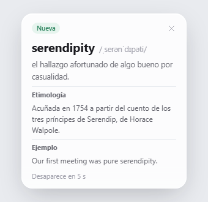 | 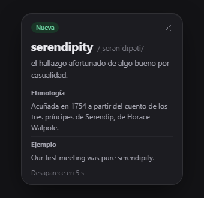 |
| Vidrio mate | Vidrio líquido |
| 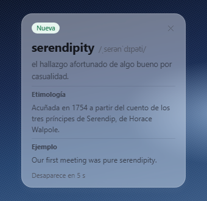 | 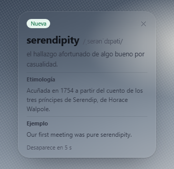 |

## Capturas de pantalla

La mayoría de las imágenes siguientes proceden de los archivos HTML de diseño de [`ui-prototypes/`](ui-prototypes/). Son conceptos de diseño, no capturas de la aplicación en funcionamiento, así que los detalles pueden variar. La imagen de la mascota de escritorio es un render de la aplicación en funcionamiento.

| Globo de explicación | Barra de acciones de selección |
| --- | --- |
|  |  |

| Explicación de un nombre | Explicación de una frase |
| --- | --- |
| 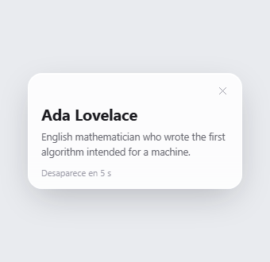 Explicación de Ada Lovelace en inglés. | 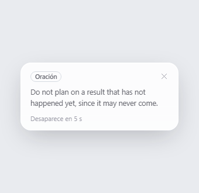 El refrán «Don't count your chickens before they hatch.», explicado en inglés. |

| Ajustes | Historial de palabras |
| --- | --- |
|  |  |

| Año en palabras | Mascota de escritorio |
| --- | --- |
|  |  |

## Demostraciones

Clips breves de las operaciones principales, con la interfaz en español.

| Globo de explicación | Año en palabras |
| --- | --- |
| 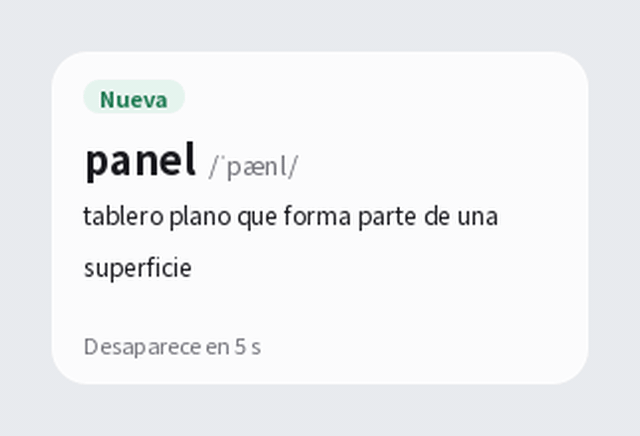 Globo de explicación de una palabra, con su etimología y una frase de ejemplo. Pasa el cursor sobre el globo para mostrar Conocida y Nueva, pulsa Conocida y la insignia cambia. La explicación es una traducción automática. | 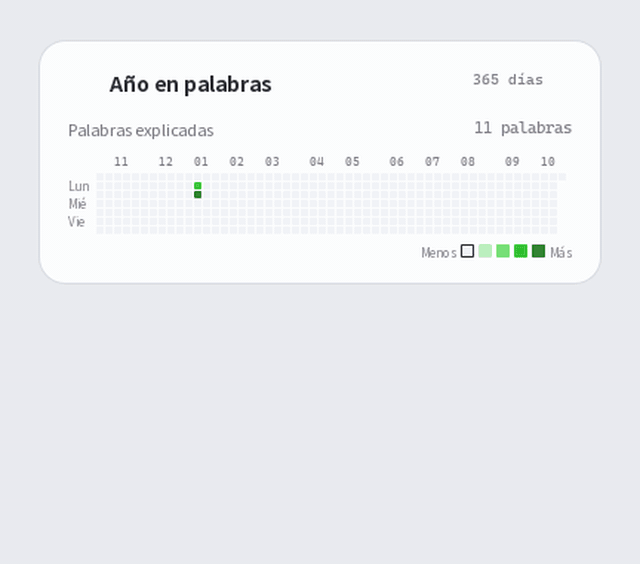 Un año de consultas en un gráfico de contribuciones. Selecciona un día para ver su total, o elige los colores de las celdas. |
| 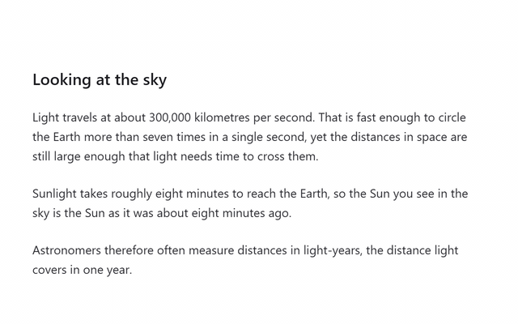 La captura atenúa la pantalla, enmarcas una zona, y Lens la lee con OCR y muestra la traducción junto a ella. Es una ilustración animada del flujo, no una grabación real. | |

## Mascotas de escritorio

Lens incluye cuatro mascotas. Cada clip muestra una de ellas haciendo su acción.

| Mochi, celebrando | Gato, amasando |
| --- | --- |
| 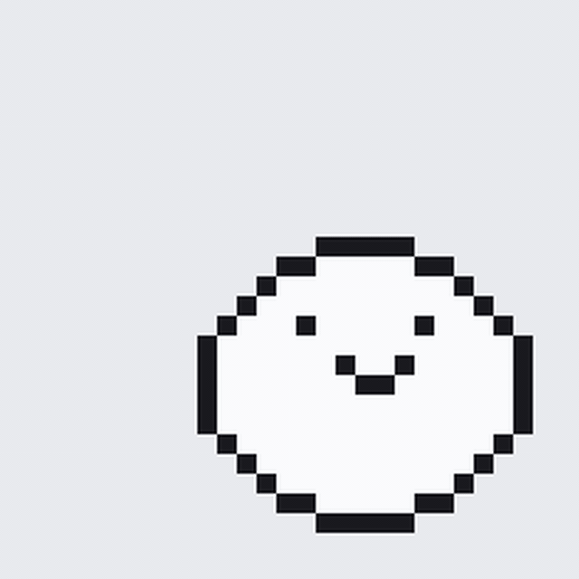 Mochi celebra. | 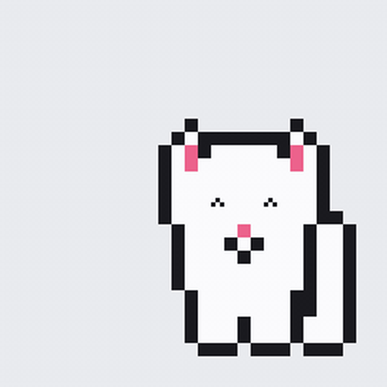 El gato amasa. |
| 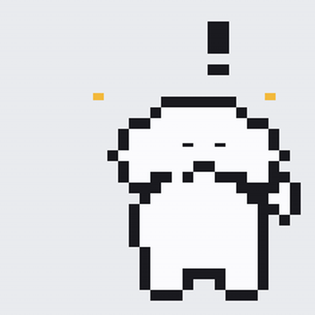 El perro reacciona cuando lo tocan. | 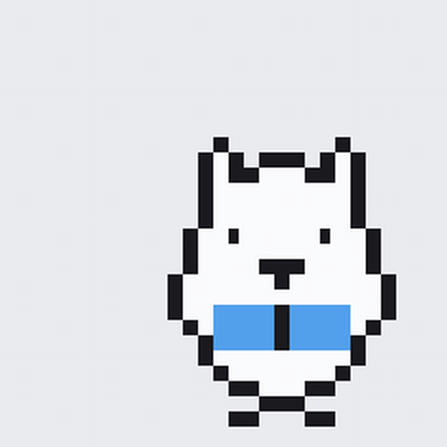 El búho lee. |

## Idiomas

La interfaz y las explicaciones tienen cada una su propio ajuste de idioma, y ambas ofrecen inglés, chino, español y japonés. Las traducciones al español y al japonés son automáticas y no han sido revisadas por una persona nativa. Si encuentras un término incorrecto, por favor, notifícalo.

## Privacidad y seguridad

Tu clave de API y tus datos de aprendizaje se guardan en `%APPDATA%\Lens\settings.json`, en tu perfil de usuario de Windows. La clave nunca se escribe en la carpeta de instalación ni en los registros. Si activas la sincronización, la copia de tus datos de aprendizaje se cifra y se guarda en un gist secreto de tu propia cuenta de GitHub; tu clave de API se queda siempre en este equipo. Lens envía el texto que seleccionas o capturas al proveedor que configures, así que no incluyas material confidencial. El enmascaramiento solo cubre URL, direcciones de correo y cadenas largas de dígitos; no identifica todos los tipos de información personal. La descarga de la lista de modelos no envía la clave de API ni texto alguno. Consulta [SECURITY.md](SECURITY.md) para ver los flujos de datos, las protecciones actuales, los límites conocidos y cómo informar de un problema de seguridad.
