
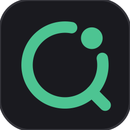

<h1 align="center">Lens</h1>

<h3 align="center">Lee inglés en inglés.</h3>

  Lens es un compañero de la bandeja del sistema de Windows que explica la palabra, el nombre o la frase que seleccionas — en un inglés más claro, junto al texto. Sin cambiar de pestaña, sin abrir un diccionario y sin dar un rodeo por el chino.

  <a href="https://github.com/kakuyo1/lens/releases/latest"><strong>Descargar para Windows</strong></a> ·
  <a href="#un-vistazo">Verlo en acción</a> ·
  <a href="https://github.com/kakuyo1/lens/releases">Todas las versiones</a>

  
  
  
  

  
  
  

<a href="README.en.md">English</a> · <a href="README.md">简体中文</a> · <a href="README.zh-TW.md">繁體中文</a> · <a href="README.ja.md">日本語</a> · Español

  <picture>
    <source media="(prefers-color-scheme: dark)" srcset="docs/readme/hero-dark.png">
    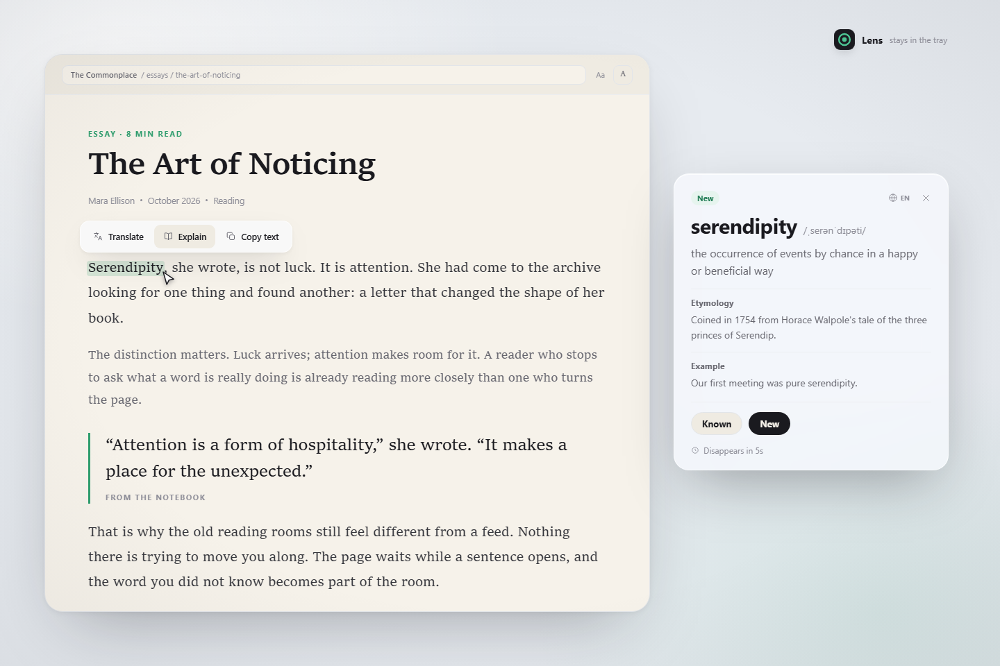
  </picture>

Las explicaciones son en inglés por defecto. Mantén pulsado el globo de la tarjeta para ver tu lengua materna; el cambio permanente está en Ajustes.

## Por qué Lens

La mayoría de las herramientas de consulta te sacan de la página y responden en tu idioma. Terminas el párrafo sin haberlo leído en inglés. Lens apuesta por lo contrario: la forma más rápida de leer mejor inglés es quedarte en inglés.

**Entra inglés, sale un inglés más claro.** Una definición en inglés sencillo, IPA y, si quieres, etimología y un ejemplo. La traducción sigue ahí; simplemente no es la opción predeterminada.

**Una palabra que se puede oír.** Un altavoz junto a la pronunciación: púlsalo a él o a la propia pronunciación y la palabra se lee una vez. Las frases, los nombres y las traducciones no suenan.

**La respuesta se queda junto al texto.** Lens vive en la bandeja del sistema y no tiene ventana principal. La burbuja aparece junto a la selección, se queda mientras pasas el ratón y desaparece cuando sigues leyendo.

**Una memoria tranquila.** Marca una palabra como Conocida o Nueva. Lens guarda la lista; el compañero de escritorio puede preguntártela más tarde. Sin rachas ni planes de estudio.

**Una definición por la que se puede entrar.** Las palabras de una definición que quedan por encima de tu nivel conservan el subrayado de puntos. Ábrela y la misma tarjeta baja un nivel, con una ruta para volver; la caché, el presupuesto y las reglas de veredicto acompañan cada paso.

## Un vistazo

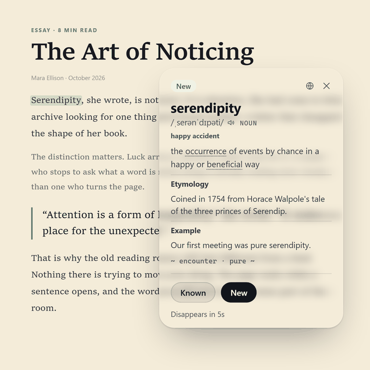

La respuesta sigue en inglés. Mantén el globo para ver tu lengua materna; al soltar, la tarjeta vuelve al inglés.

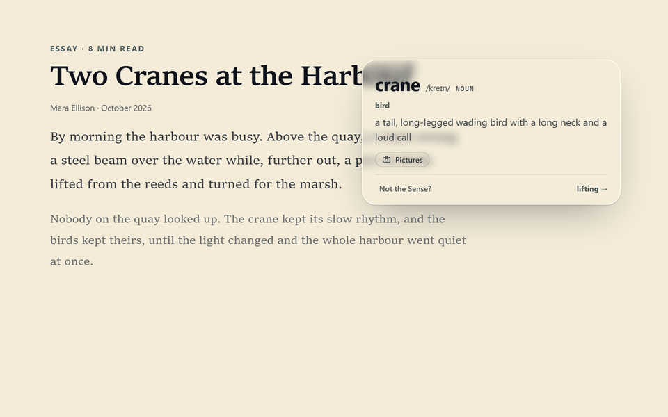

Pulsa Imágenes en una palabra para cargar sus fotos. «¿No es este sentido?» cambia la tarjeta en su sitio al otro sentido de la palabra, con sus fotos.

## Primero en inglés. Traducción cuando la pidas.

Las explicaciones son en inglés por defecto. Una selección en chino, japonés o español vuelve en inglés. El idioma de las explicaciones —inglés, chino, chino tradicional, español o japonés— es un ajuste, no un interruptor en la tarjeta: cámbialo una vez y todas las tarjetas lo siguen, respondidas desde la caché cuando esa palabra ya la tiene.

La barra de acciones ofrece Traducir, Explicar y Copiar texto. Lens gira alrededor de Explicar: te dice qué hace la palabra en ese contexto con palabras que ya conoces, en lugar de sustituirla por una palabra china que puedes saltarte. Traducir es la excepción: convierte un pasaje en chino, japonés o español al inglés; en un texto en inglés responde en el idioma de las explicaciones (inglés salvo que lo cambies).

El globo de la tarjeta es el control de idioma que queda: mantenlo pulsado medio segundo y el significado en tu lengua materna aparece bajo la definición en inglés; al soltar, desaparece. La lengua materna es un ajuste propio, chino por defecto. Una palabra cuya explicación ya incluye ese idioma no cuesta nada; cualquier otra se pide una vez por sesión.

## Dilo en voz alta

Cada tarjeta de palabra lleva un altavoz junto a la pronunciación; pulsa uno u otra y la palabra se lee una vez. Nada más de la tarjeta suena: ni la definición, ni una frase, ni un nombre.

Por defecto, la voz de Windows habla primero, con el acento que elijas: estadounidense por defecto, británico si lo pides. Cuando la máquina no tiene voz para ese acento, Lens usa lo que hayas elegido en Ajustes › Lectura y aprendizaje: un audio en línea (Youdao por defecto, o Google Translate), un modelo local que descargas una vez (Kokoro, unos 180 MB, o LJSpeech, unos 41 MB) o silencio. La elección es explícita: Lens no cambia en silencio entre en línea y local. La reproducción automática está desactivada por defecto; cuando la activas, la tarjeta que abre una consulta se lee una vez y la misma palabra no se repite. La grabación se guarda en `%APPDATA%\Lens\audio`, con un límite de 50 MB, y nunca cuenta para el presupuesto diario.

## Texto que no se puede seleccionar

Pulsa `Ctrl+Alt+S` (se puede cambiar en Ajustes), enmarca una zona de un PDF, una imagen o un fotograma de vídeo y Lens la lee localmente con OCR. Tesseract, incluido con Lens, es el motor automático. El lector puede instalar RapidOCR-json, elegirlo explícitamente y apuntarlo a una carpeta de modelos ASCII tras una comprobación de confianza. El OCR en línea es opcional, pregunta antes de cada subida y puede apuntar a Baidu OCR, Tencent Cloud OCR, Alibaba Cloud OCR, Google Cloud Vision u OCR.space. El escaneo automático sigue siendo experimental y está en desarrollo: solo vigila las aplicaciones de tu lista blanca, y sus resultados aún no son fiables.

## Cinco formas de barra de acciones

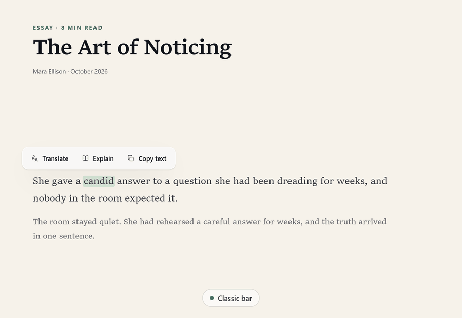

Elige la forma en Ajustes › Captura y ventanas: barra clásica, pestaña lateral, mano de cartas, etiqueta colgante o abanico. Las tres acciones y las reglas de canal no cambian, y el cajón de copiar sigue la forma desde la que se abre.

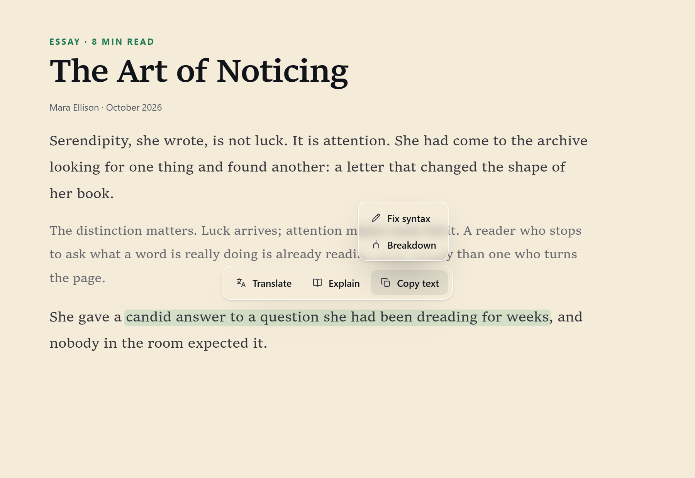

Copiar texto es un cajón, no una sola acción: al pasar el ratón solo salen las acciones que admite esa selección — Corregir ortografía en una palabra, Corregir gramática en una frase y Análisis en una frase inglesa de hasta 80 palabras. Ninguna se guarda en caché y cada una cuenta para el presupuesto diario como cualquier otra petición.

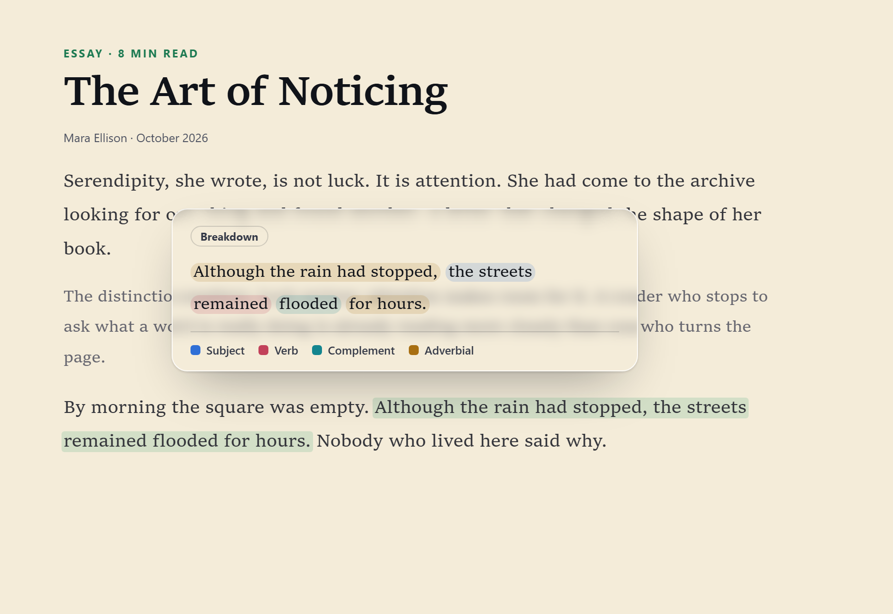

Análisis tiñe cada parte de la frase con uno de cuatro colores — sujeto, verbo, complemento, adverbial — con una leyenda debajo; una corrección subraya solo las palabras que cambió.

## Un pequeño bucle de aprendizaje

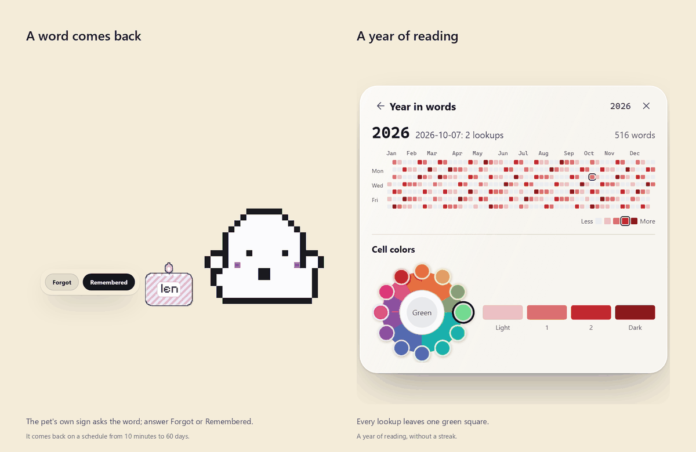

Conocida y Nueva viven en una sola lista de palabras. Pasa el ratón por una fila para releer una explicación que Lens ya guardó, sin enviar ninguna petición. Cuando toca repasar una palabra, aparece junto al compañero de escritorio un pequeño cartel, el suyo; responde Olvidé o Lo recordaba y volverá con un intervalo de entre diez minutos y sesenta días. El registro anual mantiene visible el hábito sin convertirlo en una racha.

## Siete mascotas, si las quieres

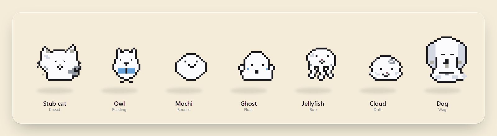

Lens incluye siete mascotas de píxeles: Gato de orejas cortas, Búho, Mochi, Fantasma, Medusa, Nube y Perro. Están desactivadas por defecto; activa una en Ajustes › Extensiones. Cada mascota tiene su propio vestuario de nueve piezas y seis escenas — cuatro propias y dos compartidas; una bufanda o unas gafas inclinan qué escena elige, y su tamaño y su ropa se recuerdan por mascota mientras la ventana se queda donde la dejas. Deambulan, se esconden en el borde de la pantalla, notan el puntero y se pueden coger y lanzar. Solo reciben tipos de evento — nunca tus selecciones, explicaciones o texto en pantalla — y los paquetes solo contienen datos.

Las seis de Fantasma: el reloj de medianoche, la calabaza de Halloween, el espejo y el té de fantasmas son suyos; el escritorio y el baño los comparte con las demás mascotas — cada escena es una animación propia. La calabaza, en movimiento:

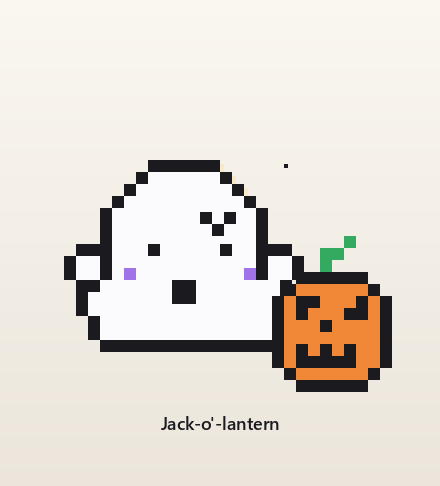

Y la tarjeta que levantan los ajustes: al pasar el ratón por una mascota en Ajustes › Extensiones aparece su postal — vestida con una pieza por ranura, de pie en un paisaje propio, con sello y matasellos.

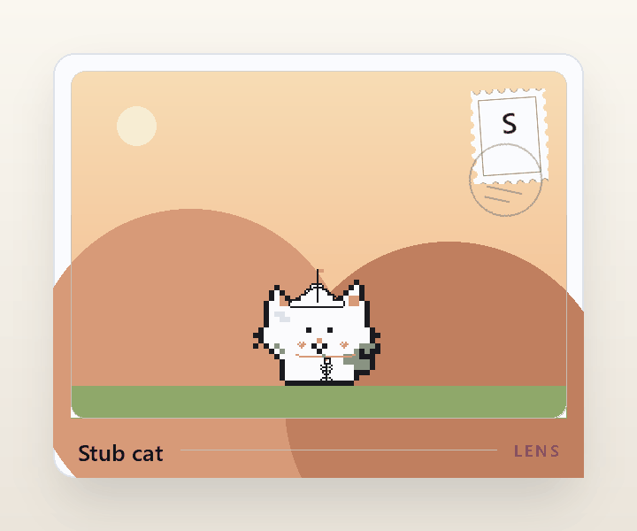

## También incluido

- **Trae tu propio modelo.** DeepSeek, OpenAI, Gemini, OpenRouter, xAI, Moonshot, Zhipu, Qwen o un endpoint personalizado compatible con OpenAI.
- **Costes visibles.** Coste por petición a partir de los tokens y un presupuesto diario que pausa las consultas, la captura y las peticiones cuando se alcanza.
- **Sincronización cuando la quieras.** Las marcas Conocida/Nueva, el historial, las estadísticas y los ajustes seleccionados se cifran con tu frase de contraseña y se guardan en un gist secreto de tu propia cuenta de GitHub. La clave de API se queda en este dispositivo.
- **Listas de palabras de ida y vuelta.** Importa o exporta `.txt` y `.json`; borra una palabra con una confirmación.
- **Fotos cuando ayudan.** Si el modelo cree que una foto explica mejor un sentido, la tarjeta puede abrir tres imágenes de Wikimedia Commons. Se guardan en caché local y «Acerca de» muestra su tamaño y permite borrarla.
- **Hazlo tuyo.** Cinco formas de barra de acciones; temas Claro, Oscuro, Vidrio mate, Vidrio líquido y Personalizado; y una tipografía inglesa con texto de burbuja de 12–18 px.
- **Cinco idiomas.** La interfaz y las explicaciones ofrecen inglés, chino, chino tradicional, español y japonés. Las traducciones al chino tradicional, al español y al japonés están generadas por máquina y no han sido revisadas por un hablante nativo.

## Temas

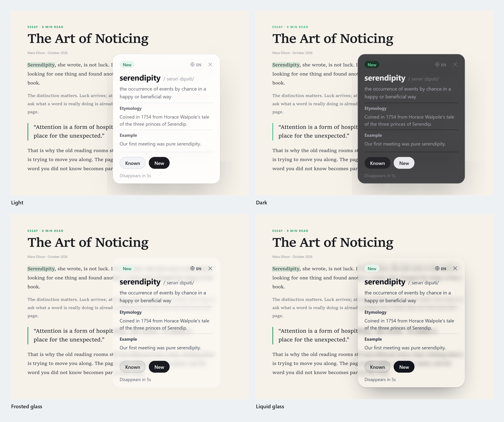

Claro y Oscuro son sólidos. Vidrio mate y Vidrio líquido dibujan cada tarjeta sobre una copia desenfocada del escritorio y mantienen a Lens fuera de las capturas de pantalla y del uso compartido mientras están activos. Personalizado te deja elegir los colores y comprueba el contraste con WCAG AA. Las animaciones siguen la configuración de animaciones de Windows.

## Descargar

Descarga `Lens-<version>-setup.exe` desde la [página de versiones](https://github.com/kakuyo1/lens/releases/latest), o `Lens-<version>-portable.zip` de la misma versión. El instalador es por usuario, así que Windows nunca pide permisos de administrador; el zip portátil se ejecuta desde cualquier carpeta.

**Windows 10/11 x64.** Necesitarás una clave de API de un proveedor compatible. Lens no incluye un diccionario de definiciones; incluye una lista de unas 168.000 palabras inglesas solo para comprobar que un candidato es una palabra real.

Puede que Windows te avise antes de ejecutarlo

Lens no tiene firma de código y SmartScreen bloquea los programas que no reconoce. Elige **Más información** y luego **Ejecutar de todos modos**. El aviso se debe a la falta de firma, no a un archivo dañado. Para comprobar que la descarga llegó intacta, compara su SHA-256 con la línea correspondiente del archivo `SHA256SUMS` de la versión; eso demuestra que el archivo no se alteró durante la transferencia, no quién lo publicó.

## Privacidad

Solo el texto que seleccionas o capturas se envía al proveedor que configures, después de ocultar localmente URL, direcciones de correo y cadenas de seis o más dígitos. El OCR se ejecuta localmente por defecto; el OCR en línea es opcional, pide confirmación en cada captura y la tarjeta de confirmación dice a qué servicio va ese recorte, y el escaneo automático experimental nunca lo usa. El altavoz lee en local con la voz del sistema o un modelo local descargado; cuando recurre a un audio en línea, solo esa palabra sale del dispositivo, y la grabación se guarda en `%APPDATA%\Lens\audio`. Tu clave de API, las credenciales de OCR y tus datos de aprendizaje se quedan en `%APPDATA%\Lens\settings.json`. Si activas la sincronización, la copia en la nube se cifra con tu frase de contraseña y se guarda en tu propio gist de GitHub; la clave se queda en este dispositivo. Lens no tiene cuenta ni servidor propio. Consulta [SECURITY.md](SECURITY.md) para conocer todos los límites.

## Preguntas frecuentes

**¿Lens es un traductor?** Puede traducir, pero está pensado para explicar. Las selecciones en chino, japonés o español vuelven en inglés.

**¿Necesito una clave de API?** Sí. Usa la de un proveedor compatible. Lens muestra el coste de cada petición y puede limitar el gasto diario.

**¿Funciona sin conexión?** El OCR local, la lista de palabras y una voz local descargada funcionan sin conexión. Las explicaciones, el OCR en línea y los audios en línea, si los activas, necesitan el servicio que configures.

**¿Qué sale de mi PC?** Solo la selección enmascarada, una captura que confirmes expresamente si usas OCR en línea, y la palabra suelta cuando el altavoz recurre a un audio en línea. Consulta [Privacidad](#privacidad).

**¿Por qué me avisa Windows?** El instalador no tiene firma de código; la nota de [Descargar](#descargar) explica cómo ejecutarlo y verificarlo.

**¿Hay versión para macOS o Linux?** Por ahora, solo Windows.

## Idiomas

[English](README.en.md) · [简体中文](README.md) · [繁體中文](README.zh-TW.md) · [日本語](README.ja.md) · [Español](README.es.md)

El idioma de la interfaz y el de las explicaciones son ajustes independientes. Ambos ofrecen inglés, chino, chino tradicional, español y japonés.

## Contribuir y licencia

Lens es código abierto bajo la [licencia MIT](LICENSE). Las issues y los pull requests son bienvenidos. Si Lens te ayuda a leer más inglés, una estrella ayuda a que otro lector lo encuentre.

Las imágenes de la interfaz se han renderizado a partir de los prototipos de diseño actuales de Lens; la compilación publicada sigue el mismo diseño y los mismos tokens.
