
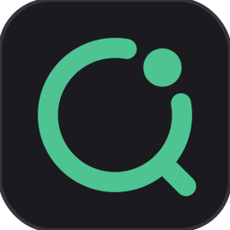

<h1 align="center">Lens</h1>

<h3 align="center">Lee inglés en inglés.</h3>

  Lens es un compañero de la bandeja del sistema de Windows que explica la palabra, el nombre o la frase que seleccionas — en un inglés más claro, junto al texto. Sin cambiar de pestaña, sin abrir un diccionario y sin dar un rodeo por el chino. Entre lecturas, una mascota de escritorio te devuelve las palabras que tocan y te las pregunta.

  <a href="https://github.com/kakuyo1/lens/releases/latest"><strong>Descargar para Windows</strong></a> ·
  <a href="#un-vistazo">Verlo en acción</a> ·
  <a href="https://kakuyo1.github.io/lens/">Página del producto</a> ·
  <a href="https://github.com/kakuyo1/lens/releases">Todas las versiones</a>

  
  
  
  

  
  
  

<a href="README.en.md">English</a> · <a href="README.md">简体中文</a> · <a href="README.zh-TW.md">繁體中文</a> · <a href="README.ja.md">日本語</a> · Español

  <picture>
    <source media="(prefers-color-scheme: dark)" srcset="docs/readme/hero-dark.png">
    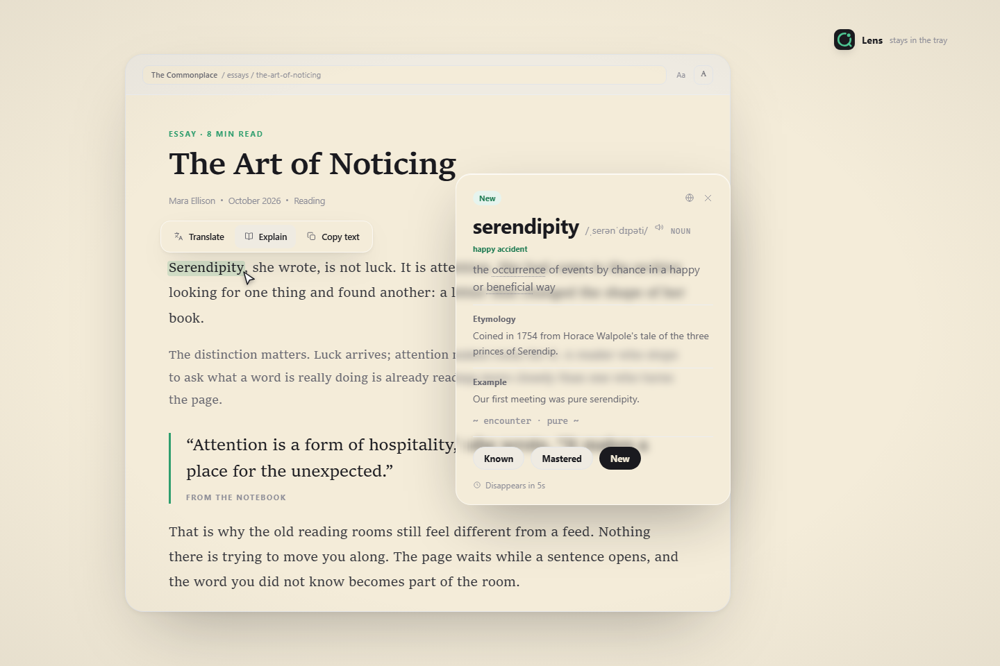
  </picture>

Las explicaciones son en inglés por defecto: te dice qué hace la palabra aquí, con palabras que ya conoces.

## Por qué Lens

La mayoría de las herramientas de consulta te sacan de la página y responden en tu idioma. Terminas el párrafo sin haberlo leído en inglés. Lens apuesta por lo contrario: la forma más rápida de leer mejor inglés es quedarte en inglés.

- **Las explicaciones son en inglés por defecto.** Te dice qué hace la palabra aquí con palabras que ya conoces, y añade IPA, etimología y un ejemplo solo si quieres; una selección en chino, japonés o español se traduce al inglés primero.
- **El idioma de las explicaciones es un ajuste.** Inglés, chino, chino tradicional, español o japonés: cámbialo una vez y todas las tarjetas lo siguen.
- **La barra de acciones: Traducir, Explicar, Copiar.** Lens gira alrededor de Explicar: un sentido en inglés que entiendes, no una palabra china que puedes saltarte.
- **La respuesta se queda junto al texto.** Lens vive en la bandeja del sistema y no tiene ventana principal; la burbuja aparece junto a la selección y desaparece cuando sigues leyendo. Una palabra de la definición por encima de tu nivel conserva el subrayado de puntos; ábrela y la tarjeta baja un nivel.
- **Tres veredictos, sin rachas.** Marca una palabra como Conocida, Dominado o Nueva para registrar dónde estás; una Dominada queda fuera del escaneo y de las preguntas de la mascota.

## Un vistazo

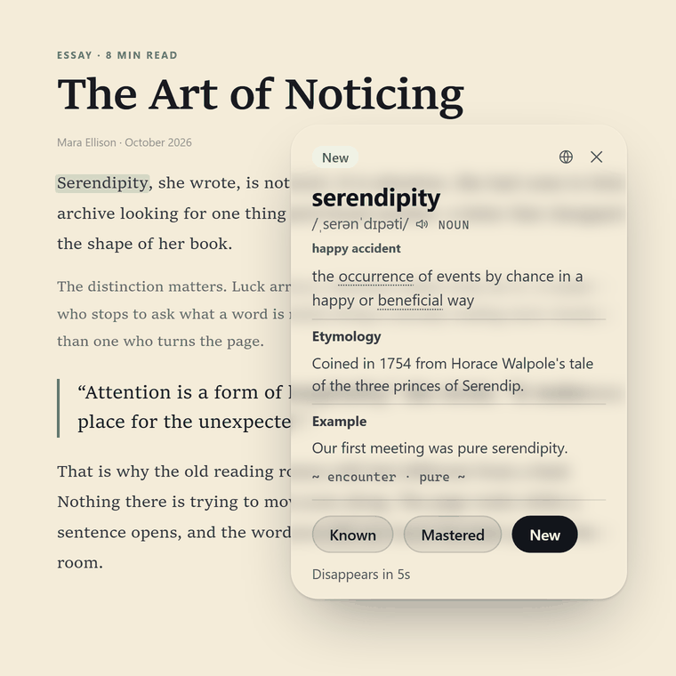

La respuesta sigue en inglés. Mantén el globo para ver tu lengua materna; al soltar, la tarjeta vuelve al inglés.

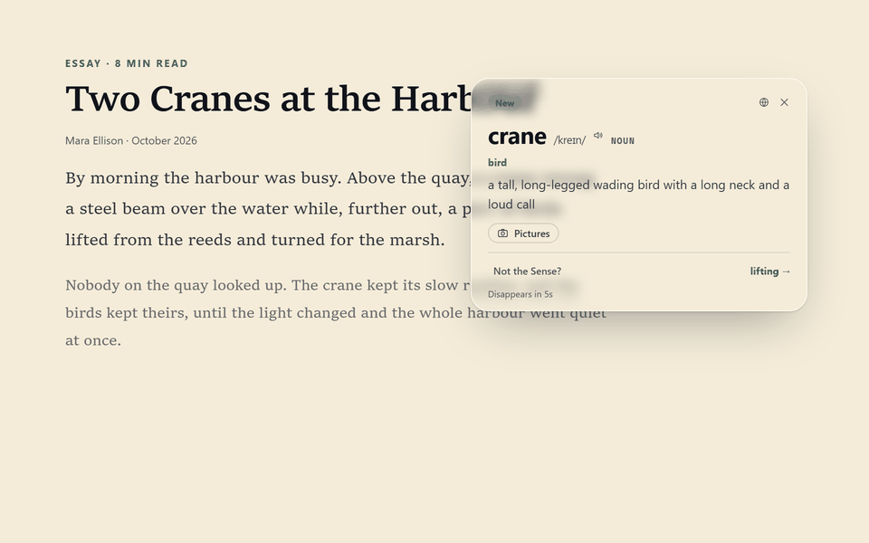

Pulsa Imágenes en una palabra para cargar sus fotos. «¿No es este sentido?» cambia la tarjeta en su sitio al otro sentido de la palabra, con sus fotos.

## Dilo en voz alta

Cada tarjeta de palabra lleva un altavoz junto a la pronunciación; pulsa uno u otra y la palabra se lee una vez. Nada más de la tarjeta suena: ni la definición, ni una frase, ni un nombre.

- **Por defecto habla primero la voz de Windows**, con el acento que elijas: estadounidense por defecto, británico si lo pides.
- **Cuando la máquina no tiene voz para ese acento**, Lens usa lo que hayas elegido en Ajustes › Lectura y aprendizaje: un audio en línea (Youdao por defecto, o Google Translate), un modelo local que descargas una vez (Kokoro, unos 180 MB, o LJSpeech, unos 41 MB) o silencio. La elección es explícita: Lens no cambia en silencio entre en línea y local.
- **La reproducción automática está desactivada por defecto.** Cuando la activas, la tarjeta que abre una consulta se lee una vez y la misma palabra no se repite.
- **La grabación se guarda en `%APPDATA%\Lens\audio`**, con un límite de 50 MB, y nunca cuenta para el presupuesto diario.

## Texto que no se puede seleccionar

Pulsa `Ctrl+Alt+S` (se puede cambiar en Ajustes › OCR), enmarca una zona de un PDF, una imagen o un fotograma de vídeo y Lens la lee localmente con OCR.

- **Tesseract, incluido con Lens, es el motor automático.** También puedes descargar RapidOCR-json desde Ajustes, o apuntar a tu propia copia y, tras detectarla y confiar en ella, elegirla; la carpeta de modelos debe ser una ruta ASCII.
- **El OCR en línea es opcional.** Pregunta antes de cada subida y puede apuntar a Baidu OCR, Tencent Cloud OCR, Alibaba Cloud OCR, Google Cloud Vision u OCR.space.

## Escaneo automático

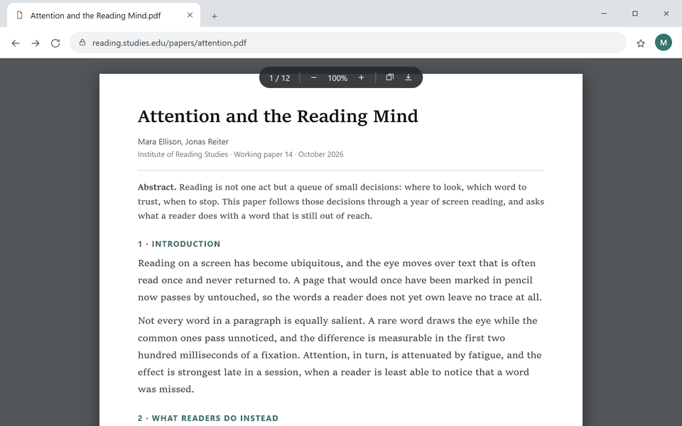

Abre un artículo en Chrome y cada palabra por encima de tu nivel recibe una línea de puntos, con Alt pulsado o no. Lens lee el texto que Chrome y Notepad++ entregan al sistema: sin OCR y sin subir nada.

- **La línea conoce tus veredictos.** Una palabra nueva lleva una línea de puntos tenue; una marcada como Conocida se dibuja más firme, y una Dominada no se dibuja. Un nombre que solo aparece en mayúscula dentro de la frase se deja en paz.
- **Mantén Alt para la señal.** Dos a cuatro palabras en inglés aparecen sobre la esquina superior derecha de la palabra y nombran el sentido que tiene ahí; los candidatos sin caché se compran por lotes, solo a la caché y sin tarjeta.
- **Retira una palabra.** Deja el puntero sobre una palabra con línea de puntos unos 0,4 segundos y un botón Dominado se levanta en su borde superior; con una pulsación, el escaneo y las preguntas de la mascota la dejan en paz.
- **Qué ventanas lee.** Las páginas de Chrome y los PDF que Chrome abre por su cuenta, además de los documentos de Notepad++; los lectores de PDF independientes y los subtítulos de vídeo figuran como Próximamente. El interruptor general está apagado por defecto y los dos de las apps encendidos; hacen falta los dos para escanear.

## Consulta al pasar el cursor

Los enlaces y los titulares suelen no poder seleccionarse. Cambia a la consulta al pasar el cursor (por defecto `Ctrl+Alt+H`; puedes cambiarla en Ajustes › Captura y ventanas), deja el puntero sobre una palabra durante un segundo y Lens la traduce. Pulsa la tecla otra vez para volver a la selección. La consulta solo lee el texto bajo el puntero: no hace clic, no toca el portapapeles, no lee campos de contraseña y solo funciona en las aplicaciones permitidas.

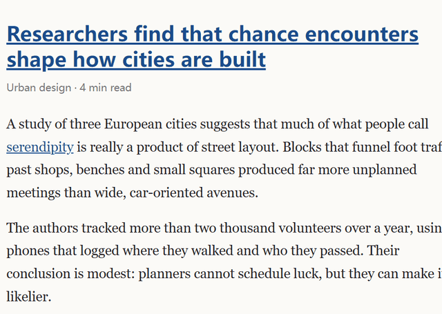

## El cajón de copiar y el análisis

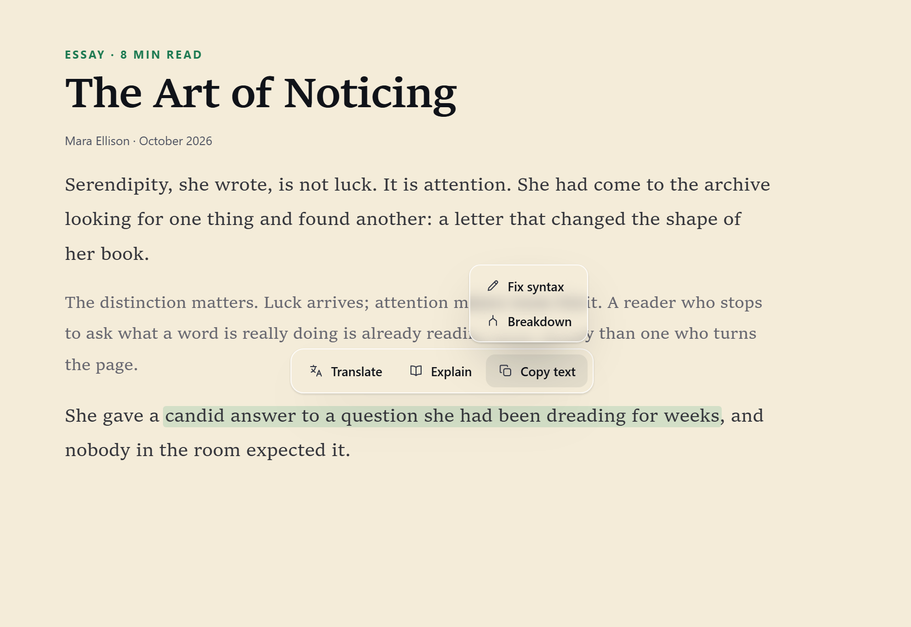

Copiar texto es un cajón, no una sola acción: al pasar el ratón solo salen las acciones que admite esa selección.

- Corregir ortografía en una palabra, Corregir gramática en una frase y Análisis en una frase inglesa de hasta 80 palabras.
- Ninguna se guarda en caché y cada una cuenta para el presupuesto diario como cualquier otra petición.

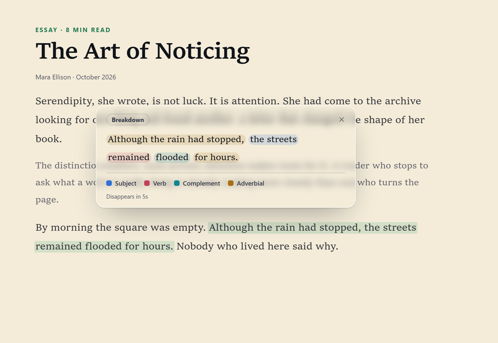

Análisis tiñe cada parte de la frase con uno de cuatro colores — sujeto, verbo, complemento, adverbial — con una leyenda debajo; una corrección subraya solo las palabras que cambió.

## Un pequeño bucle de aprendizaje

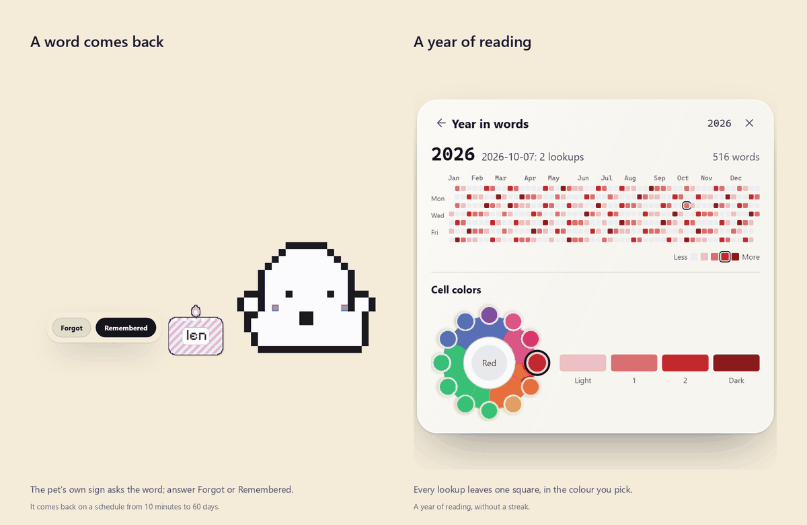

Conocida, Dominado y Nueva viven en una sola lista de palabras, con un segmento para cada una arriba.

- Pasa el ratón por una fila para releer una explicación que Lens ya guardó, sin enviar ninguna petición.
- Cuando toca repasar una palabra, aparece junto al compañero de escritorio un pequeño cartel, el suyo; responde Olvidé o Lo recordaba y volverá con un intervalo de entre diez minutos y sesenta días. Una palabra dominada no vuelve a preguntarse.
- El registro anual mantiene visible el hábito sin convertirlo en una racha: un cuadro por consulta, en uno de doce colores a tu elección (verde por defecto).

## Mascotas que te devuelven las palabras

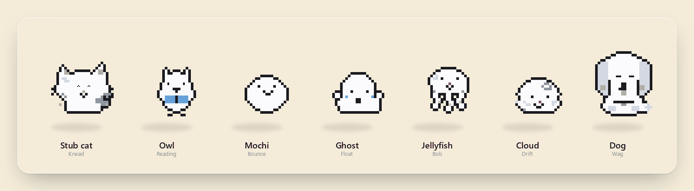

Lens incluye siete mascotas de píxeles: Gato de orejas cortas, Búho, Mochi, Fantasma, Medusa, Nube y Perro. Están desactivadas por defecto; activa una en Ajustes › Extensiones.

- Cada mascota tiene su propio vestuario de nueve piezas y seis escenas — cuatro propias y dos compartidas; una bufanda o unas gafas inclinan qué escena elige.
- Deambulan, se esconden en el borde de la pantalla, notan el puntero y se pueden coger y lanzar; cuando la barra de tareas está fija, a veces saltan a ella, rebotan, caminan despacio hasta un extremo y vuelven.
- Solo reciben tipos de evento — nunca tus selecciones, explicaciones o texto en pantalla — y los paquetes solo contienen datos.

Cada escena es una animación propia. La calabaza, en movimiento:

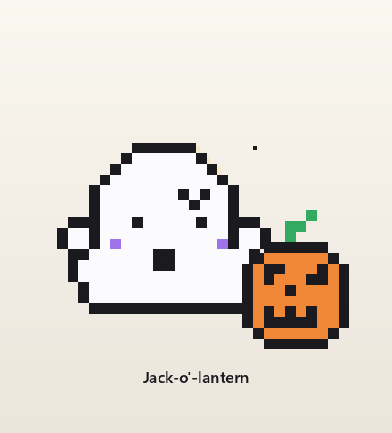

Lens también admite mascotas personalizadas: `skills/lens-pet-maker` del repositorio es una skill de Claude Code que ayuda a una IA a generar un paquete de mascota. Clona el repositorio para usarla, copia la carpeta resultante en `%APPDATA%\Lens\pets\` y actívala en Ajustes › Extensiones.

## También incluido

- **Trae tu propio modelo.** DeepSeek, OpenAI, Gemini, OpenRouter, xAI, Moonshot, Zhipu, Qwen o un endpoint personalizado compatible con OpenAI.
- **Costes visibles.** Coste por petición a partir de los tokens y un presupuesto diario que pausa las consultas, la captura y las peticiones cuando se alcanza.
- **Informe de lectura semanal.** El perfil semanal de Estadísticas muestra las consultas de la semana por hora, categoría gramatical y palabras más consultadas; pulsa «Interpretar la semana» y el modelo escribe cinco observaciones en una tarjeta de informe semanal, y su botón «Relato» escribe un relato corto con las palabras de la semana. Solo se envía cuando pulsas, y solo lleva recuentos y palabras.
- **Sincronización cuando la quieras.** Los veredictos, el historial, las estadísticas y los ajustes seleccionados se cifran con tu frase de contraseña y se guardan en un gist secreto de tu propia cuenta de GitHub. La clave de API se queda en este dispositivo.
- **Listas de palabras de ida y vuelta.** La ventana de palabras importa y exporta `.txt` y `.json`, y exporta CSV y Anki TSV con las explicaciones ya guardadas; la fila Palabras dominadas de Ajustes › Lectura y aprendizaje importa una vez una lista con una palabra por línea y marca sus palabras como dominadas. Borra una palabra con una confirmación.
- **Fotos cuando ayudan.** Si el modelo cree que una foto explica mejor un sentido, la tarjeta puede abrir tres imágenes de Wikimedia Commons. Se guardan en caché local y «Acerca de» muestra su tamaño y permite borrarla.

## Temas

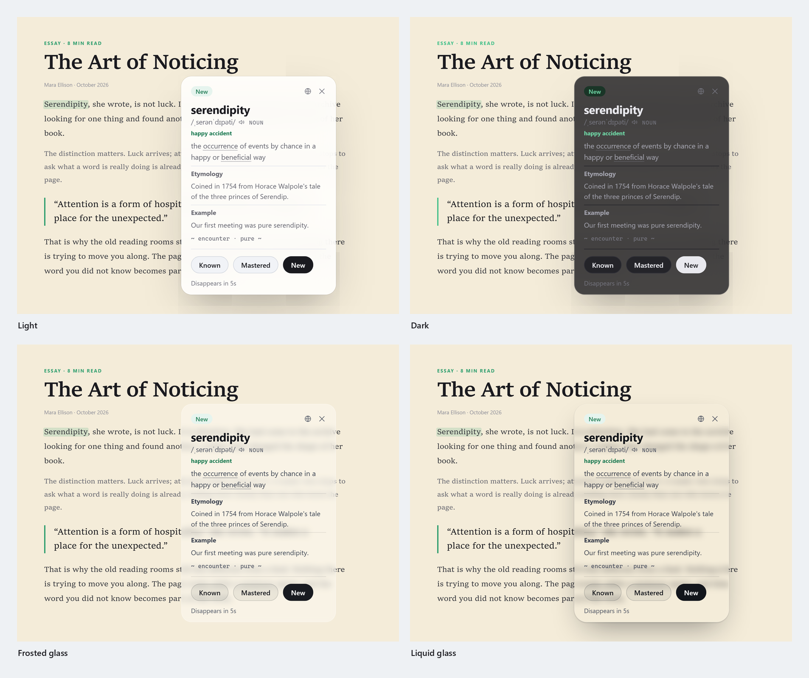

## Descargar

Descarga `Lens-<version>-setup.exe` desde la [página de versiones](https://github.com/kakuyo1/lens/releases/latest), o `Lens-<version>-portable.zip` de la misma versión.

- **El instalador** es por usuario, así que Windows nunca pide permisos de administrador; **el zip portátil** se ejecuta desde cualquier carpeta.
- **Windows 10/11 x64.** Necesitarás una clave de API de un proveedor compatible.
- Lens no incluye un diccionario de definiciones; incluye una lista de unas 168.000 palabras inglesas solo para comprobar que un candidato es una palabra real.

Puede que Windows te avise antes de ejecutarlo

Lens no tiene firma de código y SmartScreen bloquea los programas que no reconoce. Elige **Más información** y luego **Ejecutar de todos modos**.

## Privacidad

Lens no tiene cuenta ni servidor propio.

- **Lo que se envía.** El texto que seleccionas o capturas va al proveedor que configures, después de ocultar localmente URL, direcciones de correo y cadenas de seis o más dígitos. La interpretación semanal y el relato solo se envían cuando pulsas su botón, llevan solo recuentos y palabras, y estas se enmascaran igual.
- **OCR.** Se ejecuta localmente por defecto. El OCR en línea es opcional: cada captura muestra el recorte congelado y el destino exacto, se sube solo cuando lo confirmas, y el escaneo automático nunca lo usa.
- **El altavoz.** Lee en local con la voz del sistema o un modelo local descargado; cuando recurre a un audio en línea, solo esa palabra sale del dispositivo, y la grabación se guarda en `%APPDATA%\Lens\audio`.
- **En este dispositivo.** Tu clave de API, las credenciales de OCR y tus datos de aprendizaje se quedan en `%APPDATA%\Lens\settings.json`.
- **Sincronización.** Si la activas, la copia en la nube se cifra con tu frase de contraseña y se guarda en tu propio gist de GitHub; la clave se queda en este dispositivo.

Consulta [SECURITY.md](SECURITY.md) para conocer todos los límites.

## Preguntas frecuentes

**¿Lens es un traductor?** Puede traducir, pero está pensado para explicar. Las selecciones en chino, japonés o español vuelven en inglés.

**¿Necesito una clave de API?** Sí. Usa la de un proveedor compatible. Lens muestra el coste de cada petición y puede limitar el gasto diario. Por ejemplo, con DeepSeek una consulta de palabra cuesta unos 0,001 CNY, así que con 1 CNY caben unas 1000; otros proveedores cobran de otra forma.

**¿Funciona sin conexión?** El OCR local, la lista de palabras y una voz local descargada funcionan sin conexión. Las explicaciones, el OCR en línea y los audios en línea, si los activas, necesitan el servicio que configures.

**¿Qué sale de mi PC?** Solo la selección enmascarada, una captura que confirmes expresamente si usas OCR en línea, la palabra suelta cuando el altavoz recurre a un audio en línea, y los recuentos y palabras que envía el informe semanal cuando pulsas su botón. Consulta [Privacidad](#privacidad).

**¿Por qué me avisa Windows?** El instalador no tiene firma de código; la nota de [Descargar](#descargar) explica cómo ejecutarlo y verificarlo.

**¿Hay versión para macOS o Linux?** Por ahora, solo Windows.

## Contribuir y licencia

Lens es código abierto bajo la [licencia MIT](LICENSE). Las issues y los pull requests son bienvenidos. Si Lens te ayuda a leer más inglés, una estrella ayuda a que otro lector lo encuentre.

Las imágenes de la interfaz se han renderizado a partir de los prototipos de diseño actuales de Lens; la compilación publicada sigue el mismo diseño y los mismos tokens.
