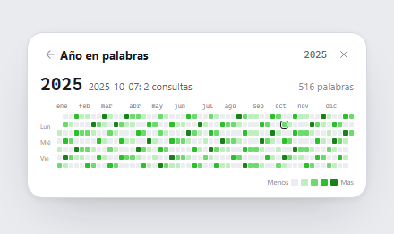
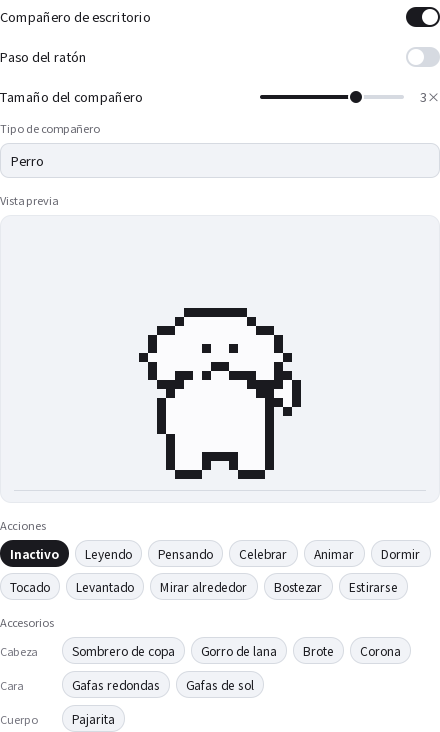
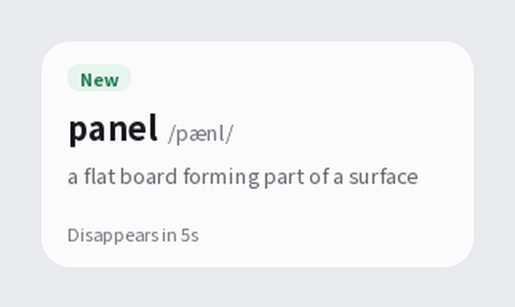
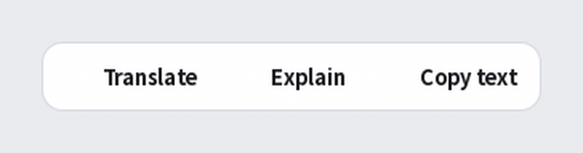
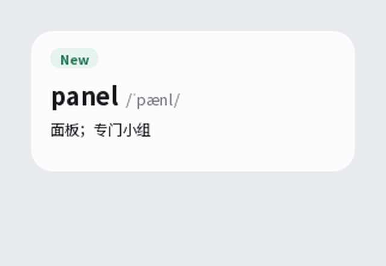
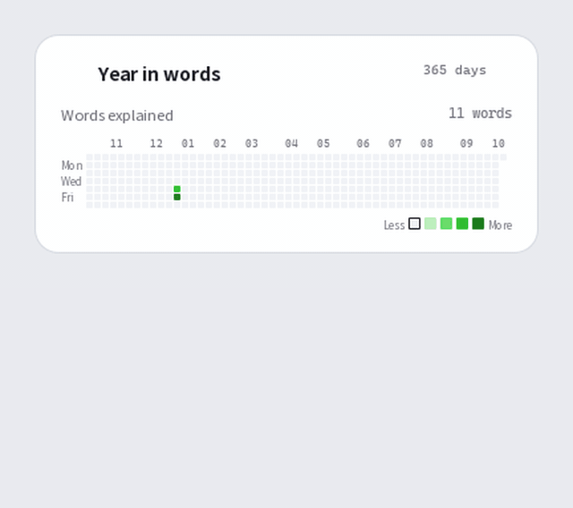

# Lens

**Sigue leyendo sin cambiar de ventana**. Lens es una herramienta de aprendizaje de inglés que vive en la bandeja del sistema de Windows. Muestra explicaciones de palabras, nombres y frases en pequeños globos junto al texto, sin que tengas que abrir un diccionario aparte.

[English](README.md) · [简体中文](README.zh-CN.md) · [日本語](README.ja.md) · [Español](README.es.md)

## Qué hace Lens

Lens vive en la bandeja del sistema y no tiene ventana principal. Selecciona un fragmento y aparecerá una pequeña barra de acciones con Traducir, Explicar y Copiar. El resultado se muestra en un globo junto al texto que lo provocó. Marca una palabra como conocida o nueva y sigue leyendo.

Si el texto no se puede seleccionar, pulsa el atajo de captura (`Ctrl+Alt+S` por defecto, que puedes cambiar en Ajustes), enmarca una zona de la pantalla, y Lens la leerá con OCR y la traducirá al momento. El escaneo automático también puede vigilar el texto de las aplicaciones que indiques, y solo de esas.

## Qué se envía

Lens clasifica en tu PC el texto capturado en uno de tres tipos de petición: una palabra envía solo la palabra, una entidad envía solo su nombre y una frase envía solo la frase seleccionada. Antes de que algo salga de tu PC, Lens enmascara las URL, las direcciones de correo y las cadenas de seis o más dígitos.

El proveedor de IA que configures genera la explicación. Lens no incluye un diccionario de definiciones. Sí incluye una lista de unas 168 000 palabras comunes del inglés, que solo sirve para comprobar que un candidato es una palabra real. Esa lista no contiene definiciones.

## Funciones

- **Explicaciones**. Una palabra recibe su significado más habitual en el idioma de explicación que elijas, con su transcripción IPA. Activa los significados múltiples para ver hasta tres, y la etimología para ver de dónde viene la palabra.
- **Lista de palabras**. Las marcas de conocida y nueva van en una sola lista, con una fila por palabra y la hora de su última consulta. Pasa el cursor sobre una fila para leer la explicación que Lens ya guardó; pasar el cursor nunca envía una petición. Borrar una palabra no se puede deshacer.
- **Año en palabras**. Las consultas de un año dibujadas como un gráfico de contribuciones. Selecciona un día para ver cuántas palabras consultaste ese día, y elige los colores de las celdas.
- **Costes y presupuesto**. La vista de costes calcula cada petición según los tokens que usó, a las tarifas actuales. Un presupuesto diario pausa las consultas, las capturas y las peticiones cuando el gasto del día llega al límite, y se reinicia cuando cambia la fecha local.
- **Captura y escaneo automático**. La captura atenúa todas las pantallas, lee la zona que enmarcas y la traduce. Lens incluye su entorno de OCR; si lo prefieres, puedes indicar en Ajustes tu propia instalación de Tesseract.
- **Mascota de escritorio**. Un pequeño perro blanco que vive en el escritorio y hace acciones mientras estudias. Viene desactivada; actívala en Ajustes, en Extensiones. Puedes arrastrarla, tocarla, vestirla con hasta tres accesorios, elegir un tamaño de una a cuatro veces, o dejar que los clics la atraviesen. Reacciona solo a tipos de evento y nunca lee tus selecciones, tus explicaciones ni el texto de la pantalla.
- **Actualizaciones**. Lens comprueba la última versión del proyecto una vez al día al iniciarse (puedes desactivarlo en General), o cuando eliges Buscar actualizaciones. Si hay una versión nueva, aparece una tarjeta con Ver, Descargar y Omitir esta versión. Las descargas se comprueban con el `SHA256SUMS` de la versión, y el instalador solo se ejecuta cuando pulsas Instalar, sin argumentos adicionales. El instalador no tiene firma de código, así que la suma de comprobación confirma que el archivo llegó íntegro, pero no demuestra quién lo publicó. Las descargas necesitan un proxy desde China continental; si no llega nada, Lens lo indica.
- **Temas**. Light, Dark, Forest y Custom. En Custom eliges los colores y Lens comprueba su contraste según WCAG AA. Un interruptor de animaciones sigue la preferencia de movimiento reducido de Windows.

## Capturas de pantalla

Las imágenes siguientes proceden de los archivos HTML de diseño de [`ui-prototypes/`](ui-prototypes/). Son conceptos de diseño, no capturas de la aplicación en funcionamiento, así que los detalles pueden variar.

| Globo de explicación | Barra de acciones de selección |
| --- | --- |
|  |  |

| Ajustes | Historial de palabras |
| --- | --- |
|  |  |

| Año en palabras | Mascota de escritorio |
| --- | --- |
|  |  |

## Demostraciones

Clips breves de las operaciones principales, con la interfaz en inglés. El clip de marcar una palabra muestra una explicación en chino, porque la palabra de ejemplo se guardó en chino.

| Globo de explicación | Barra de acciones de selección |
| --- | --- |
|  |  |

| Marcar una palabra | Año en palabras |
| --- | --- |
|  |  |

## Idiomas y apariencia

La interfaz y las explicaciones tienen cada una su propio ajuste de idioma, y ambas ofrecen inglés, chino, español y japonés. Las traducciones al español y al japonés son automáticas y no han sido revisadas por una persona nativa. Si encuentras un término incorrecto, por favor, notifícalo.

## Privacidad y seguridad

Tu clave de API y tus datos de aprendizaje se guardan en `%APPDATA%\Lens\settings.json`, en tu perfil de usuario de Windows. La clave nunca se escribe en la carpeta de instalación ni en los registros. Lens envía el texto que seleccionas o capturas al proveedor que configures, así que no incluyas material confidencial. El enmascaramiento solo cubre URL, direcciones de correo y cadenas largas de dígitos; no identifica todos los tipos de información personal. La descarga de la lista de modelos no envía la clave de API ni texto alguno. Consulta [SECURITY.md](SECURITY.md) para ver los flujos de datos, las protecciones actuales, los límites conocidos y cómo informar de un problema de seguridad.
