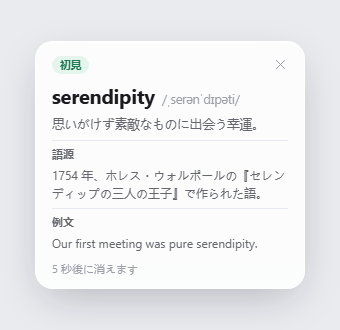
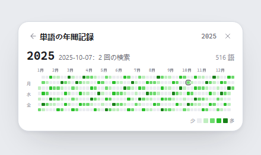
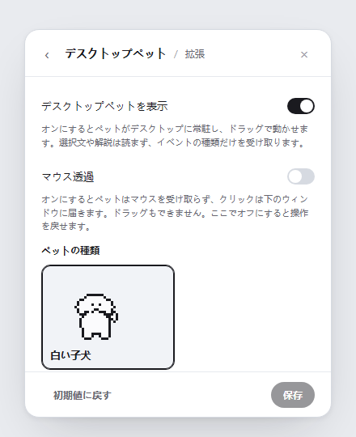

# Lens

**読んでいるページから離れずに**。Lens は、英単語・固有名詞・英文の解説を文章のそばに小さな吹き出しで表示する、Windows 向けのトレイ常駐型学習ツールです。別の辞書ウィンドウを開く必要はありません。

[English](README.md) · [简体中文](README.zh-CN.md) · [日本語](README.ja.md) · [Español](README.es.md)

## Lens にできること

Lens はシステムトレイに常駐し、メインウィンドウはありません。文章を選択すると、翻訳・解説・コピーの3つを備えた小さな操作バーが表示されます。解説は、そのきっかけになった文章のそばに吹き出しとして現れます。単語を「覚えた」または「新出」と記録して、そのまま読み進めてください。

文章を選択できない場合は、キャプチャ用のホットキー（既定は `Ctrl+Alt+S`。設定で変更できます）を押して画面上の範囲を囲みます。Lens は OCR で文字を読み取り、すぐに翻訳します。自動スキャンでは、指定したアプリの文字だけを監視することもできます。

## 送信される内容

Lens は、取得した文字をパソコン内で3種類のリクエストに振り分けます。単語なら単語だけ、固有名詞なら名前だけ、文なら選択した文だけを送信します。パソコンの外へ出す前に、URL、メールアドレス、6桁以上の数字の並びを伏せ字にします。

解説は、設定した AI プロバイダーが生成します。Lens には釈義の辞書は含まれていません。ただし、約 16 万 8 千語の一般的な英単語リストを同梱しており、候補が実在する英単語かどうかを確かめるためだけに使います。このリストには釈義は含まれません。

## 機能

- **解説**。単語には、選んだ解説言語での最も一般的な意味と、IPA の発音記号が付きます。「複数の意味」をオンにすると最大3つの意味を、「語源」をオンにすると単語の由来を表示できます。
- **単語リスト**。「覚えた」と「新出」の記録は1つのリストにまとめられ、単語ごとに1行、最後に調べた時刻が表示されます。行にカーソルを合わせると、Lens に保存済みの解説を読めます。カーソルを合わせてもリクエストは送信されません。単語の削除は元に戻せません。
- **年間の単語記録**。1年分の検索回数を貢献グラフで表示します。日付を選ぶと、その日に調べた単語数が分かり、セルの色も選べます。
- **費用と予算**。費用ビューでは、各リクエストが使ったトークン数から現在の料金で計算した金額を確認できます。1日の予算を設定すると、その日の支出が上限に達した時点で検索・キャプチャ・リクエストを一時停止し、ローカルの日付が変わるとリセットされます。
- **キャプチャと自動スキャン**。キャプチャ中はすべての画面が暗くなり、囲んだ範囲を読み取って翻訳します。OCR ランタイムは同梱されています。インストール済みの Tesseract を使いたい場合は、設定でその場所を指定できます。
- **デスクトップペット**。デスクトップに住む小さな白い犬で、学習に合わせて動きます。既定ではオフで、設定の「拡張」からオンにします。ドラッグしたり、つついたり、最大3つのアクセサリーを付けたり、サイズを1〜4倍から選んだり、マウスのクリックを下のウィンドウへ通す（マウス透過）こともできます。ペットが受け取るのはイベントの種類だけで、選択したテキスト、解説、画面の文字は読み取りません。
- **アップデート**。Lens は起動時に1日1回、プロジェクトの最新リリースを確認します（一般設定でオフにできます）。「アップデートを確認」を押したときにも確認します。新しいバージョンがあると、「表示」「ダウンロード」「このバージョンをスキップ」を備えたカードが表示されます。ダウンロードしたインストーラーは、リリースの `SHA256SUMS` と照合されます。インストールは「インストール」を押したときだけ、引数なしで実行されます。インストーラーにはコード署名がないため、照合で確認できるのは転送が完全であることだけで、配布者の身元までは証明されません。中国本土からのダウンロードにはプロキシが必要で、何も届かない場合は Lens がその旨を表示します。
- **テーマ**。Light、Dark、Forest のほか、Custom では色を自分で選べます。Lens は Custom の配色を WCAG AA の基準でコントラスト確認します。アニメーションの切り替えは、Windows の視覚効果の設定に従います。

## 画面

以下の画像は [`ui-prototypes/`](ui-prototypes/) の HTML 設計ファイルから取得したものです。実際に動作しているアプリのスクリーンショットではなく、デザインのコンセプトです。実装では異なる場合があります。

| 解説の吹き出し | 選択時の操作 |
| --- | --- |
|  |  |

| 設定 | 単語履歴 |
| --- | --- |
|  |  |

| 年間の単語記録 | デスクトップペット |
| --- | --- |
|  |  |

## 操作デモ

以下の短い動画は主な操作を示したもので、英語のインターフェースを使っています。「覚えた」「新出」の印を付ける動画に出てくる解説は中国語です。サンプルの単語が中国語で保存されているためです。

| 解説の吹き出し | 選択時の操作 |
| --- | --- |
|  |  |

| 単語への印付け | 年間の単語記録 |
| --- | --- |
|  |  |

## 言語と外観

インターフェースと解説には、それぞれ別々の言語設定があります。どちらも英語、中国語、スペイン語、日本語から選べます。スペイン語と日本語の翻訳は機械生成で、ネイティブスピーカーによるレビューは受けていません。不適切な訳語に気づいた場合は、ご報告ください。

## プライバシーとセキュリティ

API キーと学習データは、Windows のユーザープロファイル内の `%APPDATA%\Lens\settings.json` に保存されます。キーがインストールフォルダーやログに書き込まれることはありません。Lens は、選択またはキャプチャしたテキストを、設定したプロバイダーに送信します。機密情報は送らないようご注意ください。伏せ字の対象は URL、メールアドレス、6桁以上の数字の並びに限られ、個人情報のすべての種類を特定できるわけではありません。モデル一覧の取得では、API キーもテキストも送信しません。データの流れ、現在の保護策、既知の制限、セキュリティ問題の報告方法は [SECURITY.md](SECURITY.md) をご覧ください。
