
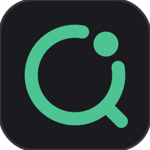

<h1 align="center">Lens</h1>

<h3 align="center">英語は、英語のまま読む。</h3>

  Lens は Windows のタスクトレイに常駐する英語リーディングの相棒です。選んだ単語・名前・文を、文字のすぐ横でやさしい英語にして説明します。タブを切り替えず、辞書ウィンドウも開かず、翻訳という回り道もしません。読んでいないあいだは、デスクトップのペットが期限の来た単語を出題します。

  <a href="https://github.com/kakuyo1/lens/releases/latest"><strong>Windows 版をダウンロード</strong></a> ·
  <a href="#ちょっと見る">動きを見る</a> ·
  <a href="https://kakuyo1.github.io/lens/">紹介ページ</a> ·
  <a href="https://github.com/kakuyo1/lens/releases">すべてのリリース</a>

  
  
  
  

  
  
  

<a href="README.en.md">English</a> · <a href="README.md">简体中文</a> · <a href="README.zh-TW.md">繁體中文</a> · 日本語 · <a href="README.es.md">Español</a>

  <picture>
    <source media="(prefers-color-scheme: dark)" srcset="docs/readme/hero-dark.png">
    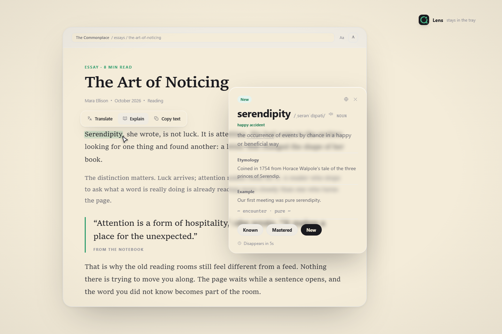
  </picture>

説明は既定で英語です。知っている英語で、その単語がここで何をしているかを説明します。

## なぜ Lens か

多くの辞書ツールは、ページから連れ出して母語で答えます。その段落を読み終えても、英語では読んでいない。Lens は逆を行きます。英語の読解力を上げる一番の近道は、英語の中にとどまることです。

- **英語を中心に。** 説明は既定で、知っている英語でその単語がここで何をしているかを説明します。母語は地球を押している間だけ。
- **ペットシステム。** 復習時期になった単語はデスクトップペットが札を出して問い、習得済みはもう出てきません。
- **自動スキャン。** Chrome で普通に読んでいると、レベルより上の単語が自分から点線を生やします。選ぶ必要はありません。
- **細かくカスタマイズ。** カードが描くもの——複数の語義・語源・例文・発音記号・コロケーション・画像——は、すべて設定で切り替えられます。

## ちょっと見る

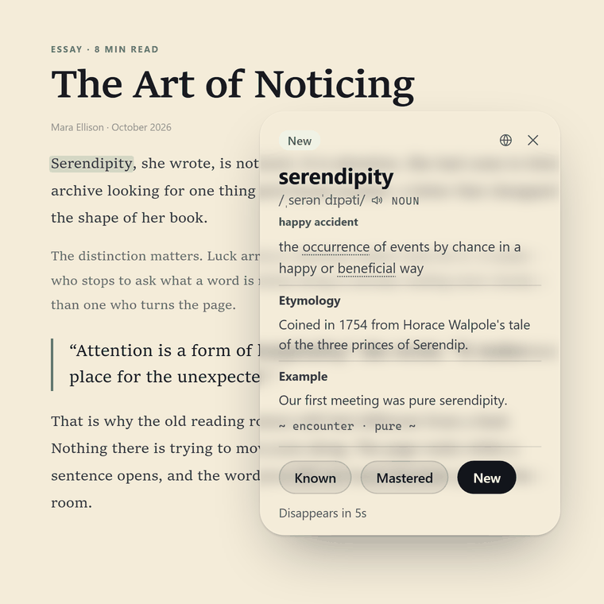

答えは英語のまま。地球を押している間だけ母語が出て、離せば英語に戻ります。

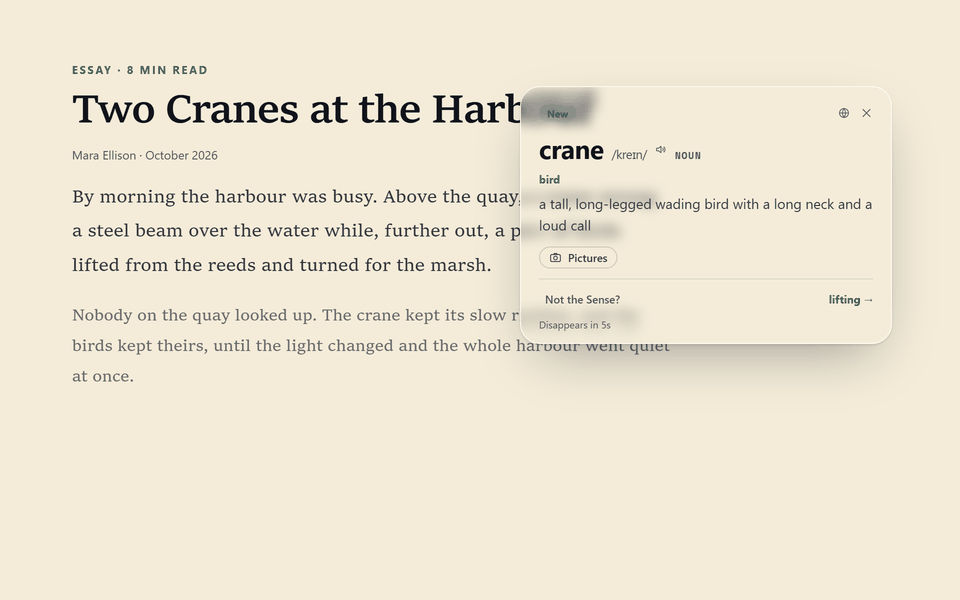

単語カードの「画像」を押すと写真が読み込まれます。「この意味ではない？」を押すと、カードがその場で別の意味に変わり、写真も切り替わります。

## 選択できないテキスト

`Ctrl+Alt+S`（設定 › OCR で変更可）を押し、PDF・画像・動画の一部を囲むと、Lens がローカルの OCR で読み取ります。

- **同梱の Tesseract が自動エンジンです。** 設定から RapidOCR-json をダウンロードするか、自分で導入したものを指定し、検出と信頼のあとで明示的に選ぶこともできます。モデルフォルダーは ASCII パスである必要があります。
- **オンライン OCR は任意です。** アップロードのたびに確認を求め、Baidu OCR・Tencent Cloud OCR・Alibaba Cloud OCR・Google Cloud Vision・OCR.space を指定できます。

## 自動スキャン

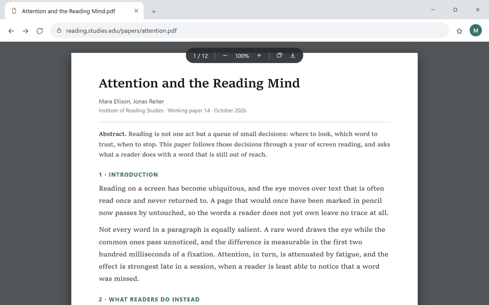

Chrome で論文を開くと、レベルを超えた単語の下に点線が現れます。Alt を押さなくても表示されます。Lens が読むのは Chrome と Notepad++ がシステムに渡す文字で、OCR もアップロードもありません。

- **点線は判定を覚えています。** 初見の単語は淡い点線、覚えたと印を付けた単語はより濃く、習得済みの単語には引きません。文中で大文字でしか出てこない名前も引きません。
- **Alt を押すと道しるべ。** 単語の右上に 2〜4 語の英語が浮かび、ここでの意味を名指しします。キャッシュにない候補はまとめて取得し、キャッシュに書くだけでカードは出しません。
- **単語を退場させる。** 点線の単語の上でポインターを約 0.4 秒止めると、上端に「習得済み」ボタンが浮かびます。押せばスキャンもペットの問いかけもその単語を扱いません。
- **読むウィンドウ。** Chrome のウェブページと Chrome 自身が開く PDF、そして Notepad++ の文書です。単体の PDF リーダーと動画の字幕は「近日対応」です。全体のスイッチは既定でオフ、2 つのアプリのスイッチは既定でオンで、両方がオンでないとスキャンしません。

## ホバーで単語を調べる

リンクや見出しは選択しにくいことがあります。ホバー取得に切り替え（既定は `Ctrl+Alt+H`。設定 › 取得とポップアップで変更できます）、単語の上でポインターを約1秒止めると、Lens がその単語を翻訳します。同じキーで選択取得に戻ります。ホバー取得はポインターの下の文字だけを読み、クリックもクリップボードの利用もせず、パスワード欄は読みません。許可されたアプリでのみ動作します。

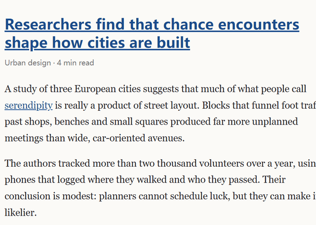

## コピーの引き出しと分解

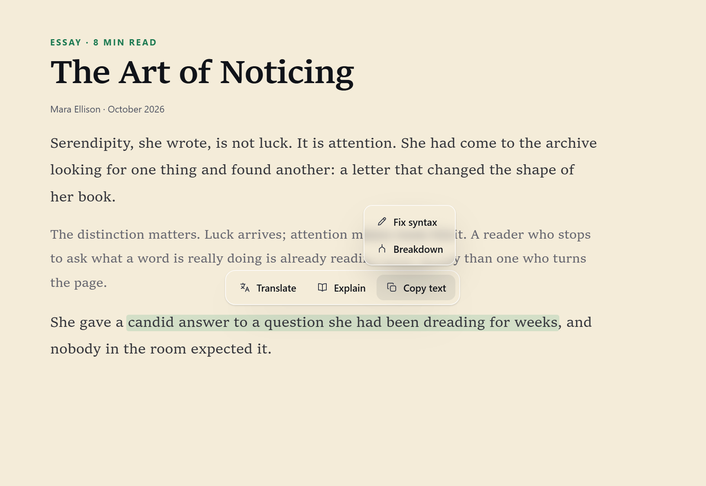

「テキストをコピー」は単一の動作ではなく引き出しです。ポインターを乗せると、その選択範囲でできる操作だけが出ます。

- 単語はスペルを直す、文は文法を直す、80 語以内の英語の文は分解もできます。
- どちらもキャッシュされず、通常のリクエストとして 1 日の予算に入ります。

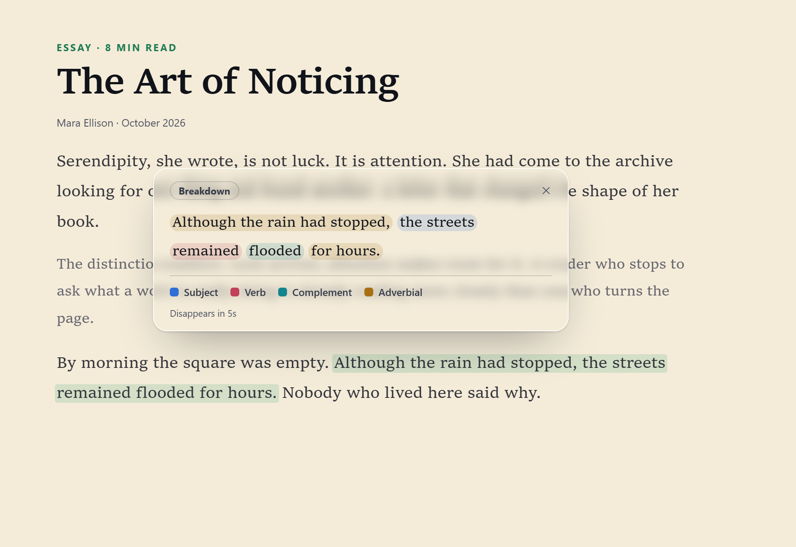

分解は文の 4 つの要素を色分けし（主語・述語・補語・状語）、下に凡例を置きます。校正は変更した単語にだけ下線を引きます。

## 小さな学習ループ

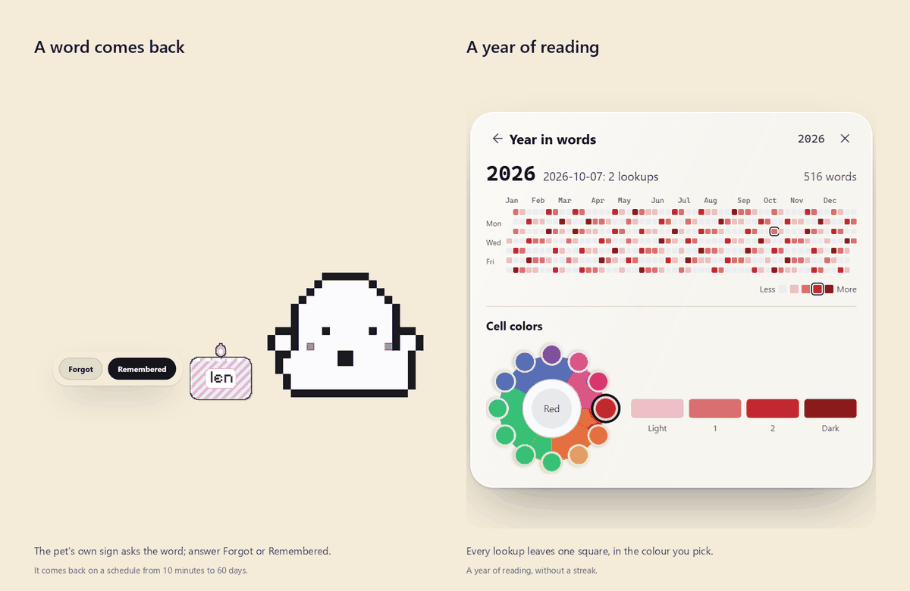

「覚えた」「習得済み」「初見」は一つの単語リストに並び、上部のセグメントで絞り込めます。

- 行にポインターを乗せると、Lens が保存済みの説明を再表示します。リクエストは送りません。
- 単語が復習時期になると、デスクトップの相棒の横にその子自身の札が立ちます。「忘れた」「覚えていた」で答えると、10 分から 60 日までの間隔でまた出てきます。習得済みにした単語は復習に出てきません。
- 年間の記録は、連続記録ではなく、12 色から選んだ色（既定は緑）のマスで読書の跡を残します。

## 単語を問い返してくるデスクトップペット

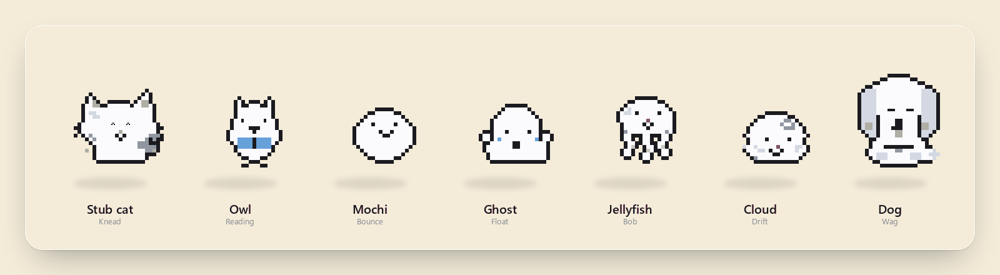

Lens には 7 匹のピクセルペットが付属します。短耳猫、フクロウ、モチ、ゴースト、クラゲ、雲、犬。既定ではオフで、設定の「拡張」からオンにできます。

- それぞれ 9 点の衣装と 6 つのシーン（専用 4 つ、共有 2 つ）があります。スカーフや眼鏡はどのシーンを選びやすくするかを変えます。
- うろついたり、画面の端に隠れたり、ポインターに気づいたり、つかんで投げることもできます。タスクバーを常時表示しているときは、ときどきタスクバーに飛び乗って弾み、ゆっくり端まで歩いて戻ります。
- イベントの種類だけを受け取り、選択範囲・解説・画面の文字は読みません。ペットパッケージはデータのみです。

各シーンはそれぞれのアニメーションです。ジャック・オー・ランタンはこう動きます：

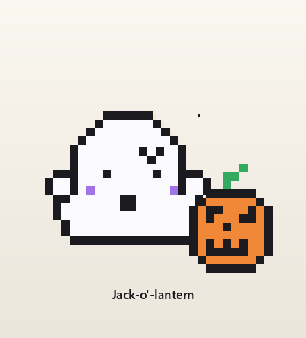

Lens はカスタムペットにも対応しています。リポジトリの `skills/lens-pet-maker` は Claude Code のスキルで、AI の支援を受けながらペットパッケージを作成できます。リポジトリをクローンして使い、できたフォルダを `%APPDATA%\Lens\pets\` に置けば、設定 ›「拡張」から有効にできます。

## ほかにも

- **モデルを持ち込む。** DeepSeek、OpenAI、Gemini、OpenRouter、xAI、Moonshot、Zhipu、Qwen、OpenAI 互換のカスタムエンドポイント。
- **見えるコスト。** トークンからリクエストごとの費用を計算。1 日の予算に達すると、取得・キャプチャ・リクエストを止めます。
- **毎週の読書レポート。** 統計パネルの「今週のプロフィール」が今週の検索を時間帯・品詞・よく引いた単語ごとに並べ、「今週を解釈する」を押すとモデルが 5 つの観察を書いて週報カードに収めます。「ショートストーリー」ボタンは今週の単語で短い物語を書きます。押したときだけ送られ、送るのは集計と単語だけです。
- **同期は必要なときだけ。** 判定、検索履歴、統計、選択した設定をパスフレーズで暗号化し、自分の GitHub アカウントの secret gist に保存します。API キーは端末に残ります。
- **単語リストの出し入れ。** 単語ポップアップでは `.txt`、`.json` のインポート/エクスポートができ、保存済みの説明付き CSV / Anki TSV もエクスポートできます。設定 › 読解と学習の「習得済みの単語」では、1 行に 1 語のリストを一度だけ取り込み、その単語を習得済みにできます。削除には確認が一度入ります。
- **写真が助けるとき。** モデルが写真のほうがわかりやすいと判断した語義は、Wikimedia Commons の写真を 3 枚開けます。写真はローカルにキャッシュされ、設定の「Lens について」でサイズ表示と削除ができます。
- **単語を読み上げる。** 発音記号の横のスピーカーは押すたびに見出し語を一度読み上げます。まず Windows の音声で読み、そのアクセントの音声が無ければ設定のフォールバックに従います。自動再生は既定でオフです。

## テーマ

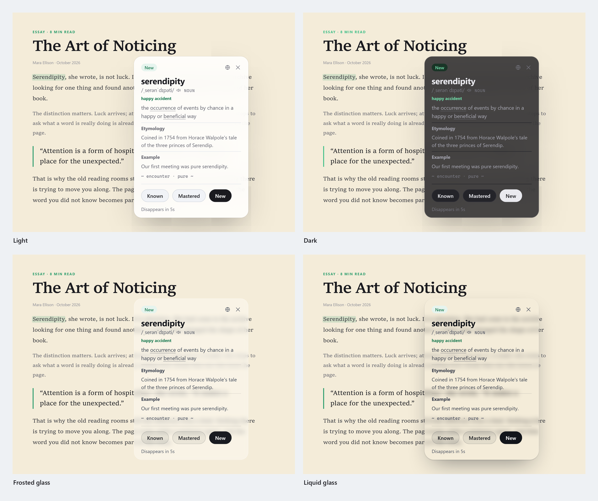

## ダウンロード

[リリースページ](https://github.com/kakuyo1/lens/releases/latest)から `Lens-<version>-setup.exe`、または同じリリースの `Lens-<version>-portable.zip` をダウンロードします。

- **インストール版**はユーザー単位なので、Windows は管理者権限を求めません。**ポータブル版**は任意のフォルダーから実行できます。
- **Windows 10/11 x64。** 対応プロバイダーの API キーが必要です。
- Lens は定義辞書を同梱していません。約 168,000 語の英語リストは、候補が実在する単語かを確認するためだけに使います。

Windows が先に警告するかもしれません

Lens はコード署名されていないため、SmartScreen が知らないプログラムを止めます。**「詳細情報」**、次に **「実行」** を選んでください。

## プライバシー

Lens 自身のアカウントもサーバーもありません。

- **送られるもの。** 選択またはキャプチャしたテキストが、設定したプロバイダーに送られます。送信前に URL、メールアドレス、6 桁以上の数字列をローカルでマスクします。毎週のレポートの解釈とショートストーリーは、ボタンを押したときだけ送られ、送るのは集計と単語だけです。
- **OCR。** 既定でローカルです。オンライン OCR は毎回確認を求め、確認カードにその切り抜きの送信先を書きます。自動スキャンも使いません。
- **読み上げ。** スピーカーはまずシステム音声かダウンロード済みのローカルモデルでローカルに読み、オンライン音声に切り替わるときはその単語だけが端末を出ます。録音は `%APPDATA%\Lens\audio` にキャッシュされます。
- **端末の中。** API キー、OCR の認証情報、学習データは `%APPDATA%\Lens\settings.json` にあります。
- **同期。** 有効にすると、クラウドのコピーはパスフレーズで暗号化され、自分の GitHub gist に保存されます。キーは端末に残ります。

詳しくは [SECURITY.md](SECURITY.md) を参照してください。

## FAQ

**Lens は翻訳ツールですか？** 翻訳もできますが、中心は解説です。中国語・日本語・スペイン語の選択範囲は英語で返ります。

**API キーは必要ですか？** 必要です。対応プロバイダーのキーを使ってください。Lens はリクエストごとの費用を表示し、1 日の上限も設定できます。たとえば DeepSeek では単語の照会 1 回が約 0.001 CNY で、1 CNY でおよそ 1000 回調べられます。ほかのプロバイダーは料金が異なります。

**オフラインで使えますか？** OCR・単語リスト・ダウンロード済みのローカル音声はオフラインで使えます。説明、オンライン OCR、オンライン音声は設定したサービスが必要です。

**PC から何が出ていきますか？** マスク後の選択テキスト、オンライン OCR で明示的に確認したキャプチャ、オンライン音声に切り替わったときの 1 語、そして毎週のレポートでボタンを押したときの集計と単語だけです。[プライバシー](#プライバシー)を参照してください。

**Windows の警告はなぜですか？** インストーラーにコード署名がないためです。実行方法と検証は[ダウンロード](#ダウンロード)の説明にあります。

**macOS や Linux 版はありますか？** 今は Windows のみです。

## コントリビュートとライセンス

Lens は [MIT ライセンス](LICENSE)のオープンソースです。issue と PR を歓迎します。Lens で英語を少し多く読めるようになったら、star が次の読者の助けになります。

インターフェース画像は Lens の現在のデザインプロトタイプから描画したものです。実際のビルドも同じレイアウトとトークンに従います。
