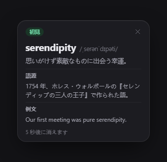
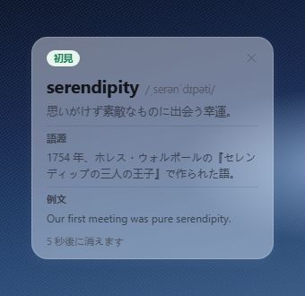
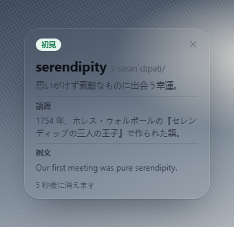
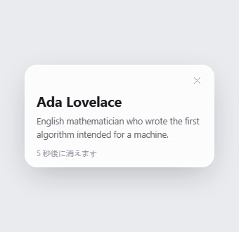
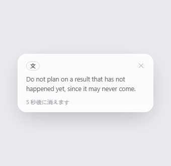
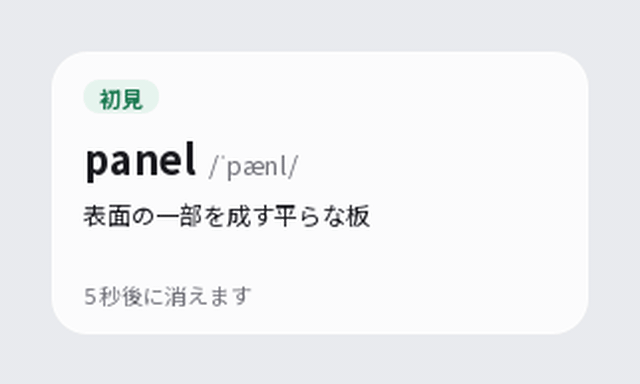
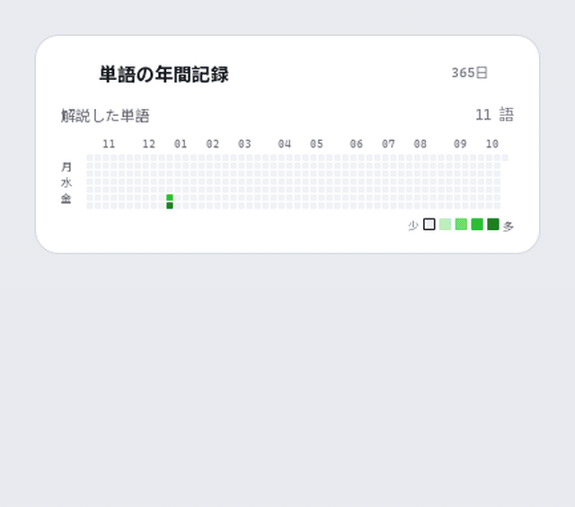
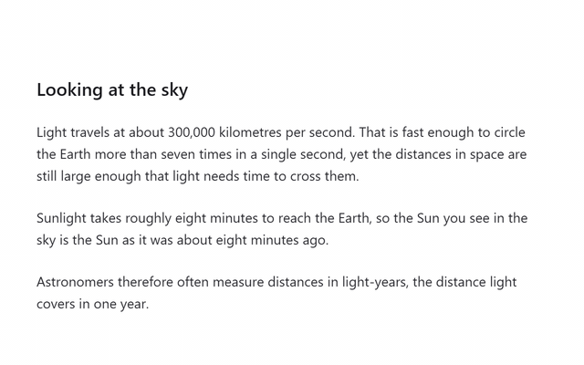

# Lens

**読んでいるページから離れずに**。Lens は、英単語・固有名詞・英文の解説を文章のそばに小さな吹き出しで表示する、Windows 向けのトレイ常駐型学習ツールです。別の辞書ウィンドウを開く必要はありません。

[English](README.md) · [简体中文](README.zh-CN.md) · [日本語](README.ja.md) · [Español](README.es.md)

## インストール

[リリースページ](https://github.com/kakuyo1/lens/releases) から `Lens-<バージョン>-setup.exe` をダウンロードして実行してください。ユーザー単位のインストールなので、管理者権限を求められることはなく、スタートメニューから Lens を起動できます。

**Windows は実行前に注意を喚起します。** Lens はコード署名されていないため、Microsoft Defender SmartScreen が認識していないプログラムをブロックします。青い「Windows が PC を保護しました」の画面で「詳細情報」を選び、「実行する」を押してください。これは回避のためだけの操作で、ファイル自体が危険だという意味ではありません。SmartScreen が信頼しているのは署名であり、 Lens にはまだ署名の付いたものが添付されていません。

インストールしたくない場合は、各リリースに `Lens-<バージョン>-portable.zip` も同梱しています。任意の場所に解凍し、その中の `lens.exe` を実行してください。中身は同じプログラムですが、スタートメニューのショートカットもアンインストーラーもありません。フォルダを削除すれば Lens は完全に消えます。設定は `%APPDATA%\Lens\settings.json` に保存されるため、単語リストと API キーはインストーラーにも zip にも含まれず、削除しても残ります。

ダウンロードしたファイルを実行前に確かめたい場合は、そのファイルの SHA-256 をリリースの `SHA256SUMS` の該当行と比較してください。これは転送中にファイルが破損していないことを示しますが、公開者が誰であるかまでは示しません。署名されていないファイルは、チェックサムごと差し替えられる可能性があるからです。

## Lens にできること

Lens はシステムトレイに常駐し、メインウィンドウはありません。文章を選択すると、翻訳・解説・コピーの3つを備えた小さな操作バーが表示されます。解説は、そのきっかけになった文章のそばに吹き出しとして現れます。単語を「覚えた」または「初見」と記録して、そのまま読み進めてください。固有名詞や文全体も解説されます。

文章を選択できない場合は、キャプチャ用のホットキー（既定は `Ctrl+Alt+S`。設定で変更できます）を押して画面上の範囲を囲みます。Lens は OCR で文字を読み取り、すぐに翻訳します。自動スキャンでは、指定したアプリの文字だけを監視することもできます。

## 送信される内容

Lens は、取得した文字をパソコン内で3種類のリクエストに振り分けます。単語なら単語だけ、固有名詞なら名前だけ、文なら選択した文だけを送信します。パソコンの外へ出す前に、URL、メールアドレス、6桁以上の数字の並びを伏せ字にします。

解説は、設定した AI プロバイダーが生成します。Lens には釈義の辞書は含まれていません。ただし、約 16 万 8 千語の一般的な英単語リストを同梱しており、候補が実在する英単語かどうかを確かめるためだけに使います。このリストには釈義は含まれません。

## 機能

- **解説**。単語には、選んだ解説言語での最も一般的な意味と、IPA の発音記号が付きます。「複数の語義」をオンにすると最大3つの語義を表示できます。「語源」をオンにすると単語の由来が分かります。その下の「例文」をオンにすると、英語の例文が1つ加わります。例文は出力トークンが増えるため、既定ではオフです。
- **固有名詞と文**。固有名詞と文全体にも解説が付きます。解説言語は単語と同じ設定に従います。
- **吹き出し**。吹き出しが表示される時間を1〜30秒（既定は5秒）から選べます。また、選択範囲の上に出すか下に出すか（既定は上）も選べます。吹き出しにカーソルを合わせると、閉じずに残ります。
- **単語リスト**。「覚えた」と「初見」の記録は1つのリストにまとめられ、単語ごとに1行、最後に調べた時刻が表示されます。行にカーソルを合わせると、Lens に保存済みの解説を読めます。カーソルを合わせてもリクエストは送信されません。単語の削除は元に戻せません。
- **単語の年間記録**。1年分の検索回数を貢献グラフで表示します。日付を選ぶと、その日に調べた単語数が分かります。セルの色は12の色相から選べ、色相ごとに4段階の濃さがあります。
- **費用と予算**。費用ビューでは、各リクエストが使ったトークン数から現在の料金で計算した金額を確認できます。1日の予算を設定すると、その日の支出が上限に達した時点で検索・キャプチャ・リクエストを一時停止し、ローカルの日付が変わるとリセットされます。
- **キャプチャと自動スキャン**。キャプチャ中はすべての画面が暗くなり、囲んだ範囲を読み取って翻訳します。OCR ランタイムは同梱されています。インストール済みの Tesseract を使いたい場合は、設定でその場所を指定できます。
- **デスクトップペット**。デスクトップに住む小さなドット絵のペットで、学習に合わせて動きます。Lens には7匹が同梱されています。短耳猫、犬、モチ、フクロウ、ゴースト、クラゲ、雲です。既定ではオフで、設定の「拡張」からオンにします。ドラッグしたり、つついたり、最大3つのアクセサリーを付けたり、サイズを1〜4倍から選んだり、マウスのクリックを下のウィンドウへ通す（マウス透過）こともできます。ペットが受け取るのはイベントの種類だけで、選択したテキスト、解説、画面の文字は読み取りません。 宠物パックも追加できます。宠物パックのフォルダーを `%APPDATA%\Lens\pets\` にコピーし、設定の「拡張」を開いてください。宠物パックは初めて有効にする前に一度確認を求め、含まれるのはデータだけでコードはありません。
- **アップデート**。Lens は起動時に1日1回、プロジェクトの最新リリースを確認します（一般設定でオフにできます）。「情報」ページの「更新を確認」を押したときにも確認します。「情報」ページには現在のバージョンとリポジトリへのリンクも表示されます。新しいバージョンがあると、「表示」「ダウンロード」「このバージョンをスキップ」を備えたカードが表示されます。ダウンロードしたインストーラーは、リリースの `SHA256SUMS` と照合されます。インストールは「インストール」を押したときだけ、引数なしで実行されます。インストーラーにはコード署名がないため、照合で確認できるのは転送が完全であることだけで、配布者の身元までは証明されません。中国本土からのダウンロードにはプロキシが必要で、何も届かない場合は Lens がその旨を表示します。
- **同期**。GitHub アカウントでサインインすると、「覚えた」と「初見」の記録、検索履歴、統計、選んだ設定を複数の端末の間で揃えられます。クラウド上のコピーは設定したパスフレーズで暗号化され、ご自身の GitHub アカウントにある secret gist に保存されます。解説は同期されません。ログアウトやクラウド上のデータの削除は、いつでも行えます。
- **テーマ**。ライト、ダーク、すりガラス、リキッドガラス、カスタムから選べます。詳しくは [テーマ](#テーマ) をご覧ください。

## テーマ

ライトとダークは単色のテーマです。すりガラスとリキッドガラスは、カードの背後にあるデスクトップをぼかした複製の上に描かれます。ガラス系のテーマが有効な間、Lens のウィンドウはスクリーンキャプチャと画面共有に映らないため、スクリーンショットにはカードが写らず、デスクトップだけが写ります。カスタムでは色を自分で選べ、Lens は WCAG AA の基準でコントラストを確認します。アニメーションの切り替えは、Windows のアニメーション効果の設定に従います。

| ライト | ダーク |
| --- | --- |
|  |  |
| すりガラス | リキッドガラス |
|  |  |

## 画面

以下の画像の多くは [`ui-prototypes/`](ui-prototypes/) の HTML 設計ファイルから取得したものです。実際に動作しているアプリのスクリーンショットではなく、デザインのコンセプトなので、細部が異なる場合があります。デスクトップペットの画像は、動作中のアプリを描画したものです。

| 解説の吹き出し | 選択時の操作 |
| --- | --- |
|  |  |

| 固有名詞の解説 | 文の解説 |
| --- | --- |
|  |  ことわざ「Don't count your chickens before they hatch.」の英語による解説。 |

| 設定 | 単語履歴 |
| --- | --- |
|  |  |

| 単語の年間記録 | デスクトップペット |
| --- | --- |
|  |  |

## 操作デモ

以下の短い動画は主な操作を示したもので、インターフェースは日本語です。

| 解説の吹き出し | 単語の年間記録 |
| --- | --- |
|  語源と例文を含む、単語の解説の吹き出し。吹き出しにカーソルを合わせると「覚えた」と「初見」が現れ、「覚えた」を押すと印が変わります。この解説は機械翻訳です。 |  1年分の検索回数を貢献グラフで表示します。日付を選ぶとその日の回数が分かり、セルの色も選べます。 |
|  キャプチャ中は画面が暗くなり、範囲を囲むと、Lens が OCR で文字を読み取り、そばに訳を表示します。キャプチャの流れを描いたアニメーションで、実際の録画ではありません。 | |

## デスクトップペット

Lens には7匹のペットが同梱されています。以下の動画では、そのうちの1匹が動きを再生します。

| モチ：喜ぶ | 猫：ふみふみ |
| --- | --- |
|  モチは「喜ぶ」を再生します。 |  猫は「ふみふみ」を再生します。 |
|  犬は「つつかれた」を再生します。 |  フクロウは「読書中」を再生します。 |

## 言語

インターフェースと解説には、それぞれ別々の言語設定があります。どちらも英語、中国語、スペイン語、日本語から選べます。スペイン語と日本語の翻訳は機械生成で、ネイティブスピーカーによるレビューは受けていません。不適切な訳語に気づいた場合は、ご報告ください。

## プライバシーとセキュリティ

API キーと学習データは、Windows のユーザープロファイル内の `%APPDATA%\Lens\settings.json` に保存されます。キーがインストールフォルダーやログに書き込まれることはありません。同期を有効にすると、学習データのコピーはパスフレーズで暗号化され、ご自身の GitHub アカウントにある secret gist に保存されます。API キーは常にこの端末にのみ保存されます。Lens は、選択またはキャプチャしたテキストを、設定したプロバイダーに送信します。機密情報は送らないようご注意ください。伏せ字の対象は URL、メールアドレス、6桁以上の数字の並びに限られ、個人情報のすべての種類を特定できるわけではありません。モデル一覧の取得では、API キーもテキストも送信しません。データの流れ、現在の保護策、既知の制限、セキュリティ問題の報告方法は [SECURITY.md](SECURITY.md) をご覧ください。
