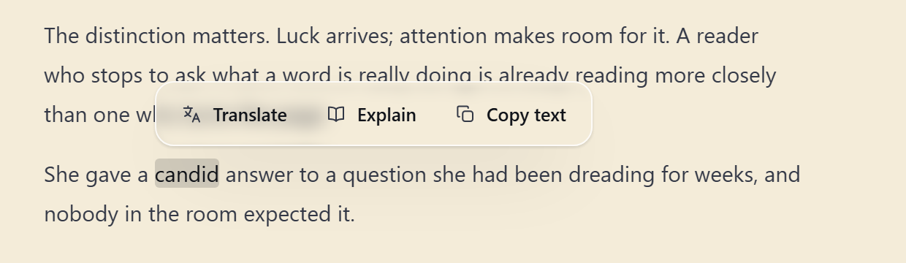

<h1 align="center">Lens</h1>

<h3 align="center">英語は、英語のまま読む。</h3>

  Lens は Windows のタスクトレイに常駐する英語リーディングの相棒です。選んだ単語・名前・文を、文字のすぐ横でやさしい英語にして説明します。タブを切り替えず、辞書ウィンドウも開かず、翻訳という回り道もしません。

  <a href="https://github.com/kakuyo1/lens/releases/latest"><strong>Windows 版をダウンロード</strong></a> ·
  <a href="#ちょっと見る">動きを見る</a> ·
  <a href="https://github.com/kakuyo1/lens/releases">すべてのリリース</a>

  
  
  
  

  
  
  

<a href="README.md">English</a> · <a href="README.zh-CN.md">简体中文</a> · <a href="README.zh-TW.md">繁體中文</a> · 日本語 · <a href="README.es.md">Español</a>

  <picture>
    <source media="(prefers-color-scheme: dark)" srcset="docs/readme/hero-dark.png">
    
  </picture>

説明は既定で英語です。カードの地球を押し続けると母語の意味が出て、離すと消えます。説明言語の切り替えは設定で行います。

## なぜ Lens か

多くの辞書ツールは、ページから連れ出して母語で答えます。その段落を読み終えても、英語では読んでいない。Lens は逆を行きます。英語の読解力を上げる一番の近道は、英語の中にとどまることです。

**英語で入って、やさしい英語で出る。** 平易な英語の語義と IPA、必要なら語源と例文。翻訳も残っています。ただし既定ではありません。

**聞ける単語。** 発音記号の横にスピーカーがあり、それか発音記号自体を押すと見出し語を一度読み上げます。文・名前・訳文は読み上げません。

**答えは文字の横に。** Lens はタスクトレイに住み、メインウィンドウを持ちません。バブルは選択範囲の横に開き、ポインターを乗せている間は留まり、読み進めれば消えます。

**静かな記憶。** 単語を「覚えた」「初見」で印をつけると、Lens が覚えます。デスクトップの相棒が後で出題することもあります。連続記録も学習計画もありません。

**定義の奥へ。** 英語の定義に出てくる、自分のレベルより上の単語には点線が残ります。開けば同じカードのまま一段下へ進み、パンくずで戻れます。キャッシュ、予算、判定のルールは各段にそのまま効きます。

## ちょっと見る

答えは英語のまま。地球を押している間だけ母語が出て、離せば英語に戻ります。

## まず英語。翻訳は求められたときだけ。

説明は既定で英語です。中国語・日本語・スペイン語の選択範囲は英語で返します。説明言語（英語・中国語・繁体字中国語・スペイン語・日本語）は設定の項目で、カード上にはありません。一度変えれば以後のカードが従い、キャッシュがあればそこから答えます。

アクションバーには「翻訳」「解説」「テキストをコピー」があります。Lens の中心は「解説」です。知っている英語で、その単語がここで何をしているかを説明します。読み飛ばせる中国語に置き換えるのではありません。翻訳は例外です。中国語・日本語・スペイン語の選択範囲は英語に訳し、英語の選択範囲は説明言語で答えます（既定は英語）。

カードに残った言語の操作は地球だけです。半秒押し続けると英語の定義の下に母語の意味が現れ、離すと消えます。母語そのものは設定の項目で、既定は中国語です。その言語を説明時に取得済みの単語は無料で、それ以外はセッションごとに一度だけ問い合わせます。

## 声に出す

単語カードの発音記号の横にスピーカーがあります。スピーカーか発音記号を押すと、見出し語を一度だけ読み上げます。定義・文・名前は読み上げません。

既定ではまず Windows の音声が、選んだアクセント（既定はアメリカ英語、希望すればイギリス英語）で読みます。そのアクセントの音声が無い場合は、設定 › 読解と学習で選んだフォールバックに従います。オンライン音声（既定は Youdao、Google 翻訳も選べます）、一度だけダウンロードするローカルモデル（Kokoro 約 180 MB、LJSpeech 約 41 MB）、または無音です。この段は明示的な選択で、オンラインとローカルを黙って切り替えません。自動再生は既定でオフです。オンにすると、検索で開いたカードが一度だけ読み、同じ単語は繰り返しません。録音は `%APPDATA%\Lens\audio` にキャッシュされ、上限は 50 MB、1 日の予算には入りません。

## 使い方

1. どのアプリでも単語・名前・文を選択します。
2. 「解説」を選ぶと、選択範囲の上か下にバブルが出ます。
3. 「覚えた」「初見」で印をつけて、読み続けます。

## 選択できないテキスト

`Ctrl+Alt+S`（設定で変更可）を押し、PDF・画像・動画の一部を囲みます。Lens がローカルの OCR で読み取ります。同梱の Tesseract が自動エンジンです。読者は RapidOCR-json を自分で導入し、明示的に選び、信頼確認のあと ASCII のモデルフォルダーを指定できます。オンライン OCR は任意で、アップロードのたびに確認を求め、Baidu OCR・Tencent Cloud OCR・Alibaba Cloud OCR・Google Cloud Vision・OCR.space を指定できます。自動スキャンは許可リストに入れたアプリだけを見ます。

## 5 種類のアクションバー

設定 › 取得とポップアップで選べます。クラシック、ページ端のタブ、カードの手札、吊り札、扇面。3 つの動作とチャンネルのルールは変わりません。コピーの引き出しは、開いた形に合わせて描かれます。

「テキストをコピー」は単一の動作ではなく引き出しです。ポインターを乗せると、その選択範囲でできる操作だけが出ます。単語はスペルを直す、文は文法を直す、80 語以内の英語の文は分解もできます。どちらもキャッシュされず、通常のリクエストとして 1 日の予算に入ります。

分解は文の 4 つの要素を色分けし（主語・述語・補語・状語）、下に凡例を置きます。校正は変更した単語にだけ下線を引きます。

## 小さな学習ループ

「覚えた」と「初見」は一つの単語リストに並びます。行にポインターを乗せると、Lens が保存済みの説明を再表示します。リクエストは送りません。単語が復習時期になると、デスクトップの相棒の横にその子自身の札が立ちます。「忘れた」「覚えていた」で答えると、10 分から 60 日までの間隔でまた出てきます。年間の記録は、連続記録ではなく、緑のマスで読書の跡を残します。

## 7 匹のデスクトップペット（任意）

Lens には 7 匹のピクセルペットが付属します。短耳猫、フクロウ、モチ、ゴースト、クラゲ、雲、犬。既定ではオフで、設定の「拡張」からオンにできます。7 匹にはそれぞれ 9 点の衣装と 6 つのシーン（専用 4 つ、共有 2 つ）があります。スカーフや眼鏡はどのシーンを選びやすくするかを変え、サイズと装いはペットごとに、ウィンドウの位置は読者のものとして覚えます。うろついたり、画面の端に隠れたり、ポインターに気づいたり、つかんで投げることもできます。イベントの種類だけを受け取り、選択範囲・解説・画面の文字は読みません。ペットパッケージはデータのみです。

ゴーストの 6 つ：真夜中の時計・ジャック・オー・ランタン・鏡・幽霊のお茶会は専用、パソコンとおふろはほかのペットと共有です。各シーンはそれぞれのアニメーションです。ジャック・オー・ランタンはこう動きます：

設定 ›「拡張」でペットにポインターを乗せると、その子の絵はがきが立ち上がります——頭・顔・体にそれぞれ 1 点ずつ身につけ、その子だけの風景に立ち、切手と消印つきで。

## ほかにも

- **モデルを持ち込む。** DeepSeek、OpenAI、Gemini、OpenRouter、xAI、Moonshot、Zhipu、Qwen、OpenAI 互換のカスタムエンドポイント。
- **見えるコスト。** トークンからリクエストごとの費用を計算。1 日の予算に達すると、取得・キャプチャ・リクエストを止めます。
- **同期は必要なときだけ。** 「覚えた」「初見」、検索履歴、統計、選択した設定をパスフレーズで暗号化し、自分の GitHub アカウントの secret gist に保存します。API キーは端末に残ります。
- **単語リストの出し入れ。** `.txt` と `.json` をインポート/エクスポート。削除には確認が一度入ります。
- **写真が助けるとき。** モデルが写真のほうがわかりやすいと判断した語義は、Wikimedia Commons の写真を 3 枚開けます。写真はローカルにキャッシュされ、設定の「Lens について」でサイズ表示と削除ができます。
- **好みに合わせて。** 5 種類のアクションバー。テーマはライト、ダーク、すりガラス、リキッドガラス、カスタム。英語フォントと 12–18 px のバブル文字。
- **5 言語。** インターフェースと説明はそれぞれ英語・中国語・繁体字中国語・スペイン語・日本語。繁体字中国語・スペイン語・日本語の翻訳は機械生成で、母語話者の校閲を受けていません。

## テーマ

ライトとダークは単色です。すりガラスとリキッドガラスは、すべてのカードをぼかしたデスクトップの上に描き、有効な間は Lens 自身をスクリーンショットと画面共有から外します。カスタムでは色を選び、WCAG AA のコントラストを確認します。アニメーションは Windows のアニメーション設定に従います。

## ダウンロード

[リリースページ](https://github.com/kakuyo1/lens/releases/latest)から `Lens-<version>-setup.exe`、または同じリリースの `Lens-<version>-portable.zip` をダウンロードします。インストール版はユーザー単位なので、Windows は管理者権限を求めません。ポータブル版は任意のフォルダーから実行できます。

**Windows 10/11 x64。** 対応プロバイダーの API キーが必要です。Lens は定義辞書を同梱していません。約 168,000 語の英語リストは、候補が実在する単語かを確認するためだけに使います。

Windows が先に警告するかもしれません

Lens はコード署名されていないため、SmartScreen が知らないプログラムを止めます。**「詳細情報」**、次に **「実行」** を選んでください。警告は署名がないことについてで、ファイルが壊れているわけではありません。ダウンロードが完全かを確認するには、ファイルの SHA-256 をリリースの `SHA256SUMS` の該当行と比べます。これは転送中に改変されていないことを示すだけで、公開者が誰かまでは示しません。

## プライバシー

選択またはキャプチャしたテキストだけが、設定したプロバイダーに送られます。送信前に URL、メールアドレス、6 桁以上の数字列をローカルでマスクします。OCR は既定でローカルです。オンライン OCR は毎回確認を求め、確認カードにその切り抜きの送信先を書きます。自動スキャンは使いません。スピーカーはまずシステム音声かダウンロード済みのローカルモデルでローカルに読み、オンライン音声に切り替わるときはその単語だけが端末を出ます。録音は `%APPDATA%\Lens\audio` にキャッシュされます。API キー、OCR の認証情報、学習データは `%APPDATA%\Lens\settings.json` にあります。同期を有効にすると、クラウドのコピーはパスフレーズで暗号化され、自分の GitHub gist に保存されます。キーは端末に残ります。Lens 自身のアカウントもサーバーもありません。詳しくは [SECURITY.md](SECURITY.md) を参照してください。

## FAQ

**Lens は翻訳ツールですか？** 翻訳もできますが、中心は解説です。中国語・日本語・スペイン語の選択範囲は英語で返ります。

**API キーは必要ですか？** 必要です。対応プロバイダーのキーを使ってください。Lens はリクエストごとの費用を表示し、1 日の上限も設定できます。

**オフラインで使えますか？** OCR・単語リスト・ダウンロード済みのローカル音声はオフラインで使えます。説明、オンライン OCR、オンライン音声は設定したサービスが必要です。

**PC から何が出ていきますか？** マスク後の選択テキストと、オンライン OCR で明示的に確認したキャプチャ、そしてオンライン音声に切り替わったときの 1 語だけです。[プライバシー](#プライバシー)を参照してください。

**Windows の警告はなぜですか？** インストーラーにコード署名がないためです。実行方法と検証は[ダウンロード](#ダウンロード)の説明にあります。

**macOS や Linux 版はありますか？** 今は Windows のみです。

## 言語

[English](README.md) · [简体中文](README.zh-CN.md) · [繁體中文](README.zh-TW.md) · [日本語](README.ja.md) · [Español](README.es.md)

インターフェース言語と説明言語は別々の設定です。どちらも英語・中国語・繁体字中国語・スペイン語・日本語から選べます。

## コントリビュートとライセンス

Lens は [MIT ライセンス](LICENSE)のオープンソースです。issue と PR を歓迎します。Lens で英語を少し多く読めるようになったら、star が次の読者の助けになります。

インターフェース画像は Lens の現在のデザインプロトタイプから描画したものです。実際のビルドも同じレイアウトとトークンに従います。
