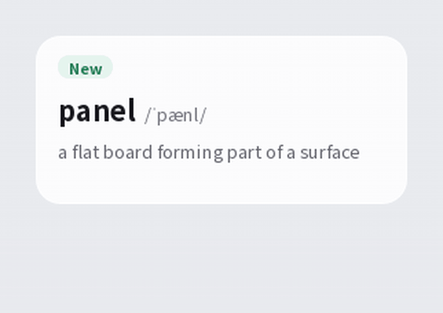

# Lens

**Stay with the page you are reading.** Lens is a Windows tray companion that explains English words, names, and sentences in small overlays beside the text, so you never open a separate dictionary window.

[English](README.md) · [简体中文](README.zh-CN.md) · [日本語](README.ja.md) · [Español](README.es.md)

## What Lens does

Lens lives in the system tray and has no main window. Select a passage, and a small action bar offers Translate, Explain, and Copy. The result appears as a bubble beside the text that prompted it. Mark a word as known or new, and keep reading.

When text cannot be selected, press the capture hotkey (`Ctrl+Alt+S` by default, changeable in Settings), frame a region of the screen, and Lens reads it with OCR and translates it straight away. Automatic scanning can also watch text in the applications you list, and only those.

## What gets sent

Lens sorts captured text on your PC into one of three requests: a word sends only the word, an entity sends only its name, and a sentence sends only the selected sentence. Before anything leaves your PC, Lens masks URLs, email addresses, and digit strings of six or more digits.

The AI provider you configure writes the explanation. Lens does not ship a definition dictionary. It does include a list of about 168,000 common English words, which it uses only to check that a candidate is a real word. That list holds no definitions.

## Features

- **Explanations.** A word gets its most common sense in the explanation language you choose, with IPA pronunciation. Turn on multiple senses to see up to three, and turn on etymology to see where the word comes from.
- **Word list.** Known and new marks sit on one list with one row per word, showing the time of its last lookup. Hover a row to read the explanation Lens already stored; hovering never sends a request. Deleting a word cannot be undone.
- **Year in words.** A year of lookups drawn as a contribution graph. Select a day to see how many words you looked up that day, and choose the colours of the cells.
- **Costs and budget.** The cost view prices each request from the tokens it used, at current rates. A daily budget pauses lookups, capture, and requests when the day's spend reaches it, and resets when the local date changes.
- **Screen capture and automatic scanning.** Capture dims every screen, reads the region you frame, and translates it. Lens bundles the OCR runtime, and you can point Settings at your own installed Tesseract instead.
- **Desktop pet.** A small pixel pet that lives on the desktop and plays actions as you study. You can pick from the pets the app ships. It is off by default; turn it on in Settings under Extensions. You can drag it, click it, dress it in up to three accessories, set its size from one to four times, or let mouse clicks pass through it. It reacts to event types only and never reads your selections, explanations, or screen text.
- **Updates.** Lens checks the project's latest release once a day at startup, which you can switch off in General, or when you choose Check for updates. A newer version shows a card with View, Download, and Skip this version. Downloads are checked against the release's `SHA256SUMS`, and the installer runs only when you press Install, with no extra arguments. The installer is not code-signed, so the checksum shows the file arrived intact but does not prove who published it. Downloads need a proxy from mainland China; Lens says so when nothing arrives.
- **Themes.** Light, Dark, Forest, and Custom. In Custom you choose the colours, and Lens checks their contrast against WCAG AA. An animation switch follows the Windows reduced-motion setting.

## Screens

The images below come from the HTML design files in [`ui-prototypes/`](ui-prototypes/). They are design concepts, not screenshots of the running application, so details can differ.

| Explanation bubble | Selection actions |
| --- | --- |
|  |  |

| Settings | Word history |
| --- | --- |
|  |  |

| Year in words | Desktop pet |
| --- | --- |
|  |  |

## Demonstrations

Short clips of the main operations, in the English interface with English explanations.

| Explanation bubble | Desktop pet celebrating |
| --- | --- |
|  The explanation bubble for a word, with its pronunciation, definition, and a countdown until it closes. |  The desktop pet's Celebrate action. The pet reacts to event types and never reads your words. |
|  Hover over the bubble to show Known and New, click Known, and the badge changes. |  A year of lookups as a contribution graph. Select a day to see its count, or choose the cell colours. |

## Languages and appearance

The interface and the explanations each have their own language setting, and both offer English, Chinese, Spanish, and Japanese. The Spanish and Japanese translations are machine-generated and have not been reviewed by a native speaker. If you find a wrong term, please report it.

## Privacy and security

Your API key and learning data are stored in `%APPDATA%\Lens\settings.json`, in your Windows user profile. The key is never written to the install folder or to logs. Lens sends the text you select or capture to the provider you configure, so keep confidential material out of it. Masking covers URLs, email addresses, and long digit strings only; it does not identify every kind of personal information. The model list download sends no API key and no text. See [SECURITY.md](SECURITY.md) for data flows, current safeguards, known limits, and how to report a security issue.
