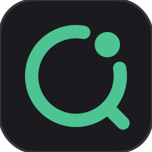
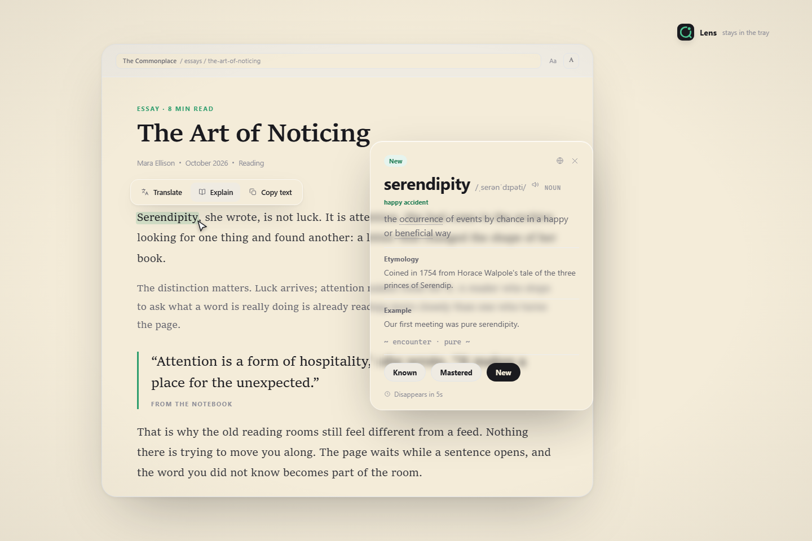
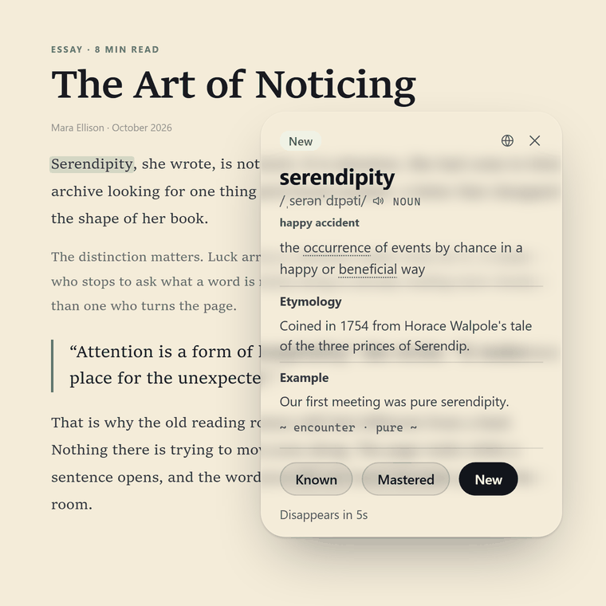
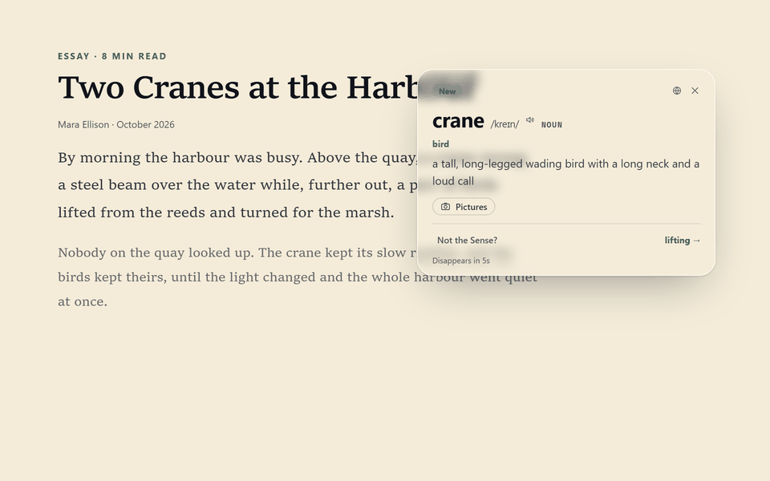
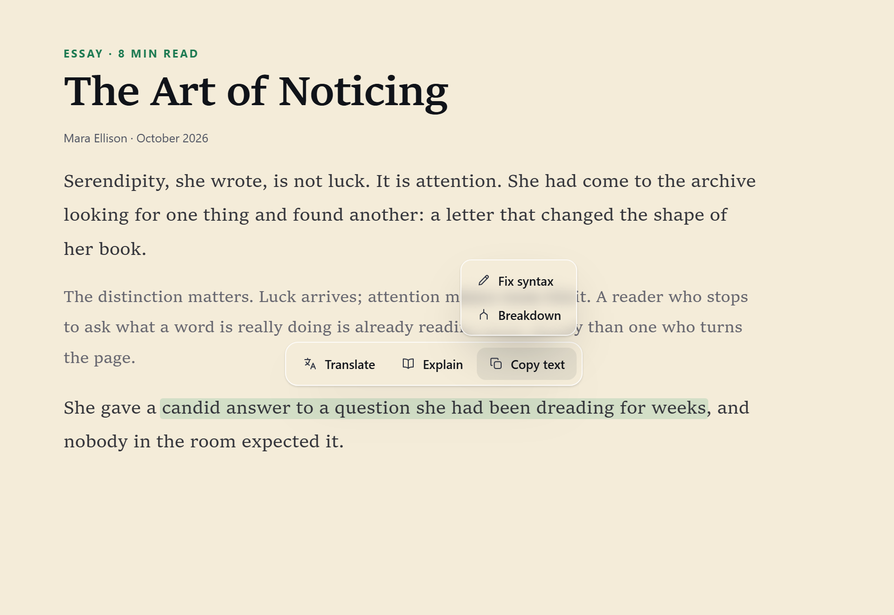
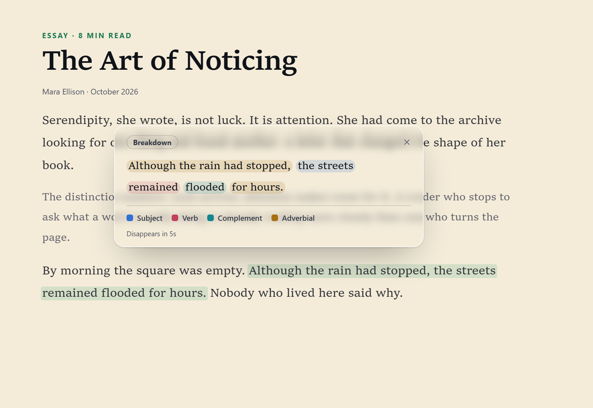
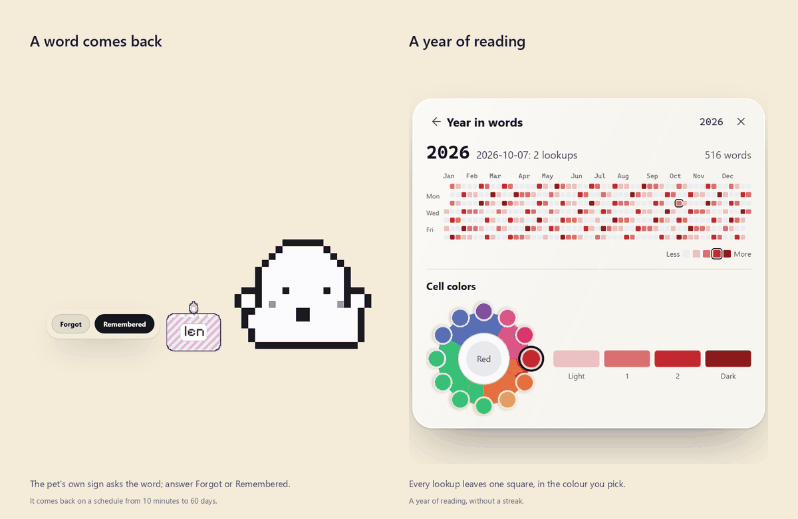
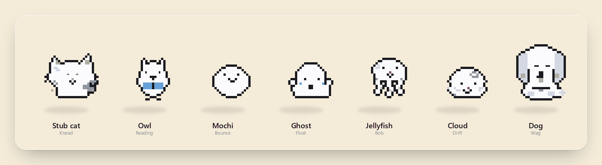
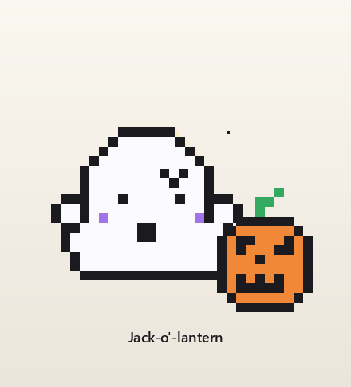
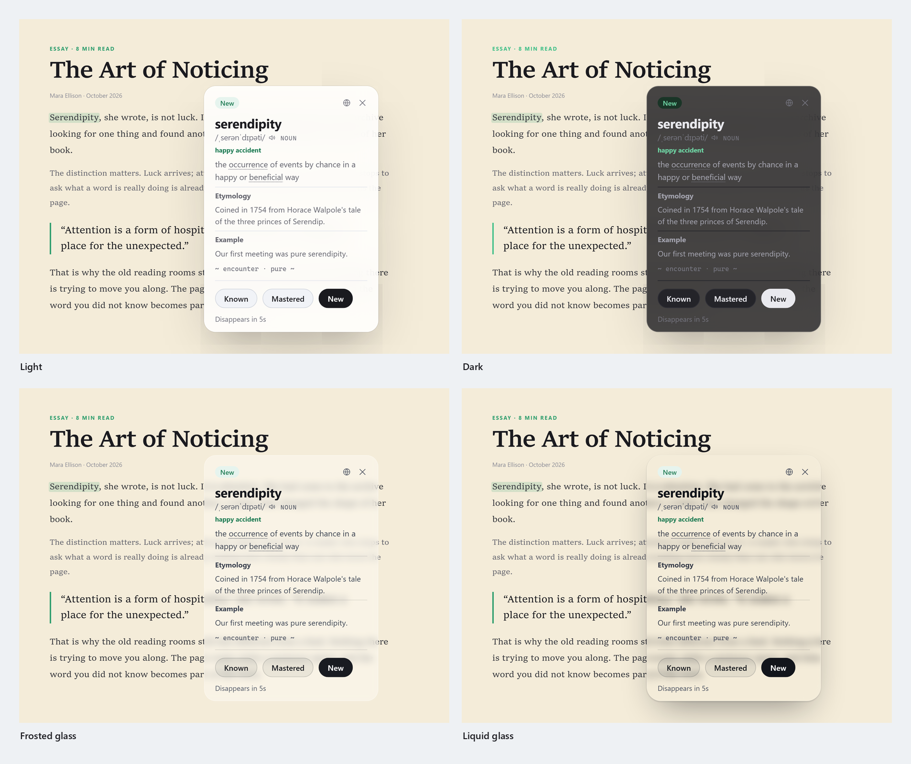

<h1 align="center">Lens</h1>

<h3 align="center">用英文，读懂英文。</h3>

  Lens 是一款常驻 Windows 系统托盘的英语阅读助手。选中一个单词、一个名字或一个句子，它会在文字旁用更清楚的英文解释——不切页，不开词典，也不把英文先翻译成中文。不取词的时候，桌面宠物会把到期的词举回来问你。

  <a href="https://github.com/kakuyo1/lens/releases/latest"><strong>下载 Windows 版</strong></a> ·
  <a href="#先看一眼">看它怎么工作</a> ·
  <a href="https://kakuyo1.github.io/lens/">宣传页</a> ·
  <a href="https://github.com/kakuyo1/lens/releases">全部版本</a>

  
  
  
  

  
  
  

<a href="README.en.md">English</a> · 简体中文 · <a href="README.zh-TW.md">繁體中文</a> · <a href="README.ja.md">日本語</a> · <a href="README.es.md">Español</a>

  <picture>
    <source media="(prefers-color-scheme: dark)" srcset="docs/readme/hero-dark.png">
    
  </picture>

解释默认使用英文；按住卡片上的地球就能看到母语释义，松手即收。永久切换解释语言在设置里。

## 为什么是 Lens

大多数查词工具会把你带离页面，再给一个中文答案。你读完了一段，却没有用英文读它。Lens 的选择相反：提高英语阅读最有效的方式，是留在英语里。

- **英文进，清楚的英文出**。解释默认使用英文：一条你能直接读懂的英文释义、音标；需要时再加上词源和例句。中文、日文或西班牙文的选区会译成英文；英文选区则按解释语言回答，默认英文。翻译仍然在，只是它不是默认动作。
- **解释语言是设置里的一项，不在卡片上**。英语、中文、繁体中文、西班牙语或日语——改一次，之后每张卡都跟着走，已有缓存的词直接取缓存。
- **动作条提供翻译、解释和复制文本**。Lens 围绕的是 “解释”：用你已经认识的英文，说明这个词在这里做什么，而不是换成一个你可以直接跳过、不再需要读英文的中文词。
- **能听见的词**。音标旁边有一枚喇叭：点它，或者点音标本身，就会读一次词头。句子、名字和译文不会出声。
- **答案留在文字旁**。Lens 常驻系统托盘，没有主窗口。气泡出现在选区旁边，鼠标停在上面就会一直留着；你继续往下读，它就退场。
- **三个判定，一份安静的记忆**。把词标成 “已会”、“掌握” 或 “新词”：已会仍在练习里，扫描虚线画得更实；掌握则让它从扫描与宠物提问里退场。没有连续打卡，也没有课程表。
- **会问你的宠物**。到期的词会在宠物脚边立起一块提问牌：答对，下一次隔得更久；答错，就提前回来。已经掌握的词不会再被问。宠物只收事件类型，读不到屏幕、选区或释义。默认关闭，在设置的 “扩展” 里开启。
- **能走进去的释义**。英文释义里超出你档位的词会留下点线；点开它，同一张卡片向下走一层，并留一条面包屑带你回来。缓存、预算与判定规则跟着每一步走。
- **卡片上的语言控件只有那枚地球**。解释语言是英文时，按住半秒，英文释义下方浮出母语的意思，松手即收。母语本身是设置里的一项，默认中文。解释时已经取回那门语言的词，按住不花钱；其余的词每个会话问一次。

## 先看一眼

答案仍然是英文。按住地球看母语，松手，卡片又回到英文。

单词卡上点 “图片”，照片就加载出来；点 “不是这个义项？”，卡片原地换到另一个义项，照片跟着变。

## 读出来

每张单词卡的音标旁都有一枚喇叭：点喇叭或点音标本身，读一次词头。卡片上的其他内容不会出声——释义、句子、名字都不读。

- **默认先由 Windows 的系统音色发声**，口音按你选的美式（默认）或英式。
- **系统没有该口音的音色时**，按你在设置 › 阅读学习里选的兜底走：在线音频（默认有道，也可选 Google 翻译）、下载一次的本地模型（Kokoro 约 180 MB，或 LJSpeech 约 41 MB），或者不发音。这一档由你明确选择——Lens 不会在在线与本地之间悄悄切换。
- **自动播放默认关闭**。打开后，取词弹出的那张卡出现即读一次，同一个词不重复。
- **在线音频缓存在 `%APPDATA%\Lens\audio`**，上限 50 MB，不计入每日预算。

## 选不中的文字

按 `Ctrl+Alt+S`（可在设置 › OCR 里修改），框选 PDF、图片或视频画面中的一块区域，Lens 会在本机用 OCR 读取。

- **随包的 Tesseract 是自动引擎**。也可以在设置里下载 RapidOCR-json，或指向自己安装的一份，检测并信任后明确选择它；模型目录必须是 ASCII 路径。
- **在线 OCR 是可选项**。每次上传前都会询问，可指向百度 OCR、腾讯云 OCR、阿里云 OCR、Google Cloud Vision 或 OCR.space。
- **自动扫描**：Chrome 网页与 Notepad++ 文档在前台时给可能超出你档位的词画虚线；按住 Alt 看义项路标，指针停留可用一枚 “掌握” 按钮让词退场。它读取应用提供的文字，不经过 OCR，也不上传。总开关与各软件开关都在设置里；PDF 阅读器与视频字幕暂不支持。

## 悬浮取词

链接和标题常常选不中。切到悬浮取词（默认 `Ctrl+Alt+H`，可在设置 › 取词与弹窗里修改），把指针停在一个词上约一秒，Lens 就直接翻译它；再按一次切回选区取词。它只读取指针下的文字，不点击，不碰剪贴板，不读密码框，并且只在允许的应用中生效。

## 复制抽屉与拆解

复制文本是一张抽屉，不是单个动作：鼠标停在上面，只有这张选区能做的事会出来。

- 单词可修拼写，句子可修语法，80 词以内的英文句子还可拆解。
- 纠正与拆解都不入缓存，各自按一次请求计入每日预算。

拆解把句子的四类成分各染一色——主语、谓语、表语、状语——下面配一行图例；纠正只给改动过的词画下划线。

## 一个安静的学习循环

已会、掌握和新词在同一张词表里，顶部的分段可以只看其中一类。

- 把指针停在某一行上，可以重读 Lens 已经存下的解释，不会发出请求。
- 单词到期时，宠物脚边会立起它自己的提问牌；回答 “忘了” 或 “记得”，它会按 10 分钟到 60 天的间隔再次被问起。标成掌握的词不再进入复习。
- 年度记录把阅读留下的痕迹画成一格一格的色块，颜色从十二种里挑，默认绿色，而不是一条连续打卡。

## 会把词举回来问你的宠物

Lens 随包提供七只像素宠物：短耳猫、猫头鹰、麻糬、小幽灵、小水母、小云和小狗。它们默认关闭，可在设置的 “扩展” 里开启。

- 每一只都有自己的九件配饰和六个场景——四个专属、两个共享；一条围巾或一副眼镜会改变它更常去哪个场景。
- 大小与穿搭按宠物各记一份，窗口位置仍只属于你。
- 它们会闲逛、在屏幕边缘躲起来、注意到指针，也能被拎起来抛出去；任务栏固定显示时，偶尔还会跳上去弹一下，慢吞吞走到头，再蹦回原处。
- 它们只接收事件类型——从不读取你的选区、解释或屏幕文字；宠物包也只含数据。

小幽灵的六个：午夜座钟、南瓜灯、镜中无影与幽灵茶会是它自己的，敲电脑和泡澡与其他宠物共享——每个场景都是一段自己的小动画。南瓜灯播起来是这样：

Lens 也支持自定义宠物：仓库里的 `skills/lens-pet-maker` 是一个 Claude Code skill，克隆仓库后可以让 AI 辅助生成；做好的宠物包放进 `%APPDATA%\Lens\pets\`，就能在设置的 “扩展” 里启用。

## 还有这些

- **自带模型**。DeepSeek、OpenAI、Gemini、OpenRouter、xAI、Moonshot、智谱、通义千问，或任何兼容 OpenAI 的自定义端点。
- **看得见的花费**。按 token 计算每次请求的费用；每日预算到顶时，暂停取词、截图和请求。
- **每周阅读报告**。统计弹窗的 “本周画像” 把这一周按小时、词性和最常查的词摊开；按下 “解读本周”，模型写五条观察，收进一张周报告卡片，还可以让它用本周的词写一篇小故事。只有你按下才发送，且只含计数与词头。
- **想同步时再同步**。判定、查词历史、统计和选定设置用你的口令加密，存放在你自己 GitHub 账号的 secret gist 里；API key 始终留在本机。
- **词表进得来也出得去**。词汇弹窗可以导入或导出 `.txt`、`.json`，也能导出带已存释义的 CSV 与 Anki TSV；设置 › 阅读学习里的 “已掌握词” 可以一次性导入一份一行一词的词表，把其中的词标为掌握。删除单词需要一次确认。
- **该给图时给图**。模型判断某条义项用照片更好说明时，卡片可以展开三张 Wikimedia Commons 图片；图片缓存在本机，“关于” 页显示缓存大小并可原地清除。
- **按你的习惯来**。五种动作条形态；晴朗白昼、静谧暗夜、雾面玻璃、流光玻璃；以及英文字体与 12–18 px 气泡字号。
- **五种语言**。界面和解释各自提供英语、中文、繁体中文、西班牙语和日语。繁体中文、西班牙语与日语的翻译由机器生成，尚未经母语人士审校。

## 主题

- **晴朗白昼和静谧暗夜**是纯色主题。
- **雾面玻璃和流光玻璃**把每张卡片画在模糊的桌面之上；玻璃主题开启时，Lens 会把自己排除在截图和屏幕共享之外。
- **动画开关**跟随 Windows 的动画效果设置。

## 下载

从[发布页](https://github.com/kakuyo1/lens/releases/latest)下载 `Lens-<版本>-setup.exe`，或同一发布里的 `Lens-<版本>-portable.zip`。

- **安装版**按用户安装，Windows 不会要求管理员权限；**便携版**解压后即可运行。
- **Windows 10/11 x64**。你需要一个受支持服务商的 API key。
- Lens 不内置释义词典；它包含一份约 168,000 个英语单词的词表，只用来判断候选词是不是真词。

Windows 可能会先拦一下

Lens 没有代码签名，SmartScreen 会拦截它不认识的程序。点 **“更多信息”**，再点 **“仍要运行”**。这是缺少签名，不是文件损坏。想核对下载是否完整，可以把文件的 SHA-256 和发布里的 `SHA256SUMS` 对应行比一下；这只能证明文件在传输中没有被改动，不能证明发布者是谁。

## 隐私

Lens 没有自己的账号，也没有自己的服务器。

- **发送的内容**。你选中或截取到的文字会发送给你配置的服务商，发送前会在本机遮盖 URL、电子邮件地址和六位及以上的数字串。每周阅读报告的解读与小故事只在你按下按钮时发送，只含计数与词头，词头同样遮盖。
- **OCR**。默认在本机运行；在线 OCR 需要你逐次确认，确认卡会写明这次裁剪发往哪个服务，自动扫描从不使用它。
- **朗读**。喇叭优先用系统音色或已下载的本地模型在本机朗读；兜底到在线音频时，离开本机的只有那个词，录音缓存在 `%APPDATA%\Lens\audio`。
- **本机存储**。API key、OCR 凭据和学习数据保存在 `%APPDATA%\Lens\settings.json`。
- **同步**。开启后，云端副本用你的口令加密，存放在你自己的 GitHub gist 里；密钥始终只在本机。

完整的数据边界见 [SECURITY.md](SECURITY.md)。

## 常见问题

**Lens 是翻译器吗**？它可以翻译，但它是为 “解释” 做的。中文、日文或西班牙文的选区返回英文。

**需要 API key 吗**？需要。用受支持服务商的 key；Lens 会显示每次请求的费用，也可以设置每日上限。以 DeepSeek 为例，一次查词约 0.001 元，1 元大约够查 1000 次；其他服务商价格不同。

**能离线用吗**？OCR、词表和已下载的本地音色在本机可用；解释、在线 OCR 与在线音频需要你配置的服务。

**什么会离开我的电脑**？只有这几样：本地脱敏后的选区文字，在线 OCR 里逐次确认的裁剪，兜底到在线音频时的那一个词，以及你按下每周报告按钮时发出的计数和词头。见[隐私](#隐私)。

**为什么 Windows 会警告**？安装包没有代码签名；怎么运行与核对文件见[下载](#下载)一节的说明。

**有 macOS 或 Linux 版吗**？目前只有 Windows。

## 参与和许可

Lens 以 [MIT 许可证](LICENSE)开源。欢迎提 issue 和 PR。如果 Lens 帮你多读了一点英文，点一个 star 会让更多读者找到它。

界面图片由 Lens 当前的设计原型渲染，实际构建遵循同一套布局与令牌。
