# Lens

**Stay with the page you are reading.** Lens is a Windows tray companion that explains English words, names, and sentences in small overlays beside the text, so you never open a separate dictionary window.

[English](README.md) · [简体中文](README.zh-CN.md) · [日本語](README.ja.md) · [Español](README.es.md)

## What Lens does

Lens lives in the system tray and has no main window. Select a passage, and a small action bar offers Translate, Explain, and Copy. The result appears as a bubble beside the text that prompted it. Mark a word as known or new, and keep reading. Names and whole sentences get explanations too.

When text cannot be selected, press the capture hotkey (`Ctrl+Alt+S` by default, changeable in Settings), frame a region of the screen, and Lens reads it with OCR and translates it straight away. Automatic scanning can also watch text in the applications you list, and only those.

## What gets sent

Lens sorts captured text on your PC into one of three requests: a word sends only the word, an entity sends only its name, and a sentence sends only the selected sentence. Before anything leaves your PC, Lens masks URLs, email addresses, and digit strings of six or more digits.

The AI provider you configure writes the explanation. Lens does not ship a definition dictionary. It does include a list of about 168,000 common English words, which it uses only to check that a candidate is a real word. That list holds no definitions.

## Features

- **Explanations.** A word gets its most common sense in the explanation language you choose, with IPA pronunciation. Turn on multiple senses to see up to three. Turn on etymology to see where the word comes from, and turn on the example sentence switch under it to add one English example. The example switch is off by default, because it costs output tokens.
- **Names and sentences.** A name and a whole sentence get explanations too, in the same explanation language as words.
- **Bubble.** Choose how long a bubble stays, from 1 to 30 seconds (5 by default), and whether it opens above or below the selection (above by default). Hovering over a bubble keeps it open.
- **Word list.** Known and new marks sit on one list with one row per word, showing the time of its last lookup. Hover a row to read the explanation Lens already stored; hovering never sends a request. Deleting a word cannot be undone.
- **Year in words.** A year of lookups drawn as a contribution graph. Select a day to see how many words you looked up that day, and choose the colours of the cells from a twelve-hue wheel, each with four shades.
- **Costs and budget.** The cost view prices each request from the tokens it used, at current rates. A daily budget pauses lookups, capture, and requests when the day's spend reaches it, and resets when the local date changes.
- **Screen capture and automatic scanning.** Capture dims every screen, reads the region you frame, and translates it. Lens bundles the OCR runtime, and you can point Settings at your own installed Tesseract instead.
- **Desktop pets.** Four pets ship with Lens: Mochi, Cat, Dog, and Owl. Each one plays actions as you study. Pets are off by default; turn one on in Settings under Extensions. You can drag it, click it, dress it in up to three accessories, set its size from one to four times, or let mouse clicks pass through it. A pet reacts to event types only and never reads your selections, explanations, or screen text. You can also install pet packages: copy a package folder into `%APPDATA%\Lens\pets\`, then open Extensions in Settings. Each package asks you once before it takes effect, and packages hold data only, never code.
- **Updates.** Lens checks the project's latest release once a day at startup, which you can switch off in General, or when you choose Check for updates on the About page, which also shows the current version and the repository link. A newer version shows a card with View, Download, and Skip this version. Downloads are checked against the release's `SHA256SUMS`, and the installer runs only when you press Install, with no extra arguments. The installer is not code-signed, so the checksum shows the file arrived intact but does not prove who published it. Downloads need a proxy from mainland China; Lens says so when nothing arrives.
- **Sync.** Sign in with GitHub to keep your word marks, lookup history, statistics, and selected settings in step across devices. The copy is encrypted with a passphrase you set and stored in a secret gist in your own GitHub account. Explanations are not synced. You can log out, or delete the cloud copy, at any time.
- **Themes.** Light, Dark, Frosted glass, Liquid glass, and Custom. See [Themes](#themes).

## Themes

Light and Dark are solid themes. Frosted glass and Liquid glass draw every card over a blurred copy of the desktop behind it, and while a glass theme is on, Lens keeps its windows out of screen captures and screen sharing, so a screenshot shows the desktop without the cards. In Custom you choose the colours, and Lens checks their contrast against WCAG AA. An animation switch follows the Windows reduced-motion setting.

| Light | Dark |
| --- | --- |
| 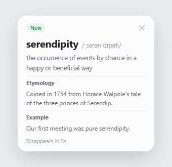 | 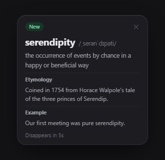 |
| Frosted glass | Liquid glass |
| 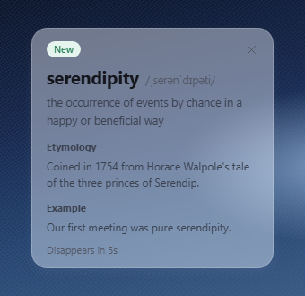 | 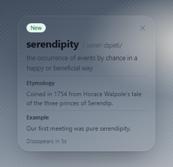 |

## Screens

Most images below come from the HTML design files in [`ui-prototypes/`](ui-prototypes/). They are design concepts, not screenshots of the running application, so details can differ. The desktop pet image is a render of the running application.

| Explanation bubble | Selection actions |
| --- | --- |
|  |  |

| Name explanation | Sentence explanation |
| --- | --- |
| 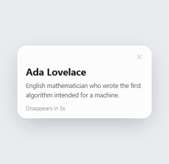 Ada Lovelace, explained in English. | 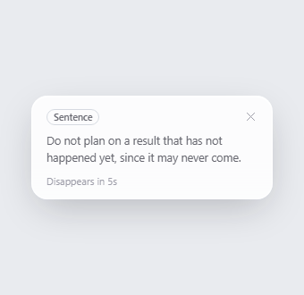 The proverb "Don't count your chickens before they hatch.", explained in English. |

| Settings | Word history |
| --- | --- |
|  |  |

| Year in words | Desktop pet |
| --- | --- |
| 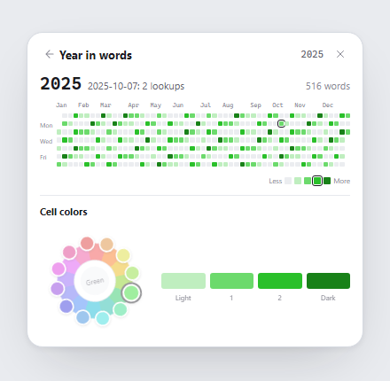 | 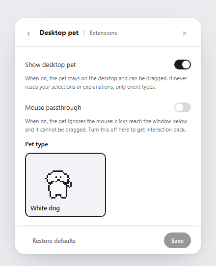 |

## Demonstrations

Short clips of the main operations, in the English interface with English explanations.

| Explanation bubble | Year in words |
| --- | --- |
| 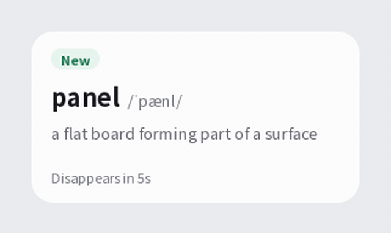 An explanation bubble for a word, with its etymology and an example sentence. Hover over the bubble to show Known and New, click Known, and the badge changes. | 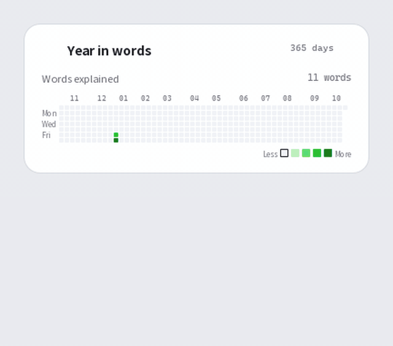 A year of lookups as a contribution graph. Select a day to see its count, or choose the cell colours. |
| 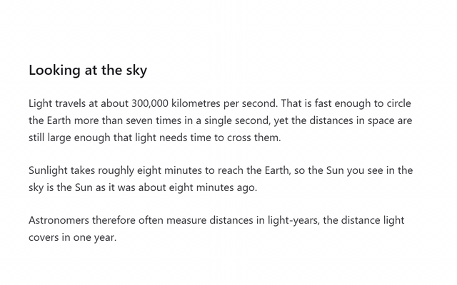 Capture dims the screen, you frame a region, and Lens reads it with OCR and shows the translation beside it. This is an animated illustration of the flow, not a recording. | |

## Desktop pets

Four pets ship with Lens. Each clip shows one of them playing its action.

| Mochi, celebrating | Cat, kneading |
| --- | --- |
|  Mochi plays Celebrate. |  Cat plays Knead. |
|  Dog plays Poked. |  Owl plays Reading. |

## Languages

The interface and the explanations each have their own language setting, and both offer English, Chinese, Spanish, and Japanese. The Spanish and Japanese translations are machine-generated and have not been reviewed by a native speaker. If you find a wrong term, please report it.

## Privacy and security

Your API key and learning data are stored in `%APPDATA%\Lens\settings.json`, in your Windows user profile. The key is never written to the install folder or to logs. If you turn on sync, a copy of your learning data is encrypted and kept in a secret gist in your own GitHub account, and your API key stays on this device. Lens sends the text you select or capture to the provider you configure, so keep confidential material out of it. Masking covers URLs, email addresses, and long digit strings only; it does not identify every kind of personal information. The model list download sends no API key and no text. See [SECURITY.md](SECURITY.md) for data flows, current safeguards, known limits, and how to report a security issue.
