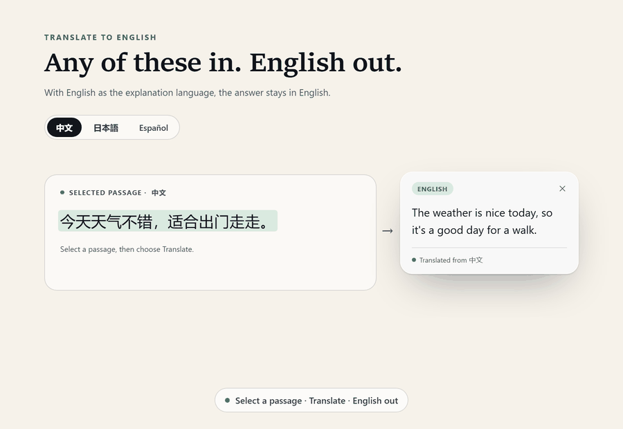
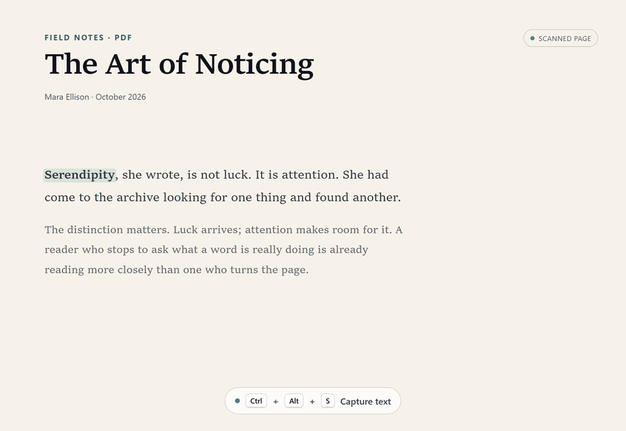

<h1 align="center">Lens</h1>

<h3 align="center">Read English in English.</h3>

  Lens is a Windows tray companion that explains the word, name, or sentence you select — in clearer English, right beside the text. No tab switch, no dictionary window, no translation detour.

  <a href="https://github.com/kakuyo1/lens/releases/latest"><strong>Download for Windows</strong></a> ·
  <a href="#a-quick-look">See it in action</a> ·
  <a href="https://github.com/kakuyo1/lens/releases">All releases</a>

  
  
  
  

  
  
  

English · <a href="README.zh-CN.md">简体中文</a> · <a href="README.ja.md">日本語</a> · <a href="README.es.md">Español</a>

  <picture>
    <source media="(prefers-color-scheme: dark)" srcset="docs/readme/hero-dark.png">
    
  </picture>

Explanations default to English. Switch to Chinese, Spanish, or Japanese from the bubble whenever you want.

## Why Lens

Most lookup tools pull you out of the page and answer in your first language. You finish the paragraph without ever reading it in English. Lens makes the opposite bet: the fastest way to read better English is to stay in English.

**English in, clearer English out.** A plain-English sense, IPA, and — when you want them — etymology and an example. Translation is still there; it just isn't the default.

**The answer stays on the page.** Lens lives in the system tray and has no main window. The bubble opens beside the selection, holds while you hover, and is gone when you keep reading.

**A quiet memory.** Mark a word Known or New. Lens keeps the list; the desktop pet can ask it back later. No streaks, no lesson plan.

## A quick look

The language switch is on the card. English is the default; Chinese is one click away.

## English first. Translation when you ask.

Explanations default to English. A selection in Chinese, Japanese, or Spanish comes back in English. When you do want Chinese, open the globe on the bubble and switch the explanation language: the same card is answered again, from cache when it already has one.

The action bar offers Translate, Explain, and Copy text. Explain is the one Lens is built around: it tells you what the word means in words you already know, instead of replacing it with a Chinese word you can skip. Translate is the exception: it turns a Chinese, Japanese, or Spanish passage into English; on English text it answers in your explanation language — English unless you change it.

## How it works

1. Select a word, a name, or a sentence in any app.
2. Choose Explain. The bubble lands above or below the selection.
3. Mark it Known or New, and keep reading.

## Text you can't select

Press `Ctrl+Alt+S` (changeable in Settings), frame a region of a PDF, image, or video still, and Lens reads it locally with OCR. Automatic scanning can watch only the apps you whitelist.

## Five action bars, one set of actions

Choose the shape in Settings › Capture & popups: the classic bar, a page-edge tab, three cards, a hang tag, or a fan. The three actions and channel rules stay the same.

## A small learning loop

Known and New live on one word list. Hover a row to reread an explanation Lens already stored, without sending a request. When a word is due, a small wooden sign appears beside the desktop pet; answer Forgot or Remembered and it comes back on a spaced schedule from ten minutes to sixty days. The year-in-words graph keeps the habit visible without turning it into a streak.

## Seven pets, if you want them

Seven pixel companions ship with Lens: Stub cat, Owl, Mochi, Ghost, Jellyfish, Cloud, and Dog. They are off by default; turn one on in Settings › Extensions. They react to event types only — never to your selections, explanations, or screen text — and packages hold data only.

## Also in the box

- **Bring your own model.** DeepSeek, OpenAI, Gemini, OpenRouter, xAI, Moonshot, Zhipu, Qwen, or a custom OpenAI-compatible endpoint.
- **Costs you can see.** Per-request cost from tokens, and a daily budget that pauses lookups, capture, and requests when the day reaches it.
- **Sync when you want it.** Word marks, lookup history, statistics, and selected settings are encrypted with your passphrase and kept in a secret gist in your own GitHub account. The API key stays on this device.
- **Word lists in and out.** Import or export `.txt` and `.json`; delete a word with one confirmation.
- **Make it yours.** Five action-bar shapes; Light, Dark, Frosted glass, Liquid glass, and Custom themes; and an English typeface with 12–18 px bubble text.
- **Four languages.** Interface and explanations each offer English, Chinese, Spanish, and Japanese. The Spanish and Japanese translations are machine-generated and have not been reviewed by a native speaker.

## Themes

Light and Dark are solid. Frosted glass and Liquid glass draw every card over a blurred copy of the desktop, and keep Lens out of screenshots and screen sharing while they are on. Custom lets you choose the colours and checks them against WCAG AA. Animations follow the Windows reduced-motion setting.

## Download

Download `Lens-<version>-setup.exe` from the [releases page](https://github.com/kakuyo1/lens/releases/latest), or `Lens-<version>-portable.zip` from the same release. The installer is per user, so Windows never asks for administrator rights; the portable zip runs from any folder.

**Windows 10/11 x64.** You will need an API key from a supported provider. Lens does not ship a definition dictionary; it includes a list of about 168,000 English words only to check that a candidate is a real word.

Windows may warn you before it runs

Lens is not code-signed, and SmartScreen blocks programs it does not recognise. Choose **More info**, then **Run anyway**. The warning is about the missing signature, not a damaged file. To check that the download arrived intact, compare its SHA-256 with the matching line in the release's `SHA256SUMS` file; that proves the file was not altered in transit, not who published it.

## Privacy

Only the text you select or capture is sent to the provider you configure, after local masking of URLs, email addresses, and digit strings of six or more digits. OCR runs locally; a screenshot is never uploaded. Your API key and learning data stay in `%APPDATA%\Lens\settings.json`. If you turn on sync, the cloud copy is encrypted with your passphrase and stored in your own GitHub gist; the key stays on this device. Lens has no account and no server of its own. See [SECURITY.md](SECURITY.md) for the full boundary.

## FAQ

**Is Lens a translator?** It can translate, but it is built for explanations. Explanations default to English; switch the explanation language if you want a translation. Chinese, Japanese, and Spanish selections come back in English.

**Do I need an API key?** Yes. Bring one from a supported provider. Lens shows the cost of each request and can cap daily spending.

**Does it work offline?** OCR and the word list are local. Explanations need the provider you configure.

**What leaves my PC?** Only the selected word, name, or sentence, after masking. No full page or screenshot is uploaded.

**Why does Windows warn me?** The installer is not code-signed. The file is intact; the warning is about the missing signature. Verify it against `SHA256SUMS`.

**Is there a macOS or Linux build?** Windows only for now.

## Languages

[English](README.md) · [简体中文](README.zh-CN.md) · [日本語](README.ja.md) · [Español](README.es.md)

The interface language and the explanation language are separate settings. Both offer English, Chinese, Spanish, and Japanese.

## Contributing and license

Lens is open source under the [MIT License](LICENSE). Issues and pull requests are welcome. If Lens helps you read more English, a star helps another reader find it.

Interface images are rendered from Lens's current design prototypes; the shipped build follows the same layout and tokens.
