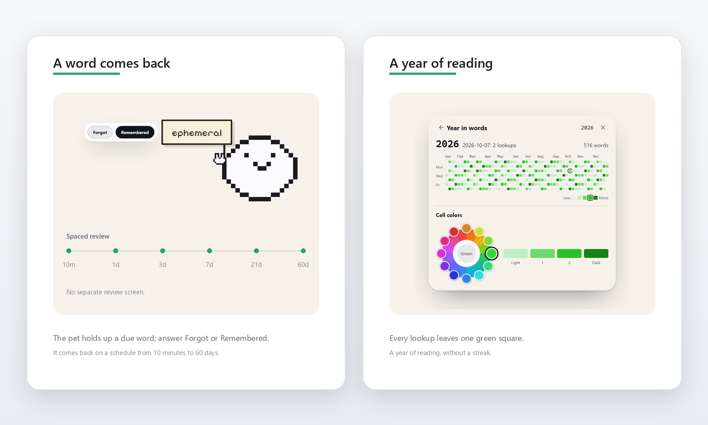

<h1 align="center">Lens</h1>

<h3 align="center">用英文，读懂英文。</h3>

  Lens 是一款常驻 Windows 系统托盘的英语阅读助手。选中一个单词、一个名字或一个句子，它会在文字旁用更清楚的英文解释——不切页，不开词典，也不把英文先翻译成中文。

  <a href="https://github.com/kakuyo1/lens/releases/latest"><strong>下载 Windows 版</strong></a> ·
  <a href="#先看一眼">看它怎么工作</a> ·
  <a href="https://github.com/kakuyo1/lens/releases">全部版本</a>

  
  
  
  

<a href="README.md">English</a> · 简体中文 · <a href="README.ja.md">日本語</a> · <a href="README.es.md">Español</a>

  <picture>
    <source media="(prefers-color-scheme: dark)" srcset="docs/readme/hero-dark.png">
    
  </picture>

解释默认使用英文；需要中文、西班牙语或日语时，点气泡上的语言按钮即可切换。

## 为什么是 Lens

大多数查词工具会把你带离页面，再给一个中文答案。你读完了一段，却没有用英文读它。Lens 的选择相反：提高英语阅读最有效的方式，是留在英语里。

**英文进，清楚的英文出。**一条你能直接读懂的英文释义、音标；需要时再加上词源和例句。翻译仍然在，只是它不是默认动作。

**答案留在文字旁。**Lens 常驻系统托盘，没有主窗口。气泡出现在选区旁边，鼠标停在上面就会一直留着；你继续往下读，它就退场。

**安静的记忆。**把词标成 “已会” 或 “新词”，Lens 替你记着；桌面宠物之后可能会把词举回来问你。没有连续打卡，也没有课程表。

## 先看一眼

语言切换就在卡片上。默认英文，中文只差一次点击。

## 英文优先，需要时再翻译

解释默认使用英文。中文选区始终用英文回答。需要中文时，点气泡上的地球按钮切换解释语言：同一张卡会重新作答，已有缓存就不发请求。

动作条提供翻译、解释和复制文本。Lens 围绕的是 “解释”：用你已经认识的英文，说明这个词在这里做什么，而不是换成一个你可以直接跳过、不再需要读英文的中文词。翻译也跟随解释语言——默认英文，除非你改。

## 怎么用

1. 在任意应用里选中一个单词、名字或句子。
2. 选择 “解释”，气泡出现在选区上方或下方。
3. 标记 “已会” 或 “新词”，继续读。

文字无法选中时，按 `Ctrl+Alt+S`（可在设置中修改），框选 PDF、图片或视频画面中的一块区域，Lens 会在本机用 OCR 读取。自动扫描只监看你加入白名单的应用。

## 一个安静的学习循环

已会和新词在同一张词表里。把指针停在某一行上，可以重读 Lens 已经存下的解释，不会发出请求。单词到期时，桌面宠物会举起一块牌子；回答 “忘了” 或 “记得”，它会按 10 分钟到 60 天的间隔再次被问起。年度记录把阅读留下的痕迹画成一格一格的绿色，而不是一条连续打卡。

## 七只桌面宠物，可选

Lens 随包提供七只像素宠物：短耳猫、猫头鹰、麻糬、小幽灵、小水母、小云和小狗。它们默认关闭，可在设置的 “扩展” 里开启。它们只接收事件类型——从不读取你的选区、解释或屏幕文字——宠物包也只含数据。

## 还有这些

- **自带模型。**DeepSeek、OpenAI、Gemini、OpenRouter、xAI、Moonshot、智谱、通义千问，或任何兼容 OpenAI 的自定义端点。
- **看得见的花费。**按 token 计算每次请求的费用；每日预算到顶时，暂停取词、截图和请求。
- **想同步时再同步。**已会/新词标记、查词历史、统计和选定设置用你的口令加密，存放在你自己 GitHub 账号的 secret gist 里；API key 始终留在本机。
- **词表进得来也出得去。**导入或导出 `.txt` 和 `.json`；删除单词需要一次确认。
- **按你的习惯来。**五种动作条形态；晴朗白昼、静谧暗夜、雾面玻璃、流光玻璃和自定义主题；以及英文字体与 12–18 px 气泡字号。
- **四种语言。**界面和解释各自提供英语、中文、西班牙语和日语。西班牙语与日语的翻译由机器生成，尚未经母语人士审校。

## 主题

晴朗白昼和静谧暗夜是纯色主题。雾面玻璃和流光玻璃把每张卡片画在模糊的桌面之上；玻璃主题开启时，Lens 会把自己排除在截图和屏幕共享之外。自定义配色会按 WCAG AA 检查对比度。动画开关跟随 Windows 的动画效果设置。

## 下载

从[发布页](https://github.com/kakuyo1/lens/releases/latest)下载 `Lens-<版本>-setup.exe`，或同一发布里的 `Lens-<版本>-portable.zip`。安装版按用户安装，Windows 不会要求管理员权限；便携版解压后即可运行。

**Windows 10/11 x64。**你需要一个受支持服务商的 API key。Lens 不内置释义词典；它包含一份约 168,000 个英语单词的词表，只用来判断候选词是不是真词。

Windows 可能会先拦一下

Lens 没有代码签名，SmartScreen 会拦截它不认识的程序。点 **“更多信息”**，再点 **“仍要运行”**。这是缺少签名，不是文件损坏。想核对下载是否完整，可以把文件的 SHA-256 和发布里的 `SHA256SUMS` 对应行比一下；这只能证明文件在传输中没有被改动，不能证明发布者是谁。

## 隐私

只有你选中或截取到的文字会发送给你配置的服务商，发送前会在本机遮盖 URL、电子邮件地址和六位及以上的数字串。OCR 在本机运行，截图不会被上传。API key 和学习数据保存在 `%APPDATA%\Lens\settings.json`。开启同步后，云端副本用你的口令加密，存放在你自己的 GitHub gist 里；密钥始终只在本机。Lens 没有自己的账号，也没有自己的服务器。完整的数据边界见 [SECURITY.md](SECURITY.md)。

## 常见问题

**Lens 是翻译器吗？**它可以翻译，但它是为 “解释” 做的。解释默认英文；想要中文翻译时，把解释语言切成中文即可。中文选区始终返回英文。

**需要 API key 吗？**需要。用受支持服务商的 key；Lens 会显示每次请求的费用，也可以设置每日上限。

**能离线用吗？**OCR 和词表在本机；解释需要你配置的服务商。

**什么会离开我的电脑？**只有选中或截取到的单词、名字或句子，且在本地脱敏之后。不会上传整页或整张截图。

**为什么 Windows 会警告？**安装包没有代码签名。文件本身是完整的，警告针对的是缺少签名；可以用 `SHA256SUMS` 核对。

**有 macOS 或 Linux 版吗？**目前只有 Windows。

## 语言

[English](README.md) · [简体中文](README.zh-CN.md) · [日本語](README.ja.md) · [Español](README.es.md)

界面语言和解释语言是两个独立设置，都可以选择英语、中文、西班牙语和日语。

## 参与和许可

Lens 以 [MIT 许可证](LICENSE)开源。欢迎提 issue 和 PR。如果 Lens 帮你多读了一点英文，点一个 star 会让更多读者找到它。

界面图片由 Lens 当前的设计原型渲染，实际构建遵循同一套布局与令牌。
