# Lens

**读英文时，不必离开正在看的页面**。Lens 是一款常驻 Windows 系统托盘的英语学习工具，会在文字旁边用小浮层解释单词、名称和句子，不必另开词典窗口。

[English](README.md) · [简体中文](README.zh-CN.md) · [日本語](README.ja.md) · [Español](README.es.md)

## Lens 能做什么

Lens 常驻系统托盘，没有主窗口。选中一段文字后，会弹出一个小动作条，提供翻译、解释和复制三项。结果以气泡的形式显示在触发它的文字旁边。把单词标记为 “已会” 或 “新词” 之后，继续阅读即可。名称和整句也会得到解释。

文字无法选中时，按下截图热键（默认 `Ctrl+Alt+S`，可在设置中修改），框选屏幕上的一块区域，Lens 会用 OCR 识别文字并立即翻译。自动扫描也可以监看你指定的应用中的文字，且只监看这些应用。

## 发送什么

Lens 在本机把捕获到的文字分成三类请求：单词请求只发送单词，实体请求只发送名称，句子请求只发送选中的句子。在任何内容离开你的电脑之前，Lens 会遮盖 URL、电子邮件地址以及六位及以上的数字串。

解释由你配置的 AI 服务商生成。Lens 不内置释义词典，但包含一份约 168,000 个常见英语单词的词表，只用来判断候选词是不是真正的英语单词，词表本身不含释义。

## 功能

- **解释**。单词会以你选择的解释语言给出最常见的义项，并附上国际音标。打开 “多义解释” 可以查看最多三个义项。打开 “词源” 可以了解单词的由来，再打开其下的 “例句” 开关，会附上一句英文例句。例句默认关闭，因为它会多消耗输出 token。
- **名称和句子**。名称和整句同样会得到解释，使用同一个解释语言。
- **气泡**。可以设置气泡停留的时长（1 到 30 秒，默认 5 秒），以及气泡出现在选区的上方还是下方（默认上方）。鼠标移到气泡上时，它会一直停留。
- **词汇列表**。已会和新词标记都记在同一张列表里，每个词一行，显示最近一次查词的时间。把指针停在某一行上，就能读到 Lens 已经存下的释义，悬停不会发出任何请求。删除单词后无法撤销。
- **单词年度记录**。一整年的查词次数画成贡献图。选中某一天，可以看到当天查了多少个词。选择格子的配色时，可以在十二等分的色相环上选色，每个色相有四档深浅。
- **花费与预算**。花费视图根据每次请求用掉的 token 数，按当前价目计算费用。设定每日预算后，当天花费达到上限时，Lens 会暂停取词、截图和请求，并在本地日期变更后重置。
- **截图取词与自动扫描**。截图时会压暗所有屏幕，读取你框选的区域并翻译。Lens 随附 OCR 运行时；如果你已安装 Tesseract，也可以在设置里指向它。
- **桌面宠物**。应用随包提供四只宠物：麻糬、猫、小狗和猫头鹰，学习时会做出相应的动作。默认关闭，可在设置的 “扩展” 分类中开启。你可以拖动它、戳它，给它戴上最多三件配饰，把大小调成一到四倍，也可以开启鼠标穿透，让点击落到下层窗口。宠物只接收事件类型，从不读取你的选区、释义或屏幕文字。也可以安装宠物包：把宠物包目录复制到 `%APPDATA%\Lens\pets\`，再打开设置的 “扩展” 分类。每个宠物包第一次启用前都会确认一次；宠物包只含数据，不含代码。
- **检查更新**。Lens 会在每天启动时检查项目的最新版本（可在通用设置中关闭），也可以在 “关于” 页点击 “检查更新”。“关于” 是设置目录末尾的一页，显示当前版本和仓库链接。出现新版本时会显示一张卡片，提供查看、下载和跳过此版本。下载的安装包会按发布页中的 `SHA256SUMS` 校验，只有你点击 “安装” 才会运行，且运行时不带任何参数。安装包没有代码签名，因此校验只能说明文件完整到达，不能证明发布者的身份。下载需要中国大陆的代理，若长时间没有收到文件，Lens 会提示。
- **同步**。用 GitHub 账号登录后，已会与新词标记、查词历史、统计和选定的设置可以在几台设备之间保持一致。云端副本用你设置的口令加密，存放在你自己 GitHub 账号下的一个 secret gist 里。解释不参与同步。你随时可以退出登录，或删除云端数据。
- **主题**。内置晴朗白昼、静谧暗夜、雾面玻璃和流光玻璃四套主题，另有自定义配色。详见[主题](#主题)。

## 主题

晴朗白昼和静谧暗夜是纯色主题。雾面玻璃和流光玻璃会把每张卡片画在模糊的桌面底图之上；玻璃主题开启时，Lens 的窗口会排除在屏幕截图和屏幕共享之外，截图里只有桌面。自定义配色时可以自行选色，Lens 会按 WCAG AA 检查对比度。动画开关跟随 Windows 的动画效果设置。

| 晴朗白昼 | 静谧暗夜 |
| --- | --- |
|  | 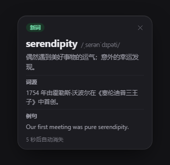 |
| 雾面玻璃 | 流光玻璃 |
| 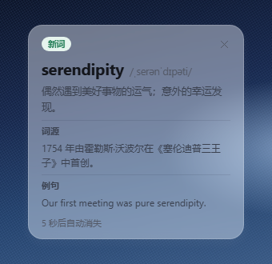 | 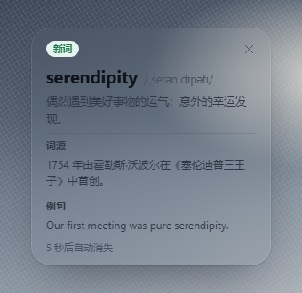 |

## 界面截图

以下大部分截图来自 [`ui-prototypes/`](ui-prototypes/) 中的 HTML 设计稿，展示的是设计概念，不是运行中应用的截图，实际实现可能有所不同。桌面宠物的截图取自运行中应用的渲染。

| 解释气泡 | 选区动作条 |
| --- | --- |
| 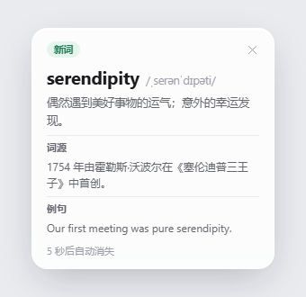 |  |

| 名称解释 | 句子解释 |
| --- | --- |
| 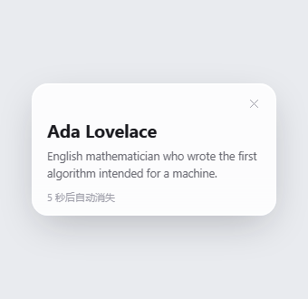 Ada Lovelace 的英文解释。 | 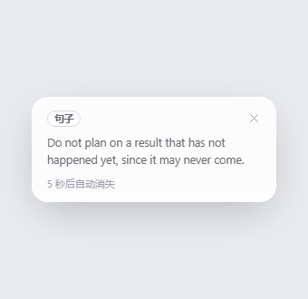 谚语 “Don't count your chickens before they hatch.” 的英文解释。 |

| 设置 | 词汇历史 |
| --- | --- |
|  |  |

| 单词年度记录 | 桌面宠物 |
| --- | --- |
| 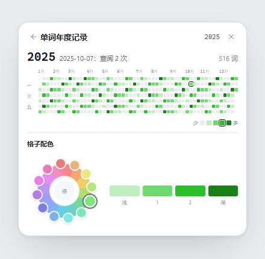 | 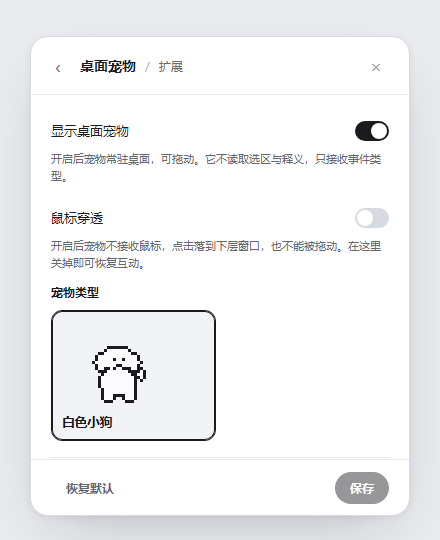 |

## 操作演示

以下短片展示主要操作，界面和解释都是中文。

| 解释气泡 | 单词年度记录 |
| --- | --- |
| 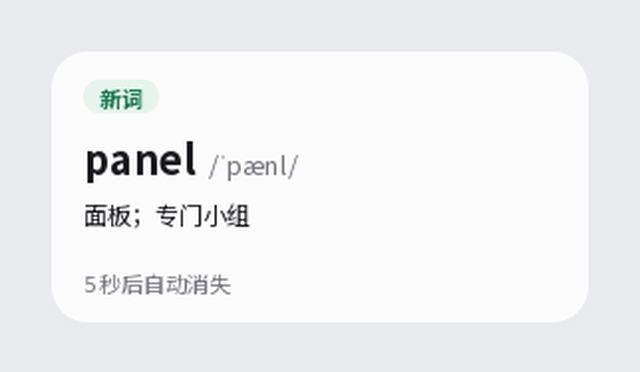 单词的解释气泡，带词源和例句。把指针移到气泡上，显示 “已会” 和 “新词”，点击 “已会”，标记随即变化。 | 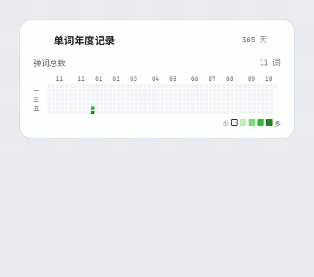 一年的查词次数，画成贡献图。选中某一天查看当天次数，也可以选择格子的配色。 |
| 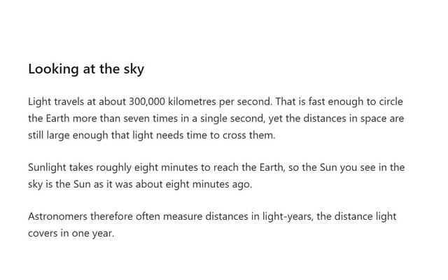 截图时压暗屏幕，框选一块区域，Lens 用 OCR 识别文字，并在旁边显示译文。这是动画示意，不是实际录屏。 | |

## 桌面宠物

应用随包提供四只宠物。下面每段动图展示一只宠物做出它的动作。

| 麻糬，庆祝 | 猫，踩奶 |
| --- | --- |
|  麻糬做出庆祝动作。 |  猫做出踩奶动作。 |
|  小狗被戳了一下。 |  猫头鹰做出阅读动作。 |

## 语言

界面语言和解释语言分别设置，两者都可以选择英语、中文、西班牙语和日语。西班牙语与日语的翻译由机器生成，未经母语人士审校。如果发现错误的用语，欢迎反馈。

## 隐私与安全

API key 和学习数据保存在 `%APPDATA%\Lens\settings.json` 中，即你的 Windows 用户配置文件里。密钥不会写入安装目录，也不会写入日志。开启同步后，学习数据的副本会用口令加密，存放在你自己 GitHub 账号下的一个 secret gist 中；API key 始终只保存在本机。Lens 会把你选中或捕获的文字发送给你配置的服务商，请勿发送机密或敏感内容。脱敏只覆盖 URL、电子邮件地址和六位及以上的数字串，不能识别所有类型的个人信息。获取模型列表时不发送 API key，也不发送任何文字。数据流、现有保护措施、已知限制以及安全问题的报告方式，见 [SECURITY.md](SECURITY.md)。
