
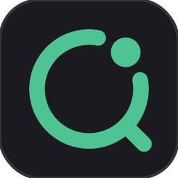

<h1 align="center">Lens</h1>

<h3 align="center">用英文，讀懂英文。</h3>

  Lens 是一款常駐 Windows 系統匣的英文閱讀助手。選取一個單字、一個名字或一個句子，它會在文字旁用更清楚的英文解釋——不切頁，不開字典，也不把英文先翻譯成中文。沒有取詞的時候，桌面寵物會把到期的詞舉回來問你。

  <a href="https://github.com/kakuyo1/lens/releases/latest"><strong>下載 Windows 版</strong></a> ·
  <a href="#先看一眼">看它怎麼工作</a> ·
  <a href="https://kakuyo1.github.io/lens/">宣傳頁</a> ·
  <a href="https://github.com/kakuyo1/lens/releases">全部版本</a>

  
  
  
  

  
  
  

<a href="README.en.md">English</a> · <a href="README.md">簡體中文</a> · 繁體中文 · <a href="README.ja.md">日本語</a> · <a href="README.es.md">Español</a>

  <picture>
    <source media="(prefers-color-scheme: dark)" srcset="docs/readme/hero-dark.png">
    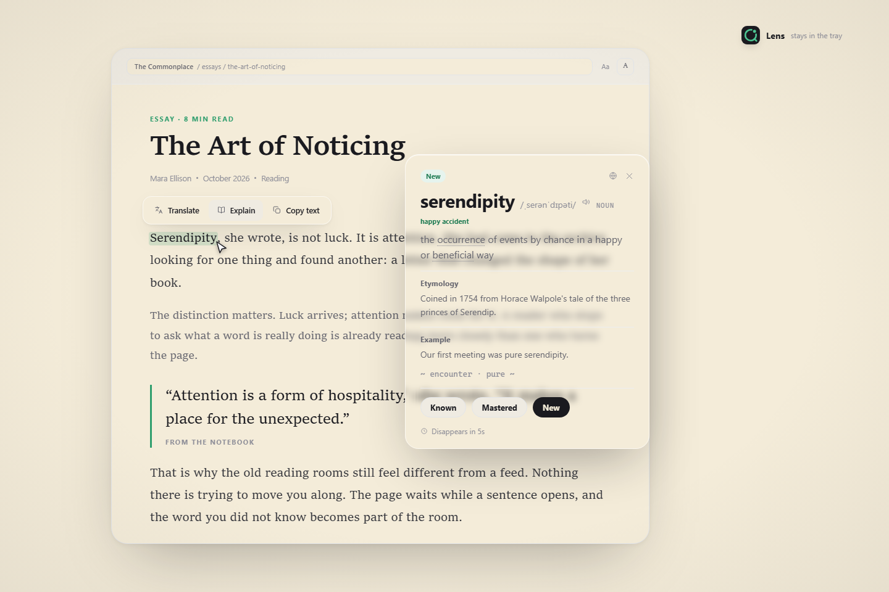
  </picture>

解釋預設是英文：用你已經認識的英文，講清這個詞在這裡做什麼。

## 為什麼是 Lens

大多數查詞工具會把你帶離頁面，再給一個中文答案。你讀完了一段，卻沒有用英文讀它。Lens 的選擇相反：提高英文閱讀最有效的方式，是留在英文裡。

- **圍繞英文**。解釋預設用你已經認識的英文講清這個詞在這裡做什麼，母語按住地球才出現。
- **寵物系統**。到期的新詞由桌面寵物舉牌提問，直到掌握為止。
- **自動掃描**。在 Chrome 裡正常閱讀，超出你等級的詞自己長出虛線，不用選取任何東西。
- **高度自訂**。卡片畫什麼由你決定——多義、詞源、例句、音標、搭配、圖片，在設定裡逐項開關。

## 先看一眼

  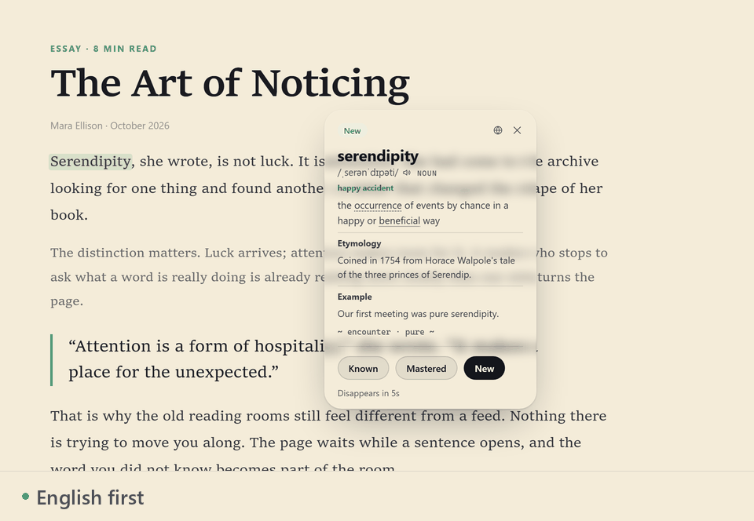
  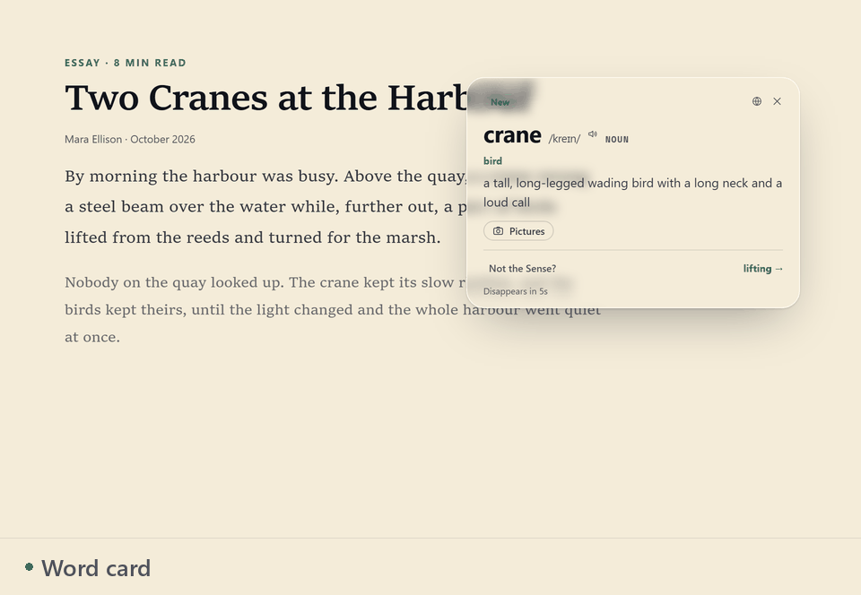

  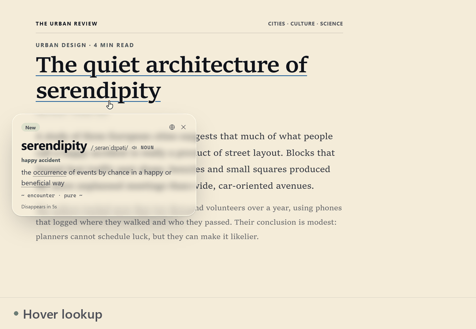
  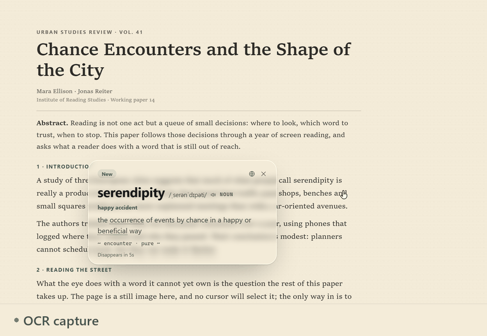

  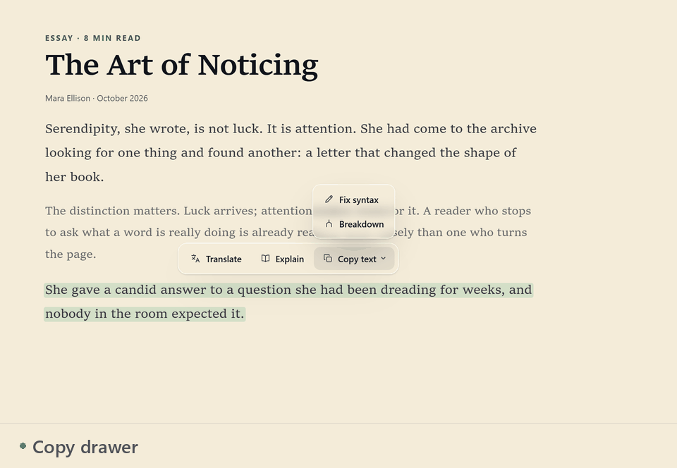
  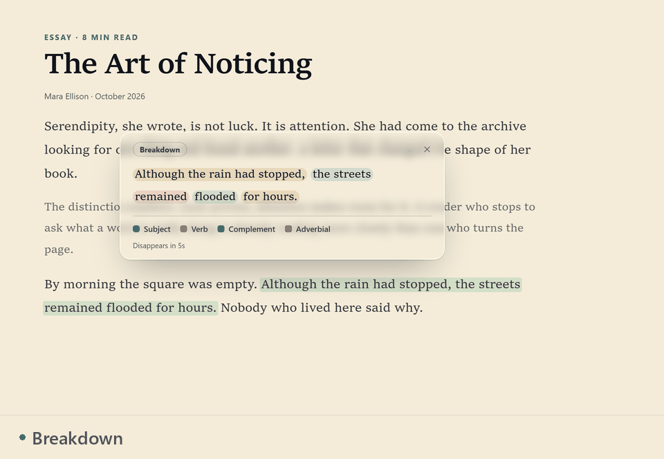

## 自動掃描

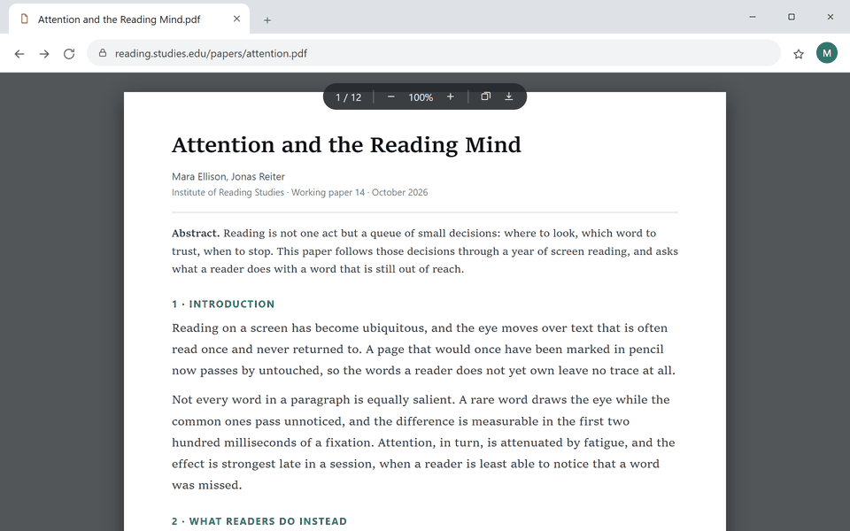

在 Chrome 裡開啟一篇論文，超出你等級的詞下面就會長出虛線，不按 Alt 也顯示。Lens 讀的是 Chrome 與 Notepad++ 交給系統的文字，不經過 OCR，也不上傳。

- **虛線認得你的判定**。新詞畫一條淺虛線；標為已會的詞畫得更實，掌握的詞不畫。只在句中以大寫出現過的名字也不畫。
- **按住 Alt 看路標**。詞的右上角浮出兩到四個英文詞，說明它在這裡是哪一義；快取裡沒有的候選按批補買，只寫進快取，不彈卡。
- **讓一個詞退場**。指標在虛線詞上停約 0.4 秒，詞的上緣升起一枚 “掌握”；點它，掃描與寵物提問都不再找這個詞。
- **讀哪些視窗**。Chrome 的網頁，以及 Chrome 自己開啟的 PDF；Notepad++ 的文件也算一份。獨立的 PDF 閱讀器與影片字幕標為 “待上線”。總開關預設關，兩個軟體的開關預設開，兩者同時開啟才掃描。

## 一個安靜的學習迴圈

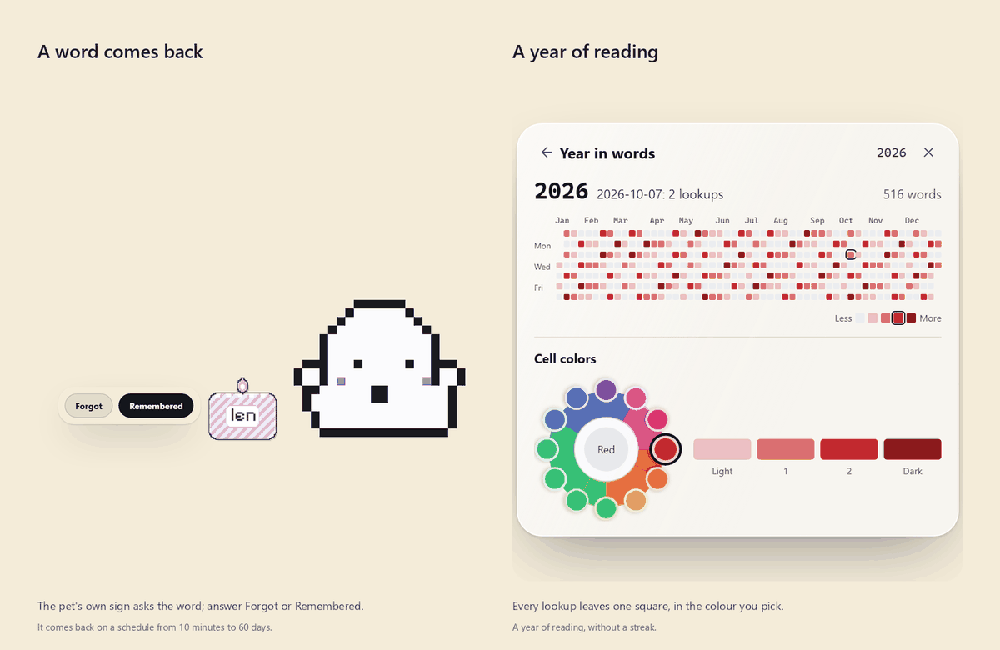

已會、掌握和新詞在同一張詞表裡，頂部的分段可以只看其中一類。

- 把指標停在某一行上，可以重讀 Lens 已經存下的解釋，不會發出請求。
- 單字到期時，寵物腳邊會立起它自己的提問牌；回答 “忘了” 或 “記得”，它會按 10 分鐘到 60 天的間隔再次被問起。標成掌握的詞不再進入複習。
- 年度紀錄把閱讀留下的痕跡畫成一格一格的色塊，顏色從十二種裡挑，預設綠色，而不是一條連續打卡。

## 會把詞舉回來問你的寵物

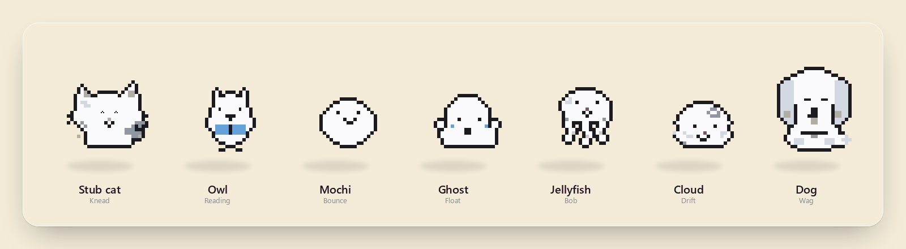

Lens 隨包提供七隻像素寵物：短耳貓、貓頭鷹、麻糬、小幽靈、小水母、小雲和小狗。它們預設關閉，可在設定的 “擴充功能” 裡開啟。

- 每隻都有自己的九件配件和六個場景——四個專屬、兩個共享；一條圍巾或一副眼鏡會改變它更常去哪個場景。
- 它們會閒逛、在螢幕邊緣躲起來、注意到指標，也能被拎起來拋出去；工具列固定顯示時，偶爾還會跳上去彈一下，慢吞吞走到頭，再蹦回原處。
- 它們只接收事件類型——從不讀取你的選取範圍、解釋或螢幕上的文字；寵物包也只含資料。

每個場景都是一段自己的小動畫。南瓜燈播起來是這樣：

Lens 也支援自訂寵物：倉庫裡的 `skills/lens-pet-maker` 是一個 Claude Code skill，克隆倉庫後可以讓 AI 協助生成；做好的寵物包放進 `%APPDATA%\Lens\pets\`，就能在設定的 “擴充功能” 裡啟用。

## 還有這些

- **自備模型**。DeepSeek、OpenAI、Gemini、OpenRouter、xAI、Moonshot、智譜、通義千問，或任何相容 OpenAI 的自訂端點。
- **看得見的花費**。依 token 計算每次請求的費用；每日預算到頂時，暫停取詞、截圖和請求。
- **每週閱讀報告**。統計彈窗的 “本週畫像” 把這一週按小時、詞性和最常查的詞攤開；按下 “解讀本週”，模型寫五條觀察，收進一張週報告卡片，還可以讓它用本週的詞寫一篇小故事。只有你按下才傳送，且只含計數與詞頭。
- **想同步時再同步**。判定、查詞歷史、統計和選定設定用你的通行碼加密，存放在你自己 GitHub 帳號的 secret gist 裡；API key 始終留在本機。
- **詞表進得來也出得去**。詞彙彈窗可以匯入或匯出 `.txt`、`.json`，也能匯出帶已存釋義的 CSV 與 Anki TSV；設定 › 閱讀學習裡的 “已掌握詞” 可以一次性匯入一份一行一詞的詞表，把其中的詞標為掌握。刪除單字需要一次確認。
- **該給圖時給圖**。模型判斷某條義項用照片更好說明時，卡片可以展開三張 Wikimedia Commons 圖片；圖片快取在本機，“關於” 頁顯示快取大小並可原地清除。
- **單字讀得出來**。每張單字卡的音標旁有一枚喇叭，點一次讀一次詞頭；系統音色優先，缺該口音的音色時依設定的備援走，自動播放預設關。

## 主題

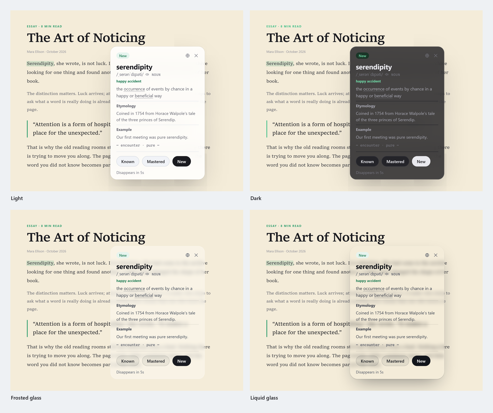

## 下載

從[發行頁](https://github.com/kakuyo1/lens/releases/latest)下載 `Lens-<版本>-setup.exe`，或同一版本裡的 `Lens-<版本>-portable.zip`。

- **安裝版**以使用者為單位安裝，Windows 不會要求系統管理員權限；**免安裝版**解壓後即可執行。
- **Windows 10/11 x64**。你需要一個支援服務商的 API key。
- Lens 不內建釋義字典；它包含一份約 168,000 個英文單字的詞表，只用來判斷候選詞是不是真詞。

Windows 可能會先攔一下

Lens 沒有程式碼簽章，SmartScreen 會攔截它不認識的程式。點 **“更多資訊”**，再點 **“仍要執行”**。

## 隱私

Lens 沒有自己的帳號，也沒有自己的伺服器。

- **送出的內容**。你選取或擷取到的文字會傳送給你設定的服務商，傳送前會在本機遮蓋 URL、電子郵件位址和六位及以上的數字字串。每週閱讀報告的解讀與小故事只在你按下按鈕時傳送，只含計數與詞頭，詞頭同樣遮蓋。
- **OCR**。預設在本機執行；線上 OCR 需要你逐次確認，確認卡會寫明這次裁剪送往哪個服務，自動掃描從不使用它。
- **朗讀**。喇叭優先以系統音色或已下載的本地模型在本機朗讀；備援到線上音訊時，離開本機的只有那個詞，錄音快取在 `%APPDATA%\Lens\audio`。
- **本機儲存**。API key、OCR 憑據和學習資料儲存在 `%APPDATA%\Lens\settings.json`。
- **同步**。開啟後，雲端副本用你的通行碼加密，存放在你自己的 GitHub gist 裡；金鑰始終只在本機。

完整的資料邊界見 [SECURITY.md](SECURITY.md)。

## 常見問題

**Lens 是翻譯器嗎**？它可以翻譯，但它是為 “解釋” 做的。中文、日文或西班牙文的選取範圍返回英文。

**需要 API key 嗎**？需要。用支援服務商的 key；Lens 會顯示每次請求的費用，也可以設定每日上限。以 DeepSeek 為例，一次查詞約 0.001 元，1 元大約夠查 1000 次；其他服務商價格不同。

**能離線用嗎**？OCR、詞表和已下載的本地音色在本機可用；解釋、線上 OCR 與線上音訊需要你設定的服務。

**什麼會離開我的電腦**？只有這幾樣：本機脫敏後的選取文字，線上 OCR 裡逐次確認的裁剪，備援到線上音訊時的那一個詞，以及你按下每週報告按鈕時傳出的計數與詞頭。見[隱私](#隱私)。

**為什麼 Windows 會警告**？安裝包沒有程式碼簽章；怎麼執行與核對檔案見[下載](#下載)一節的說明。

**有 macOS 或 Linux 版嗎**？目前只有 Windows。

## 參與和許可

Lens 以 [MIT 授權](LICENSE)開源。歡迎提 issue 和 PR。如果 Lens 幫你多讀了一點英文，點一個 star 會讓更多讀者找到它。

介面圖片由 Lens 目前的設計原型渲染，實際建置遵循同一套版面配置與設計變數。
